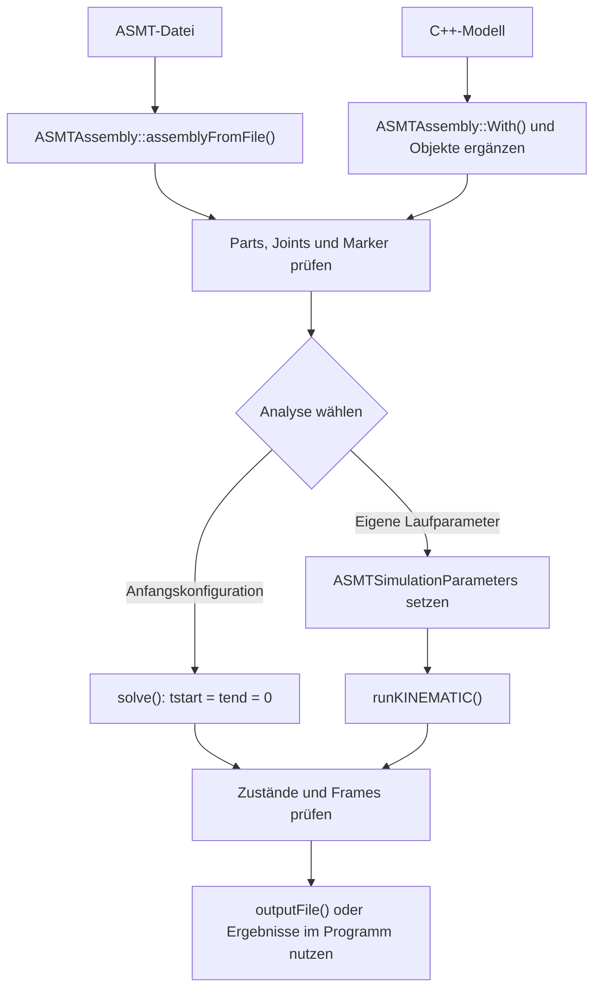

# Arbeitsprinzipien dieses Buches {#kap-arbeitsprinzipien .unnumbered}

## Warum dieses Buch als lebendes Projekt aufgebaut ist {.unnumbered}

Ein Buch über einen aktiven Solver in einer aktiven CAD-Umgebung muss mit dem Projekt wachsen. Das gilt besonders für FreeCAD und OndselSolver, weil sich Architektur, Bugs, APIs und Modellierungsprinzipien über Zeit verändern. Ein einmal fertiges Buch würde schnell veralten.

Darum gilt hier:

- Das Buch wird nicht komplett neu geschrieben.
- Kapitel werden ergänzt, korrigiert und vertieft.
- Neue Erkenntnisse werden in die vorhandene Struktur eingefügt.
- Jeder Abschnitt erhält eine sachliche, überprüfbare Grundlage.

## Vorgehensweise der Dokumentation {.unnumbered}

Für dieses Projekt gilt ein einfacher Standard:

- Beschreibung des Sachverhalts auf verständlicher Ebene
- Einordnung in die reale FreeCAD-/OndselSolver-Architektur
- Beispiel oder kleine Reproduktion
- Hinweise, was in diesem Kontext relevant ist
- Verknüpfung mit den echten Dateien und Modulen im Sandbox-Projekt

## Grundidee von OndselSolver {.unnumbered}

OndselSolver modelliert Mechanik als Beziehungssystem:

- Teile haben Positionen und Orientierungen.
- Gelenke, Kontakte und Constraints beschreiben Beziehungen zwischen diesen Positionen.
- Der Solver löst diese Beziehungen so, dass das System konsistent ist.

Das ist nicht dasselbe wie ein „Baukastensystem mit fertigen 3D-Schnitten“. Vielmehr ist der Solver ein numerischer Gleichungslöser, der geometrische und kinematische Bedingungen erfüllt.

## Wichtiges Verständnis für Leser {.unnumbered}

Ein neuer Leser muss die folgenden Grundbegriffe verstehen:

- Part: ein Bauteil oder ein physischer Körper
- Joint: Verbindung zwischen Teilen
- Constraint: geometrische oder kinematische Bedingung
- Solve: Berechnung einer konsistenten Konfiguration
- Residuum: Restfehler einer Gleichung oder Beziehung
- Iteration: wiederholte Annäherung an eine Lösung

## Wie dieses Buch mit Realcode verknüpft wird {.unnumbered}

Die Praxis ist wichtiger als bloße Theorie. Dieses Buch bezieht sich daher auf die im Sandbox-Projekt vorhandenen Quellstellen, insbesondere:

- FreeCAD-Assembly-Struktur
- OndselSolver-Quellcode im dritten Party Bereich
- Aufgaben und Bugreports aus dem Sandbox

Das bedeutet: Wenn ein Kapitel etwas über die Kommunikation zwischen FreeCAD und OndselSolver sagt, dann verweist es auf die Architektur der Baugruppenmodul-Implementierung und auf die typische Datenflusslogik, nicht nur auf allgemeine Theorie.

## Regel für Ergänzungen {.unnumbered}

Wenn ein neues Kapitel hinzugefügt wird, gilt:

- bestehende Kapitel bleiben unverändert, soweit nicht klar ob vervollständigung notwendig ist
- neue Erkenntnisse werden an das Ende oder in eine passende Ergänzung eingefügt
- bei Fehlern wird der Text korrigiert, aber nicht in einem „Neuaufbau“ der gesamten Datei verworfen

## Ziel dieses Buches {.unnumbered}

Das Buch soll das Verständnis schaffen, nicht nur einfach Fakten aufzuzählen. Ein Lernender soll am Ende verstehen:

- Was ein Solver macht
- Wie ein CAD-System ihm Daten liefert
- Wie das Ergebnis zurück in die 3D-Geometrie übernommen wird
- Warum FreeCAD und OndselSolver in einem gemeinsamen Architekturmodell verbunden sind

Dieses Buch ist somit ein langfristiger Lern- und Arbeitsdokument.

# Grundlagen, FreeCAD und ASMT {.teil}

# Was ist OndselSolver? {#kap-was-ist-ondselsolver}

## Ein kurzer Satz

OndselSolver ist ein Mehrkörper- und Assembliesolver. Er berechnet, wie Teile in einer Konstruktion zueinander liegen müssen, wenn bestimmte geometrische Beziehungen, Gelenke, Abstände oder Winkel eingehalten werden sollen.

In einem CAD-Kontext ist das besonders wichtig für Baugruppen, Mechanismen und Kinematik. FreeCAD kann Teile und Beziehungen modellieren; der Solver findet dann eine konsistente Lage der Teile, wenn diese Beziehungen erfüllt sein müssen.

## Warum ein Solver überhaupt nötig ist

Ohne Solver wäre eine Baugruppe nur eine Menge von Objekten mit Positionen. Der Benutzer kann sie manuell bewegen, aber das System kennt die Beziehungen zwischen den Teilen nicht in numerisch umsetzbarer Form.

Ein Solver bringt genau diese logische Schicht ein:

- „Teil A ist mit Teil B über eine Drehachse verbunden“
- „Teil C muss auf der Ebene von Teil D liegen“
- „Die Distanz zwischen den Punkten muss 45 mm betragen“
- „Die Drehung von Teil X muss mit Translation von Teil Y gekoppelt sein“

Der Solver nimmt diese Bedingungen, modelliert sie als Gleichungen und sucht nach einer konsistenten Lösung.

## OndselSolver in der FreeCAD-Welt

In der FreeCAD-Assembly-Architektur wirkt OndselSolver als die Berechnungsebene hinter der Baugruppenlogik. Der Benutzersicht bleibt dabei meist die 3D-Baugruppe und die Joint-Definitionen erhalten. Unter der Oberfläche übernimmt der Solver die Berechnung der Positionen und Orientierungen.

Das ist entscheidend: FreeCAD stellt die Daten bereit, OndselSolver verarbeitet sie. Danach kann FreeCAD die berechneten Platzierungen wieder in die 3D-Geometrie einsetzen.

## Typische Aufgaben eines Solvers

Ein Assembly-Solver muss typischerweise diese Dinge leisten:

- bekannte Ausgangslage prüfen
- Freiheitsgrade erkennen
- Constraints und Gelenke auflösen
- fehlende oder redundante Bedingungen entdecken
- zu einer konsistenten Lage konvergieren
- Ergebnisse in Form neuer Platzierungen zurückgeben

## Kinematik vs. Dynamik

Ein wichtiger Punkt: Ein Solver für Baugruppen ist nicht automatisch nur eine „Bewegungssimulation“ im Sinne einer vollständigen Dynamik mit Kräften, Massen und Zeitintegration.

Die Grundidee ist oft:

- Kinematik: Wie liegen die Teile zueinander, wenn die Beziehungen erfüllt werden?
- Dynamik: Wie bewegen sie sich über Zeit unter Kräften, Trägheit und Bewegungsgesetzen?

OndselSolver kann in diesem Zusammenhang als Mehrkörper-Mechanik-Engine verstanden werden: Sie arbeitet mit geometrischen und mechanischen Constraints, nicht nur mit bloßer Geometrie-Objektplatzierung.

## Warum das für FreeCAD relevant ist

Für FreeCAD ist das besonders wichtig, weil Baugruppen oft aus mehreren Teilen bestehen, die eine funktionale Beziehung zueinander besitzen. Beispiele:

- Schwenkarm und Gelenk
- Lager und Ausrichtung
- Korrekte Position von Bohrungen oder Schnitten
- Kinematische Kette mit mehreren beweglichen Gliedern

Der Solver macht aus diesen Beziehungen eine technische, berechenbare Struktur. Das ist der Kern dessen, was in FreeCAD als Assembly-Lösung bezeichnet wird.

## Ein einfaches Alltagsschema

Wenn ein Benutzer eine Baugruppe zusammenbaut, dann beschreibt er meist intuitiv:

- „Diese zwei Teile sollen fest verbunden sein.“
- „Diese Linie und diese Achse sollen aufeinander liegen.“
- „Dieser Winkel soll 90° betragen.“

Der Solver verwandelt diese Aussagen in formalisierte Gleichungen. Dann löst er sie im Sinne eines Systems aus miteinander verbundenen Bedingungen.

## Die zentrale Idee in einem Satz

OndselSolver ist die Recheneinheit, die in FreeCAD aus geometrischen Relationen eine konsistente mechanische Konfiguration erzeugt.

Damit ist es nicht nur ein Spezialwerkzeug, sondern ein grundlegender Baustein, der das Denken in „Objekten“ in das Denken in „Beziehungen“ übersetzt.

## Wichtige Lernfrage

Der Leser sollte sich im Verlauf des Buches immer fragen:

- Welche Beziehung beschreibt dieser Joint oder Constraint?
- Welches Teil hat welchen Freiheitsgrad?
- Welche Variable wird vom Solver gelöst?
- Was ist die Ausgangsbedingung und welche Resultate sind akzeptabel?

Diese Fragen sind der Schlüssel zum Verständnis von OndselSolver.

# Wie funktioniert OndselSolver? {#kap-wie-funktioniert-ondselsolver}

## Grundprinzip

OndselSolver arbeitet mit einem klassischen Muster: Er nimmt ein Mechanikmodell, übersetzt es in Gleichungen und löst dann eine oder mehrere konsistente Konfigurationen. Das geschieht üblicherweise nicht in einem Schritt „per Hand“, sondern iterativ.

Die wichtigsten Schritte sind:

1. Modellierung der Teile und Beziehungen
2. Erzeugung der Gleichungssysteme aus den Constraints
3. Berechnung eines Näherungswertes
4. Iterative Verfeinerung bis zur Lösung
5. Rückgabe der berechneten Platzierungen

## Teile, Gelenke und Constraints

Ein Mehrkörpersystem besteht aus mehreren Teilen. Sie bewegen sich relativ zueinander, aber nicht frei. Ihre Bewegung wird durch Verbindungen eingeschränkt.

Beispiele:

- Festes Gelenk
- Drehgelenk
- Schiebegelenk
- Planare Beziehung
- Punkt-auf-Linie
- Winkel- oder Abstandsbeschränkung

Diese Beziehungen erzeugen sogenannte Constraints. Ein Constraint ist eine mathematische Bedingung, mit der die mögliche Bewegung der Teile eingeschränkt wird.

## Freiheitsgrade

Ein Teil im Raum hat normalerweise sechs Freiheitsgrade:

- drei Translationen
- drei Rotationen

Ein Joint oder Constraint nimmt davon einige weg. Ein festes Gelenk entfernt praktisch alle Freiheitsgrade, ein Drehgelenk nur eine Rotation, ein Schiebegelenk nur eine Translation. So entsteht ein System, das bei der korrekten Kombination stabil und lösbar wird.

## Warum Iteration nötig ist

Die meisten realen mechanischen Beziehungen sind nicht linear. Das bedeutet:

- Die Positionsänderung eines Teils beeinflusst andere Bedingungen gleichzeitig.
- Die Lösung kann nicht immer geschlossen per Formel bestimmt werden.
- Man muss mit einem Näherungsprozess starten und sich schrittweise verbessern.

Das ist der Kern der numerischen Lösung: Start mit einer geschätzten Konfiguration, berechne Fehler, korrigiere Positionen, wiederhole bis der Fehler klein genug ist.

## Newton-Verfahren als einfaches Denkmodell

Ein sehr verbreiteter Gedanke in Solvern ist das Newton-Verfahren oder ähnliche iterative Verfahren:

- Definiere eine Fehlermenge
- Berechne die Ableitung des Fehlers
- Korrigiere die Variablen in Richtung kleinerer Fehler
- Wiederhole, bis der Fehler unter einem Toleranzwert liegt

In einfachen Worten:

- Der Solver schaut, wie groß der Fehler des aktuellen Zustands ist.
- Dann schätzt er, in welche Richtung sich die beweglichen Größen verändern müssen.
- Danach wiederholt er das, bis die Lösung „gut genug“ ist.

## Wichtiger Unterschied zwischen „geometrisch korrekt“ und „physikalisch vollständig“

Ein Solver kann eine konsistente geometrische Lösung finden, ohne dass das gesamte mechanische System mit Massen, Kräften und Simulationsdauer vollständig modelliert ist. Das ist bei Assemblies oft genau der gewünschte Einsatz.

Der Fokus liegt dann auf:

- Stabilität der Konfiguration
- Konsistenz der Beziehungen
- Erfüllung der Constraints

Nicht immer auf physikalische Dynamik im engeren Sinne.

## So sieht ein typischer Ablauf aus

Ein typischer Solve-Lauf läuft in etwa so:

1. Daten aus FreeCAD werden in Solver-Objekte übersetzt.
2. Jedes Teil bekommt eine Position und Orientierung.
3. Jede Verbindung wird als Constraint oder Joint modelliert.
4. Der Solver baut das Gleichungssystem auf.
5. Der Solver startet mit einer Näherung.
6. Fehler werden berechnet.
7. Iterationen verbessern die Lösung.
8. Das Ergebnis wird als neue Platzierungen zurückgegeben.

## Warum dieses Modell für FreeCAD relevant ist

In FreeCAD macht das Modell genau folgendes:

- Die Benutzeroberfläche beschreibt nur die Beziehungen.
- Der Solver führt die numerische Berechnung durch.
- FreeCAD übernimmt das Ergebnis und zeigt es visuell an.

Damit bleibt die Bedienung verständlich, während der mathematische Kern unabhängig arbeitet.

## Ein kleines C++-Beispiel: Konzept statt Compile-Ready-API

Das folgende Beispiel ist bewusst einfach und dient dem Lernverständnis. Es zeigt den denkbaren Ablauf, wie eine Beziehungsliste in einen Solver-Kontext übersetzt werden kann.

```cpp
#include <vector>
#include <string>
#include <cmath>

struct Part {
    std::string name;
    double x;
    double y;
    double z;
};

struct DistanceConstraint {
    std::string partA;
    std::string partB;
    double targetDistance;
};

int main() {
    std::vector<Part> parts = {
        {"A", 0.0, 0.0, 0.0},
        {"B", 3.0, 0.0, 0.0}
    };

    DistanceConstraint c{"A", "B", 5.0};

    // Einfache Fehlerfunktion: Abstand muss targetDistance sein.
    auto residual = [&](const Part& a, const Part& b) {
        double dx = b.x - a.x;
        double dy = b.y - a.y;
        double dz = b.z - a.z;
        double dist = std::sqrt(dx * dx + dy * dy + dz * dz);
        return dist - c.targetDistance;
    };

    double error = residual(parts[0], parts[1]);
    // Fehler wird iterativ reduziert.
    // Der Solver korrigiert dann die Positionen von B oder A.

    return 0;
}
```

Wichtig ist hier nicht die genaue Bibliothek, sondern das Muster:

- Teile mit Variablen
- Constraint mit gewünschter Kennzahl
- Fehlerfunktion
- iterative Annäherung

## Ein kleines Python-Beispiel: Datenmodellierung und Fehlerbewertung

```python
import math

parts = {
    "A": {"x": 0.0, "y": 0.0, "z": 0.0},
    "B": {"x": 3.0, "y": 0.0, "z": 0.0},
}

def distance_error(part_a, part_b, target_distance):
    dx = part_b["x"] - part_a["x"]
    dy = part_b["y"] - part_a["y"]
    dz = part_b["z"] - part_a["z"]
    actual = math.sqrt(dx * dx + dy * dy + dz * dz)
    return actual - target_distance

error = distance_error(parts["A"], parts["B"], 5.0)
print(f"Fehler vor Korrektur: {error}")
```

Das zeigt auch die zentrale Idee: Eine Beziehung ist in der Regel eine Funktion, die einen Fehlerwert liefert. Je kleiner der Fehler, desto näher ist der Zustand an einer gültigen Lösung.

## Fazit

OndselSolver funktioniert nicht durch „magische Intuition“, sondern nach einem klaren logischen Muster:

- Beziehungen werden in mathematische Bedingungen übersetzt
- Fehler werden bewertet
- Positionen werden iterativ angepasst
- Eine Lösung wird gefunden, wenn der Fehler klein genug ist

Das ist das zentrale Verständnis, das für die gesamte FreeCAD-Assembly-Arbeit wichtig ist.

# Datenvorbereitung für den Solver und Ergebnisinterpretation {#kap-datenvorbereitung}

## Warum Datenvorbereitung so wichtig ist

Ein Solver ist nur so gut wie die Daten, die ihm gegeben werden. Wenn die Eingabedaten schlecht modelliert, inkonsistent, doppeldeutig oder numerisch instabil sind, wird selbst ein guter Solver keine zuverlässige Antwort liefern.

Für FreeCAD bedeutet das: Eine Baugruppe muss sinnvoll aufgebaut sein, damit OndselSolver sie verarbeiten kann.

## Typische Vorbereitungsaufgaben

Vor einem Solve sind häufig diese Schritte nötig:

- Teil- und Joint-Definitionen prüfen
- Referenzen auf richtige Objekte auflösen
- unerwünschte oder redundante Constraints entfernen
- geerdete Teile und relative Bewegungen sauber trennen
- Startwerte plausibel wählen
- numerische Toleranzen prüfen

## Gute Datenstruktur für den Solver

Ein einfacher und verständlicher Stil ist dieser:

- Jedes Teil erhält eine eindeutige ID
- Jedes Joint oder Constraint erhält einen Typ
- Jedes Joint enthält seine Referenzen und gewünschte Parameter
- Der Solver bekommt eine konsistente Liste dieser Objekte

In Python sieht das typischerweise so aus:

```python
parts = {
    "base": {"id": "base", "x": 0.0, "y": 0.0, "z": 0.0},
    "arm": {"id": "arm", "x": 2.0, "y": 0.0, "z": 0.0},
}

joints = [
    {"type": "revolute", "part_a": "base", "part_b": "arm", "axis": "z"},
]
```

Diese Struktur ist nicht „die echte API“ von OndselSolver, sondern ein Lernmodell. Es zeigt, wie man Daten logisch gruppiert und dem Solver bereitstellt.

## C++-Ansatz für Solver-Daten

In C++ ist eine klare Struktur oft sehr hilfreich. Ein Beispiel:

```cpp
#include <string>
#include <vector>

struct PartData {
    std::string id;
    double x;
    double y;
    double z;
};

struct JointData {
    std::string type;
    std::string partA;
    std::string partB;
    double value;
};

int main() {
    std::vector<PartData> parts = {
        {"base", 0.0, 0.0, 0.0},
        {"arm", 2.0, 0.0, 0.0}
    };

    std::vector<JointData> joints = {
        {"revolute", "base", "arm", 90.0}
    };

    // Die Daten sind jetzt bereit für die Systembildung.
    // Der Solver kann diese Informationen in Constraints transformieren.
    return 0;
}
```

Der Kern ist hier nicht die genaue API, sondern das Prinzip: Die Daten müssen sauber, strukturiert und konsistent sein.

## Häufige Fehler beim Vorbereiten von Solver-Daten

Diese Punkte treten besonders oft auf:

- Referenz auf falsches Teil
- unvollständige Gelenk-Definition
- inkonsistente Achsenausrichtung
- Redundanz von Constraints
- Geometrie mit zu wenig Informationen
- schlechte Startwerte

Diese Faktoren führen dazu, dass der Solver entweder nicht konvergiert oder eine Lösung findet, die zwar mathematisch denkbar ist, aber für die reale Anwendung unbrauchbar bleibt.

## Ergebnisinterpretation

Wenn ein Solver eine Berechnung beendet, muss der Leser nicht nur wissen, ob der Solve „funktioniert hat“, sondern auch was das Ergebnis bedeutet.

Wichtige Fragen:

- Ist der Lösungsfehler klein genug?
- Gibt es noch freie Freiheitsgrade?
- Waren die Constraints wirklich erfüllt?
- Hat der Solver eine gültige Lösung gefunden oder nur einen Konsistenzpunkt?

## Wie Fehlerwerte interpretiert werden

Ein Solver liefert normalerweise keine „schöne“ Zahl, sondern eine Residuen- oder Fehlerinformation. Das muss man lesen:

- Residuum nahe null: gute Übereinstimmung
- großes Residuum: Constraint nicht erfüllt
- keine Konvergenz: Ausgangslage oder Modell unpassend
- multiple Lösungen: gleiche Beziehung kann mehrere geometrische Lösungen zulassen

## Python-Example zur Ergebnisprüfung

```python
results = {
    "base": {"x": 0.0, "y": 0.0, "z": 0.0},
    "arm": {"x": 4.0, "y": 0.0, "z": 0.0},
}

required_distance = 4.0

def check_distance(part_a, part_b, expected):
    dx = part_b["x"] - part_a["x"]
    dy = part_b["y"] - part_a["y"]
    dz = part_b["z"] - part_a["z"]
    actual = (dx * dx + dy * dy + dz * dz) ** 0.5
    residual = abs(actual - expected)
    return residual

residual = check_distance(results["base"], results["arm"], required_distance)
print(f"Residual der Abstandsbedingung: {residual}")
```

Das zeigt die zentrale Regel: Nicht „es gibt ein Ergebnis“, sondern „das Ergebnis erfüllt die gewünschte Beziehung innerhalb der Toleranz“ ist entscheidend.

## Die praktische Bedeutung in FreeCAD

In FreeCAD bedeutet Ergebnisinterpretation konkret:

- untersucht man die Position der gelösten Teile,
- prüft man anschließend, ob die gezeichneten Beziehungen konsistent sind,
- vergleicht man die von der UI gezeigten Werte mit den vom Solver berechneten Werten,
- erkennt man früh, ob das Modell numerisch stabil ist.

## Fazit

Vorbereitung und Interpretation sind zwei Seiten derselben Aufgabe:

- Die Vorbereitungsphase macht aus einer Idee ein mathematisch gültiges System.
- Die Interpretationsphase macht aus einer Lösung eine verständliche, nutzbare Baugruppenlage.

Ohne diese beiden Schritte wird ein Solver nicht als hilfreiches Werkzeug wahrgenommen, sondern als „Black Box“, die manchmal funktioniert und manchmal nicht.

# Wie kommuniziert OndselSolver mit FreeCAD? {#kap-kommunikation-mit-freecad}

## Das Grundmodell

Die Verbindung zwischen FreeCAD und OndselSolver ist kein „magischer Direktzugriff“, sondern ein klarer Datenfluss:

1. FreeCAD modelliert Objekte, Plazierungen und Beziehungen.
2. Die Assembly-Architektur sammelt diese Informationen.
3. Die Daten werden in eine Solver-geeignete Struktur übersetzt.
4. OndselSolver berechnet die Lösung.
5. FreeCAD übernimmt die berechneten Platzierungen erneut in die 3D-Objekte.

Das ist die zentrale Kommunikationsschicht.

## Ein wichtiger Gedanke: Darstellung und Solver sind getrennt

Eine FreeCAD-Baugruppe hat eine sichtbare 3D-Darstellung und eine Mechanik-/Solver-Logik. Diese beiden Ebenen sind nicht identisch.

- Die GUI zeigt, was der Nutzer sieht.
- Die Baugruppenstruktur hält die Beziehungen fest.
- Der Solver arbeitet mit den modellierten Bedingungen.
- Die Resultate werden in die Objekte zurückgeschrieben.

Diese Trennung ist wichtig. Der Datenfluss ist nicht „ein Objekt ändert sich direkt im Solver und alles ist automatisch perfekt“, sondern „FreeCAD organisiert die Daten, der Solver verarbeitet sie, dann schreibt FreeCAD die Ergebnisse zurück“.

## Ein typischer Ablauf in der FreeCAD-Assembly-Architektur

Ein realistischer Ablauf sieht so aus:

- Ein Objekt wird als Teil in einer Baugruppe erkannt.
- Ein Joint oder Constraint wird als Beziehung hinzugefügt.
- Die Baugruppenlogik sammelt alle relevanten Objekte und Beziehungen.
- Ein `AssemblyObject` oder ein vergleichbares Objekt dient als Fassade für den Solver.
- Der Solver erzeugt intern ein Modell aus Teilen, Körpern und Beziehungen.
- Nach der Berechnung werden die neuen Platzierungen in die FreeCAD-Objekte übernommen.

## Warum die Kommunikationsschicht entscheidend ist

Die größte Schwierigkeit ist oft nicht der mathematische Kern, sondern die Übersetzung zwischen zwei Welten:

- FreeCAD spricht in Objekten, Referenzen, Links, Plazierungen und Joints.
- OndselSolver spricht in Körpern, Variablen, Constraints und iterativen Lösungsschritten.

Damit liegt die eigentliche Herausforderung darin, genau diese Daten korrekt zu übersetzen.

## Die Rolle von Referenzen

In FreeCAD sind Beziehungen häufig als Referenzen gespeichert. Ein Joint zeigt zum Beispiel auf zwei Objekte oder Subkomponenten und definiert ihre relative Lage.

Der Solver braucht daraus eine kompakte, berechenbare Darstellung. Das heißt:

- Objekt identifizieren
- Beziehung bestimmen
- Parameter auslesen
- numerischen Zustand aufbauen

Das ist der Kern einer Projektion von CAD-Daten in Solver-Daten.

## Das Problem der Identität

Ein zentrales Thema in der FreeCAD-Assembly-Architektur ist Identität:

- Das sichtbare Objekt kann eine Spiegelung oder ein Link sein.
- Das echte Objekt kann an einer anderen Stelle im Dokument liegen.
- Der Solver will eine eindeutige, konsistente Teil-Identität.

Das erklärt, warum in komplexen Baugruppen sehr viel an Auflösung und Abbildung geschieht. Die Kommunikationsschicht muss sicherstellen, dass identische physische Teile nicht verwechselt werden.

## Warum `AssemblyObject` und `AssemblyLink` wichtig sind

Im FreeCAD-Assembly-Code sind diese Strukturen der zentrale Übersetzungsmechanismus:

- `AssemblyObject` ist die eigentliche Baugruppe und die Solver-Fassade
- `AssemblyLink` stellt eingebettete oder verlinkte Strukturen in der Baugruppe dar

Diese Objekte helfen dabei, die freie CAD-Welt und die Solver-Welt sauber zu trennen und wieder zusammenzubinden.

## Was bei der Rückgabe an FreeCAD passiert

Nach der Berechnung ist ein wichtiger Schritt die Rückgabe der Lösung in die CAD-Welt:

- neue Plazierungen werden gesetzt
- relative Beziehungen werden aktualisiert
- visuelle Darstellung wird neu gezeichnet
- Statusinformationen werden ergänzt

Ohne diese Rückgabe wäre die Lösung zwar numerisch korrekt, aber für den Benutzer nicht sichtbar.

## Beispiel: Datenfluss in verständlicher Form

```python
# 1) FreeCAD-Klasse modelliert Benutzer-Input
assembly = {
    "parts": ["base", "arm"],
    "joints": [{"type": "revolute", "a": "base", "b": "arm"}],
}

# 2) Übersetzung in Solver-Daten
solver_model = {
    "bodies": [
        {"id": "base", "position": [0, 0, 0]},
        {"id": "arm", "position": [2, 0, 0]},
    ],
    "constraints": [{"kind": "revolute", "body_a": "base", "body_b": "arm"}],
}

# 3) Ergebnis aus dem Solver
result = {
    "arm": {"position": [2, 0, 0], "rotation": [0, 0, 0.5]},
}

# 4) FreeCAD übernimmt die Platzierung
# -> Darstellung wird erneuert
```

Das ist ein didaktisches Beispiel. In der echten Architektur erfolgt die Übersetzung deutlich komplexer, aber das Muster bleibt dasselbe.

## Wichtige Lernfrage für den Leser

Wenn ein Solver in FreeCAD nicht funktioniert, dann lohnt es sich immer, diese Fragen zu beantworten:

- Welche Objekte wurden genau an den Solver übergeben?
- Welche Beziehungen wurden modelliert?
- Gab es eine fehlerhafte Referenz?
- Wurden die Resultate richtig zurück in die Platzierungen übernommen?

Das sind die Fragen, die die Kommunikationsschicht zwischen FreeCAD und OndselSolver verständlich machen.

## Fazit

OndselSolver und FreeCAD kommunizieren nicht über „eine gemeinsame Realität“, sondern über eine gut definierte Daten- und Übersetzungslogik.

Die harte Arbeit liegt nicht nur im Rechnen, sondern in der sauberen Verknüpfung von:

- 3D-Modellierung
- semantischer Baugruppenlogik
- geometrischen Beziehungen
- Solver-Parametern
- resultierenden Placements

Das ist der Kern, den ein Lernender verstehen muss, wenn er FreeCAD und OndselSolver wirklich durchdringen will.

# FreeCAD-Beispiele mit Bibliotheken und Solver-Integration {#kap-freecad-beispiele}

## Warum dieses Kapitel wichtig ist

Ein Leser versteht OndselSolver erst wirklich, wenn er sieht, wie die Bibliotheken in der echten FreeCAD-Welt zusammenspielen. In der Praxis ist das nicht „ein Solver, der isoliert läuft“, sondern ein Zusammenspiel aus mehreren Bibliotheken und Modulen.

In FreeCADs Assembly-Implementierung ist das sichtbar:

- [Assembly/App/CMakeLists.txt](https://github.com/FreeCAD/FreeCAD/blob/main/src/Mod/Assembly/App/CMakeLists.txt) verbindet das Assembly-Modul mit `Part`, `PartDesign`, `Spreadsheet`, `FreeCADApp` und `OndselSolver`
- [CommandExportASMT.py](https://github.com/FreeCAD/FreeCAD/blob/main/src/Mod/Assembly/CommandExportASMT.py) exportiert eine Baugruppe als `.asmt`
- [AssemblyObject.cpp](https://github.com/FreeCAD/FreeCAD/blob/main/src/Mod/Assembly/App/AssemblyObject.cpp) und [AssemblyObject.h](https://github.com/FreeCAD/FreeCAD/blob/main/src/Mod/Assembly/App/AssemblyObject.h) kapseln die Baugruppenlogik und den Solver-Zugang

Das zeigt: Es gibt eine klare Trennung zwischen

- CAD-Bibliotheken und Objekten,
- Assembly-Logik,
- Solver-Integration,
- GUI/Interaktion.

## Die wichtigsten Bibliotheken im FreeCAD-Assembly-Kontext

### FreeCADApp

`FreeCADApp` ist die Kernbibliothek zur Verwaltung von Dokumenten, Objekten, Eigenschaften und Parametern.

Sie beschreibt die Grundlage, auf der ein Part, ein Link, eine Baugruppe oder ein Joint entsteht.

### Part / PartDesign

Diese Bibliotheken liefern die geometrischen und parametrischen Funktionen. Sie sind wichtig, wenn geometrische Formen, Plazierungen und profilebasiertes Arbeiten in die Solver-Logik eingebunden werden.

### Assembly-Modul

Das Assembly-Modul ist die konkrete Brücke zwischen:

- geometrischem CAD-Modell,
- Joints/Constraints,
- Solver-Objekten,
- berechneten Resultaten.

Im realen Code ist das in [Assembly/App/CMakeLists.txt](https://github.com/FreeCAD/FreeCAD/blob/main/src/Mod/Assembly/App/CMakeLists.txt) gut sichtbar:

```cmake
set(Assembly_LIBS
    Part
    PartDesign
    Spreadsheet
    FreeCADApp
    OndselSolver
)
```

Das ist ein sehr wichtiges Beispiel für die Integrationslogik: Das Assembly-Modul verwendet FreeCAD-Bibliotheken und zusätzlich die Solver-Bibliothek.

## Typischer Datenfluss in einem FreeCAD-Setup

Ein realer Ablauf sieht in der Praxis typischerweise so aus:

1. FreeCAD erzeugt ein Dokument und Objekte.
2. Assembly-Objekte sammeln die Teile und Joints.
3. Das Assembly-Modul ordnet sie für den Solver an.
4. OndselSolver löst die Beziehungssysteme.
5. Die Ergebnisse werden in die FreeCAD-Platzierungen zurück geschrieben.

Das heißt: Der Solver ist kein selbstständiges CAD-System, sondern ein Teil einer größeren Architektur.

## Ein kleines Python-Beispiel mit FreeCAD und Solver-Logik

Das folgende Beispiel ist bewusst einfach und zeigt das Grundmuster, ohne die komplette FreeCAD-API zu reproduzieren.

```python
import FreeCAD as App

# Ein einfaches Dokument als Basis für eine Baugruppe
# In der echten FreeCAD-Architektur würden hier Beispiele mit AssemblyObject,
# Joint-Definitionen und Solver-Aufrufen folgen.
doc = App.newDocument("DemoAssembly")

base = doc.addObject("Part::Box", "Base")
arm = doc.addObject("Part::Box", "Arm")

# Repräsentation der geometrischen Daten
base.Placement.Base = (0, 0, 0)
arm.Placement.Base = (20, 0, 0)

# Logik: Die Position eines Teils ist das, was der Solver in
# einer konsistenten Baugruppe schließlich berechnet.
print("Base: ", base.Placement.Base)
print("Arm: ", arm.Placement.Base)
```

Was wichtig ist: Das Beispiel zeigt den Stil der Verbindung zwischen CAD-Objekten und einer für den Solver relevanten Geometrie- oder Platzierungsdatenstruktur.

## Ein reales Muster aus dem Projekt

In der echten Implementation werden Assembly-Objekte und Solver-Objekte strukturell verbunden. Das ist im Build-System sichtbar, in `src/Mod/Assembly/App/CMakeLists.txt`:

```cmake
set(Assembly_LIBS
    Part
    PartDesign
    Spreadsheet
    FreeCADApp
    OndselSolver
)

# ... weiter unten in derselben Datei:
add_library(Assembly SHARED ${Assembly_SRCS})
target_link_libraries(Assembly ${Assembly_LIBS})
```

OndselSolver steht also nicht direkt in der `target_link_libraries`-Zeile, sondern in der Variable `Assembly_LIBS`. Diese Variable wird beim Linken eingesetzt, und damit wird das Assembly-Modul gegen OndselSolver gelinkt.

Das ist die zentrale Stelle für den gesamten Abschnitt:

- `Assembly` ist ein FreeCAD-Modul
- `OndselSolver` ist die Solver-Bibliothek
- beide werden zu einer gemeinsamen Laufzeit-/Link-Umgebung kombiniert

Die Header des Solvers findet der Compiler über `src/Mod/Assembly/CMakeLists.txt`. Dort wird entweder die mitgelieferte Kopie in `src/3rdParty/OndselSolver` eingebunden, oder, wenn `FREECAD_USE_EXTERNAL_ONDSELSOLVER` gesetzt ist, eine im System installierte Version.

## Kopflose Ausführung (Headless) von FreeCAD

Für Automatisierung oder Server-/CI-Umgebungen ist ein entscheidender Fall die sogenannte headless Ausführung: FreeCAD wird ohne GUI gestartet. Das ist besonders hilfreich, wenn eine Baugruppe aus einer Python-Datei berechnet oder im Hintergrund aufgelöst werden soll.

Typischer Ablauf:

1. `freecad.App` wird mit dem Unterbefehl `freecadcmd` gestartet
2. eine Python-Datei wird geladen
3. die Baugruppe wird erzeugt oder geöffnet
4. die Solver-Logik wird ausgeführt
5. das Ergebnis wird in die Konsole oder in Dateien geschrieben

Ein typisches Muster sieht so aus:

```bash
~/freecad/App_weekly/freecad.App freecadcmd -c "import FreeCAD as App; doc = App.newDocument('HeadlessDemo'); print(doc.Name)"
```

Der Unterbefehl `freecadcmd` sorgt dafür, dass das AppImage FreeCAD ohne GUI startet. Eine separate Installation von `FreeCADCmd` ist nicht nötig.

Das ist der entscheidende Unterschied zu einer GUI-Version: Es gibt kein sichtbares Fenster, aber dieselbe CAD-/Solver-Logik kann verwendet werden.

## Ein konkretes Beispiel für headless Nutzung

Im Buch liegt ein Beispiel unter:

- `examples/05-freecad-headless/`

Das Beispiel zeigt genau diesen Kopf-Los-Start und setzt ein Python-Skript mit der FreeCAD-API in Bewegung. Das ist die bevorzugte Ausführungsform für Automatisierung, Testläufe und Build-/CI-Szenarien.

## Warum das für OndselSolver relevant ist

Die Solver-Integration wirkt nur dann wirklich sinnvoll, wenn das CAD-System die Daten sauber liefert und die Solver-Ergebnisse sauber in die CAD-Welt zurückschreibt. Genau diese Abbildung ist die eigentliche Ingenieursarbeit hinter FreeCAD + OndselSolver.

Die wichtigsten Fragen lauten deshalb:

- Welche Objekte werden aus der CAD-Welt an den Solver gegeben?
- Welche Joints oder Constraints wurden modelliert?
- Wie werden die Berechnungsergebnisse in die Ausgabe zurück übertragen?
- Wie funktioniert das in einer headless Umgebung ohne GUI?

Diese Fragen sind der Kern des Verständnisses.

## Fazit

FreeCAD ist in der Praxis kein „einfaches“ 3D-Programm, sondern eine ingenieurtechnische Plattform mit mehreren Bibliotheken und klarer Modulstruktur. Die Kombination aus FreeCADApp, Part, PartDesign, Assembly und OndselSolver ist der eigentliche Kern der Mechanik-/Assembliestruktur.

Daraus ergibt sich eine einfache Wahrheit:

Der Solver wird nicht einfach „dazugeschaltet“, sondern als Teil einer vollständigen CAD-/Modellierungs-Architektur eingebettet.

# Formatbeschreibung ASMT {#kap-formatbeschreibung-asmt}

## Was ist ASMT?

ASMT ist ein Assemblies-/Solver-Format, das als Austausch- und Zwischendarstellung zwischen einer FreeCAD-Äquivalenzmodellierung und dem OndselSolver genutzt werden kann. Es ist kein rein „grafisches“ Format, sondern ein strukturiertes Datenformat für Mechanik- und Kinematik-Modelle.

In diesem Projekt ist ASMT bereits als Vorstellung und Export-Mechanismus sichtbar:

- [CommandExportASMT.py](https://github.com/FreeCAD/FreeCAD/blob/main/src/Mod/Assembly/CommandExportASMT.py) enthält den Exportbefehl für `.asmt`-Dateien
- [Init.py](https://github.com/FreeCAD/FreeCAD/blob/main/src/Mod/Assembly/Init.py) registriert `.asmt` als Importtyp
- `vendor/OndselSolver/OndselSolver/ASMTAssembly.cpp` und verwandte Klassen im Submodul modellieren das Solver-seitige Format

Damit ist ASMT ein sehr konkretes Bindeglied zwischen FreeCAD-Modell und OndselSolver-Repräsentation.

## Warum ein separates Format sinnvoll ist

Ein 3D-Modell in FreeCAD enthält oft mehr als nur mechanische Beziehungen. Es enthält:

- geometrische Bauteile,
- Platzierung und Transformation,
- Joints und Constraints,
- Gruppen und Bezugssysteme,
- zusätzliche Metadaten der Bearbeitung.

Der Solver benötigt aber meist eine klarere, reduzierte und strukturierte Darstellung. Genau dafür ist ASMT nützlich: Es beschreibt die Assembly-Informationen in einer Form, die für die Berechnung besser geeignet ist.

## Typische Inhalte eines ASMT-Modells

Ein ASMT-Modell enthält typischerweise eine Kombination aus:

- Teilen (`part`, `body`, `item`-ähnliche Objekte)
- Verbindungen (`joint`, `constraint`)
- Bezugssystemen (`frame`, `marker`, `coordinate system`)
- Platzierungen (`position`, `rotation`, `orientation`)
- Informationen über die Beziehung zwischen den Teilen

Das Format soll also nicht nur Geometrie speichern, sondern auch die Kinematik- und Constraints-Semantik.

## Das ASMT-Modell aus Sicht der Solver-Architektur

Im OndselSolver-Code sind Strukturen wie `ASMTAssembly`, `ASMTPart`, `ASMTJoint` oder ähnliche Klasen eine unmittelbare signalisierte Sichtweise auf eine Assembly-Definition. Diese Klassen sind nicht zufällig benannt: Sie modellieren die gleiche Idee wie in FreeCAD, nur in einer formelleren, solverorientierten Weise.

Das bedeutet:

- Ein Assembly-Teil in FreeCAD soll im ASMT-Format als ein solverfähiger Teil erscheinen.
- Ein Joint in FreeCAD wird als ASMT-Joint bzw. Constraint-Klasse ins Modell übertragen.
- Die Positionsergebnisse des Solvers werden später wieder in die FreeCAD-Objekte zurückgegeben.

## Ein Beispiel für die Struktur eines ASMT-Dokuments

ASMT ist in der Praxis für Menschen meist nicht komplett „handgeschriebenes XML“, sondern ein lesbares, strukturiertes Textformat. Die genaue Ausformung kann je nach Implementierung variieren, aber die Idee bleibt konstant:

```text
Assembly {
  Name: ExampleAssembly

  Part {
    Name: Base
    Position: 0 0 0
  }

  Part {
    Name: Arm
    Position: 10 0 0
  }

  Joint {
    Type: Revolute
    PartA: Base
    PartB: Arm
    Axis: Z
  }
}
```

Wichtig ist hier nicht die exakte Syntax eines bestimmten Standards, sondern das Konzept:

- Teile werden benannt
- Beziehungen werden als Joints oder Constraints beschrieben
- die relative Lage wird durch Formulierung der Verbindung definiert

## Wie ASMT mit FreeCAD zusammenhängt

ASMT ist die Brücke zwischen:

- dem verständlichen, graphischen FreeCAD-Modell,
- und der numerischen, solverorientierten Darstellung.

FreeCAD erzeugt oder exportiert die Assembly-Daten in ein Format, das der Solver semantisch verarbeiten kann. Danach kann der Solver die Positions- und Orientierungswerte berechnen und in die FreeCAD-Objekte zurückführen.

Diese Rolle ist in `CommandExportASMT.py` deutlich sichtbar: Es ist eine explizite Export-Aktion, die auf eine existierende Assembly angewendet wird.

## Warum ASMT für Lernende wichtig ist

Ein Leser, der das Buch ernsthaft verstehen will, sollte ASMT als „eine zugeschnittene, solverfreundliche Version der CAD-Assembly-Informationen“ verstehen. Das hilft bei drei Dingen:

- die Datenstruktur zu verstehen,
- die Rollen von Teilen, Gelenken und Constraints zu erkennen,
- die Verbindung zwischen Benutzeroberfläche und numerischer Berechnung zu sehen.

## Ein wichtiger realistischer Punkt

In diesem Projekt selbst ist ASMT noch als Forschungs-/Interoperabilitätsformat sichtbar, nicht als vollständig ausgereiftes, universell abgeschlossenes Dateiformat. Das zeigt die `Init.py`-Kommentierung sehr klar: „The correct format for assembly interoperability is a research topic. ASMT is a placeholder.“

Das heißt:

- ASMT ist ein sehr wichtiges, relevantes Konzept,
- aber es ist noch keine „fertige, abschließende universelle Spezifikation“ in dem Sinne, wie ein vollständiger Dateistandard sein könnte.
- Für Lernzwecke ist es trotzdem ein sehr nützliches Denkmodell.

## Fazit

ASMT ist die sprachliche und strukturelle Brücke zwischen einem visuellen CAD-Modell und dem mathematischen Mehrkörpersystem des Solvers. Es macht aus einer Baugruppe eine strukturierte, berechenbare Definition aus Teilen, Beziehungen und Constraints.

Für den Lernenden bedeutet das:

- ASMT ist kein bloßes Nebenprodukt,
- sondern ein Schlüsselkonzept für das Verständnis von FreeCAD + OndselSolver.

Das ist genau der Punkt, an dem der Übergang von „Objektmodellierung“ zu „solverfähiger Mechanik“ sichtbar wird.

# Praxisfluss: FreeCAD → ASMT/Assembly → OndselSolver → Rückgabe in FreeCAD {#kap-asmt-flow}

## Warum dieses Kapitel notwendig ist

Das bisherige Buch erklärt isolierte Konzepte. Das hier ist der praktische „End-to-End-Fluss“: Wie die echte Architektur ein Baugruppenmodell in eine solverfähige Darstellung überführt und danach die Lösung wieder zurück in die CAD-Welt schreibt.

Das ist der Kern, den ein Lernender wirklich verstehen muss.

## Der komplette Ablauf

Ein realer Flow in einem FreeCAD-Assembly-System läuft im Grundsatz so:

1. Der Nutzer modelliert Teile und Beziehungen in FreeCAD.
2. Die Assembly-Logik erkennt die relevanten Objekte und ihre Verbindungen.
3. Die Baugruppe wird in eine solverorientierte Repräsentation übersetzt.
4. Die Übersetzung kann als ASMT- oder Assembly-ähnliches Modell erfolgen.
5. OndselSolver löst die Beziehungssysteme.
6. Die berechneten Platzierungen werden in die FreeCAD-Objekte zurückgeschrieben.
7. Die Darstellung im 3D-Fenster wird aktualisiert.

Das ist der reale Kreislauf zwischen CAD und Solver.

## Beispiel aus der Projektstruktur

In FreeCADs Assembly-Implementierung ist die Verbindung konkret im Code sichtbar:

- [CommandExportASMT.py](https://github.com/FreeCAD/FreeCAD/blob/main/src/Mod/Assembly/CommandExportASMT.py) exportiert eine Baugruppe als `.asmt`
- [Assembly/App/CMakeLists.txt](https://github.com/FreeCAD/FreeCAD/blob/main/src/Mod/Assembly/App/CMakeLists.txt) bindet `OndselSolver` in die Assembly-Library ein
- [AssemblyObject.cpp](https://github.com/FreeCAD/FreeCAD/blob/main/src/Mod/Assembly/App/AssemblyObject.cpp) verarbeitet die Solve- und Placement-Logik

Das zeigt bereits den vollständigen gedachten Ablauf:

- FreeCAD erzeugt das Modell
- Assembly kapselt und übersetzt es
- OndselSolver berechnet die Lösung
- FreeCAD zeigt das Ergebnis an

## Ein konkretes, vereinfachtes Beispiel

Das folgende Beispiel zeigt den Ablauf ohne die komplette FreeCAD-API und ohne die reale Solver-Bibliothek zu kopieren. Es ist eine didaktische Darstellung.

```python
import FreeCAD as App

# 1) FreeCAD-Modell erzeugen
# Ein Dokument wird als Assembly-Kontext gestartet.
doc = App.newDocument("TandemDemo")

base = doc.addObject("Part::Box", "Base")
base.Length = 40
base.Width = 20
base.Height = 10

arm = doc.addObject("Part::Box", "Arm")
arm.Length = 30
arm.Width = 10
arm.Height = 10
arm.Placement.Base = (20, 0, 0)

# 2) In der echten Architektur würde hier ein Joint oder eine Constraint-Definition
#    entstehen, z. B. eine Achsen- oder Abstandsbeschränkung.
#    Der Assembly-Code sammelt diese Daten und gibt sie an den Solver weiter.

assembly_data = {
    "parts": ["Base", "Arm"],
    "constraints": [
        {"type": "distance", "part_a": "Base", "part_b": "Arm", "target": 25.0}
    ]
}

print("Assembly-Daten erstellt:")
print(assembly_data)

# 3) Solver-ähnliche Darstellung
solver_input = {
    "bodies": [
        {"id": "Base", "position": [0, 0, 0]},
        {"id": "Arm", "position": [20, 0, 0]},
    ],
    "constraints": [{"kind": "distance", "target": 25.0}]
}

print("Solver-Input vorbereitet:")
print(solver_input)

# 4) Ergebnisnachbereitung im FreeCAD-Kontext
# In der echten Pipeline würde der Solver neue Positionen berechnen und
# diese Werte in die Plazierungen zurückschreiben.
arm.Placement.Base = (25, 0, 0)

print("Arm-Platzierung nach Solve:", arm.Placement.Base)
```

Wichtig ist hier die Reihenfolge:

- FreeCAD modelliert die Geometrie
- Assembly definiert die Beziehungen
- Solver verarbeitet die Beziehung
- Ergebnis wird wieder in das CAD-Modell geschrieben

## Der dreiteilige Blick auf den Ablauf

### CAD-Seite

Die CAD-Seite kennt die Geometrie, die Objekte und die Sichtbarkeit. Sie ist die Benutzerschnittstelle und das Modell des Baugruppenkontexts.

### Assembly-/ASMT-Seite

Diese Ebene formt die CAD-Daten in eine klare, solverorientierte Struktur um. Dabei ist ASMT das sichtbarste Format, aber der eigentliche Gedanke ist die gleiche Haltung: eine definierte, berechenbare Repräsentation der Baugruppe.

### Solver-Seite

Das Mehrkörpersystem löst die Beziehungen, korrigiert die Positionen und liefert eine konsistente Konfiguration zurück.

## Warum die Rückgabe in FreeCAD so wichtig ist

Wenn die Lösung berechnet ist, muss sie wieder in die CAD-Darstellung zurückfließen. Nur dann ist sie für den Benutzer sichtbar und nutzbar. Genau das passiert in der echten Architektur durch die Update- und Placement-Mechanik der Assembly-Objekte.

Ohne diese Rückübertragung wäre die Lösung nur eine numerische Nebenwirkung, kein nutzbares CAD-Ergebnis.

## Praktische Lernfrage

Ein Leser sollte bei jeder Lösung sich immer fragen:

- Wo beginnt das Modell?
- Welche Daten werden zum Solver geschickt?
- Wie funktioniert die Übersetzung in die Assembly-/ASMT-Struktur?
- Was ist der Fehlerwert und wie wird er gelöst?
- Wie werden die berechneten Werte wieder in FreeCAD gesetzt?

Diese Fragen machen den gesamten Ablauf verständlich.

## Fazit

Der echte Flow ist kein linearer Einzeiler, sondern ein geschlossener Kreis:

FreeCAD → Assembly/ASMT → OndselSolver → Ergebnis zurück in FreeCAD

Das ist die wichtigste praktische Sichtweise auf OndselSolver in einer CAD-Umgebung. Wenn man diesen Kreislauf verstanden hat, dann ist das gesamte Buch in seiner Grundlogik verankert.

# FreeCAD AppImage unter Ubuntu und Dash-Icon {#kap-freecad-app}
## AppImage unter Ubuntu einrichten

Ein AppImage wird nicht mit `apt` installiert. Es ist eine ausführbare, portable Datei. Lege die offizielle FreeCAD-Linux-x86_64-AppImage in einem dauerhaften Ordner ab, zum Beispiel als `~/freecad/App_weekly/freecad.App`. Mache sie ausführbar und starte sie:

```bash
mkdir -p "$HOME/freecad/App_weekly"
chmod +x "$HOME/freecad/App_weekly/freecad.App"
"$HOME/freecad/App_weekly/freecad.App"
```

Für die wöchentlich aktualisierte AppImage liegt im Buch das Skript `examples/05-freecad-headless/update-weekly-appimage.sh`. Es benötigt die GitHub-CLI `gh`, lädt das offizielle Weekly-AppImage samt SHA256-Prüfung und speichert es als `~/freecad/App_weekly/freecad.App`:

```bash
examples/05-freecad-headless/update-weekly-appimage.sh
```

Ein anderer Zielordner lässt sich über `FREECAD_APP_DIR` angeben.

Falls Ubuntu meldet, dass `libfuse.so.2` fehlt, installiere das passende FUSE-2-Kompatibilitätspaket:

```bash
# Ubuntu 24.04 und neuer
sudo apt install libfuse2t64

# Ältere Ubuntu-Versionen, falls libfuse2t64 nicht verfügbar ist
sudo apt install libfuse2
```

## Dash-Eintrag und Icon erstellen

Zuerst wird das FreeCAD-Icon aus dem AppImage in das Benutzerprofil kopiert:

```bash
APPIMAGE="$HOME/freecad/App_weekly/freecad.App"
ICON_DIR="$HOME/.local/share/icons"
DESKTOP_DIR="$HOME/.local/share/applications"
TMP_DIR="$(mktemp -d)"

mkdir -p "$ICON_DIR" "$DESKTOP_DIR"
(
  cd "$TMP_DIR"
  "$APPIMAGE" --appimage-extract
)
install -m 644 "$TMP_DIR/squashfs-root/.DirIcon" "$ICON_DIR/freecad-weekly.svg"
rm -rf "$TMP_DIR"
```

Danach den Desktop-Eintrag erstellen:

```bash
cat > "$DESKTOP_DIR/freecad-weekly.desktop" <<EOF
[Desktop Entry]
Type=Application
Name=FreeCAD Weekly (App)
Comment=FreeCAD Weekly AppImage
Exec=$HOME/freecad/App_weekly/freecad.App %F
Icon=$ICON_DIR/freecad-weekly.svg
Terminal=false
Categories=Graphics;Engineering;Science;
MimeType=application/x-extension-fcstd;
EOF

chmod +x "$DESKTOP_DIR/freecad-weekly.desktop"
```

Drücke die Super-Taste und suche nach „FreeCAD Weekly (App)“. Über das Kontextmenü kann der Eintrag zu den Favoriten hinzugefügt werden. Falls die Suche den neuen Eintrag nicht sofort zeigt, melde dich einmal ab und wieder an.

## Beispiele starten

Die GUI-Beispiele verwenden `~/freecad/App_weekly/freecad.App`:

```bash
cd examples/04-freecad-pipeline
./run-app.sh

cd ../05-freecad-headless
./run.sh
```

Die Beispiele `01` bis `03` und `06` sind bewusst eigenständige C++-Konsolenprogramme. Sie demonstrieren Rechenideen und ASMT-ähnliche Datenstrukturen und benötigen kein FreeCAD-AppImage. Das Verzeichnis `05-freecad-headless` bietet mit `run.sh` einen GUI-Smoke-Test und mit `run-headless.sh` einen optionalen automatisierten Lauf ohne GUI. Beide verwenden dasselbe `freecad.App`; für den Lauf ohne GUI wird es mit dem Unterbefehl `freecadcmd` gestartet.

Für ein AppImage an einem anderen Ort kann der Pfad beim Start überschrieben werden:

```bash
FREECAD_APP="$HOME/Downloads/freecad.App" ./run-app.sh
```

# Konkrete OndselSolver-Beispiele mit ASMT-Dateien {#kap-asmt-beispiele}

## Vom Datenmodell zum echten Solve

Die vorigen C++-Demos erklären einzelne Ideen. Dieses Beispiel verarbeitet dagegen echte Dateien aus OndselSolvers `testapp`-Sammlung. Es ruft den Originalcode `MbD::ASMTAssembly::assemblyFromFile()`, `solve()` und `outputFile()` auf.

Das Beispiel liegt unter [`examples/07-ondselsolver-real-asmt`](./examples/07-ondselsolver-real-asmt/README.md). CMake baut OndselSolver aus dem auf einen bekannten Stand fixierten Submodul `vendor/OndselSolver`.

## Die drei konkreten Mechanismen

Die drei verwendeten Fixture-Dateien liegen direkt im Beispielordner und werden beim CMake-Konfigurieren in den Beispiel-Build kopiert:

| Datei | Mechanismus | Relevante Beziehungen |
|---|---|---|
| `__cubes.asmt` | zwei Körper | Fixed Joint und Angle Joint |
| `fourbar.asmt` | Viergelenk | mehrere Gelenke zwischen drei beweglichen Teilen und der Assembly |
| `piston.asmt` | Kurbel-Schieber | Gelenke einschließlich eines zylindrischen Gelenks |

Die Dateien sind echte Solver-Eingaben und keine nachträglich vereinfachten Pseudodateien. Sie enthalten unter anderem Assembly- und Part-Positionen, Rotationsmatrizen, RefPoints, Marker, Masseneigenschaften, Joint-Referenzen und Simulationsparameter.

## Eine ASMT-Datei lesen

Eine ASMT-Datei beginnt mit dem Formatkopf und der Root-Assembly. Danach folgen eingerückte Abschnitte. Beispielhaft sieht man in `__cubes.asmt`:

```text
OndselSolver
Assembly
	Notes
	Name
		OndselAssembly
	Position3D
		0 0 0
	RotationMatrix
		1 0 0
		0 1 0
		0 0 1
```

Weiter unten referenzieren Joints die Marker ihrer beiden Seiten. Ein Fixed Joint fixiert den ersten Körper an der Assembly; das Angle Joint beschreibt die Winkelbeziehung zum zweiten Körper. Die Marker sind lokale Bezugssysteme, keine sichtbaren CAD-Körper.

Die Geometrie ist in diesen Solver-Fixtures nicht als vollständiger CAD-B-Rep enthalten. Das Beispiel demonstriert daher den echten Kinematik- und Constraint-Solve mit konkreten Körpern, Markern und Gelenken, nicht die Darstellung von Volumenkörpern.

## Bauen, lösen und Ergebnis schreiben

Im Repository-Root:

```bash
./examples/07-ondselsolver-real-asmt/run.sh
./examples/07-ondselsolver-real-asmt/run.sh fourbar.asmt
./examples/07-ondselsolver-real-asmt/run.sh piston.asmt
```

Der erste Aufruf baut die Solver-Bibliothek und den kleinen Runner. Danach wird die ausgewählte `.asmt`-Datei geladen, `ASMTAssembly::solve()` führt den Solve der Anfangslage aus und `outputFile()` serialisiert das Ergebnis erneut.

Die Ergebnisse liegen im jeweiligen Build-Verzeichnis:

- `build/__cubes-solved.asmt`
- `build/fourbar-solved.asmt`
- `build/piston-solved.asmt`

Im Log erscheinen die Solver-Konvergenzwerte. Bei `__cubes.asmt` meldet der Solver außerdem eine entfernte redundante Winkelbedingung; bei `fourbar` und `piston` sind mehrere Iterationswerte sichtbar, die gegen die Solve-Toleranz konvergieren.

## Installierte Bibliothek und reproduzierbarer Build

In der aktuellen Sandbox-Installation stürzte ein separater Runner gegen `~/freecad-sandbox/install/lib/libOndselSolver.so` beim ASMT-Marker-Parsing mit einem Heap-Fehler ab. Derselbe Fixture-Lauf war erfolgreich, sobald OndselSolver frisch aus der Workspace-Source gebaut wurde. Deshalb baut dieses Beispiel die Source-Version mit und linkt direkt dagegen.

Das ist für Lernende auch ein wichtiger Integrationspunkt: Bei C++-Bibliotheken müssen Header, Shared Library und ABI aus zueinander passenden Builds stammen. Ein erfolgreicher Link allein beweist noch nicht, dass ein installierter Solver-Build korrekt zum aktuellen Source-Stand passt.

# OndselSolver-Programmierschnittstelle {.teil}

Dieser Teil beschreibt die fachliche ASMT-Anwendungsoberfläche und ordnet die wichtigsten Funktionsfamilien des Solverkerns ein. Die vielen internen Methoden der Numerik- und Matrixklassen sind keine pauschal stabile Client-API; für konkrete Integrationen ist der Quellstand im Submodul maßgeblich.

# Programmierschnittstelle von OndselSolver {#kap-api-ueberblick}

## Solver verwenden: der Ablauf

Der typische Einsatz hat fünf Schritte: Eingabemodell laden oder in C++ aufbauen, die Assembly prüfen, die passende Analyse starten, Ergebnisse abfragen und optional als ASMT-Datei schreiben.



1. **Laden oder aufbauen:** `assemblyFromFile()` lädt ASMT; `With()` und `add*()` bilden ein Modell in C++.
2. **Prüfen:** Namen, Markerpfade und Joint-Anzahl kontrollieren, bevor gerechnet wird.
3. **Analyse wählen:** `solve()` löst nur die Anfangskonfiguration und setzt dabei die Simulationsparameter zurück. Für eigene Zeitparameter diese setzen und `runKINEMATIC()` aufrufen.
4. **Ergebnisse lesen:** `numberOfFrames()`, `updateForFrame(index)` und räumliche Getter bedienen die Ergebnisserien.
5. **Ausgeben:** `outputFile()` schreibt die Assembly. Der aktuelle GCC-Serializer kann ungültige Joint-Typnamen erzeugen; diese Datei ist dann nicht zuverlässig wieder einlesbar.

Der schnellste praktische Einstieg ist das echte Fixture-Beispiel: `cd examples/07-ondselsolver-real-asmt && ./run.sh fourbar.asmt`. Die API-Beispiele für Laden, Inspektion und Modellobjekte stehen in [`examples/08-ondselsolver-api`](./examples/08-ondselsolver-api/README.md).

## Ziel und Geltungsbereich

Part II beschreibt, wie ein C++-Programm OndselSolver aufruft und Solver-Assemblies modelliert. Die wichtigste Integrationsschicht dieses Quellstands ist die ASMT-Objektfamilie (`ASMTAssembly`, `ASMTPart`, Marker, Joints, Motions und Parameter). Der Aufruf `ASMTAssembly::solve()` übersetzt diese Objekte in das interne MbD-System und startet die Berechnung.

„Alle Funktionen“ muss hier präzise abgegrenzt werden: Der Quellbaum enthält Hunderte Klassen und tausende Methoden, darunter Matrixoperationen, symbolische Ableitungen, Constraint-Gleichungen und Integrator-Schritte. Diese sind nicht automatisch eine stabile Anwendungs-API. Die Kapitel behandeln daher vollständig die fachlichen ASMT-Einstiegspunkte und ordnen den internen Solver nach Funktionsfamilien ein. Parser-, Serialisierungs- und Diagnosehilfen werden als Implementierungs-/Erweiterungspunkte markiert, nicht als notwendige Anwendungsaufrufe.

Maßgebliche Referenz ist immer der eingebundene Quellstand unter `vendor/OndselSolver/OndselSolver`. Der Parser akzeptiert nur eine Teilmenge der im Verzeichnis vorhandenen Klassen. Eine vorhandene C++-Klasse ist kein Beweis, dass derselbe Typ aus einer ASMT-Datei geladen oder über `solve()` verwendet werden kann.

## Schichtenmodell

| Ebene | Haupttypen | Aufgabe |
|---|---|---|
| Eingabe/Ausgabe | `ASMTAssembly::assemblyFromFile`, `outputFile` | ASMT laden und serialisieren |
| Solvermodell | `ASMTAssembly`, `ASMTPart`, `ASMTMarker`, `ASMTJoint` | Körper, Lage, Referenzen und Beziehungen darstellen |
| Analysevorgaben | `ASMTMotion`, `ASMTLimit`, `ASMTForceTorque`, `ASMTConstantGravity`, `ASMTSimulationParameters` | Bewegung und Analyseparameter festlegen |
| Übersetzung | `createMbD`, `deleteMbD`, `updateFromMbD` | ASMT-Objekte in interne MbD-Objekte abbilden und Ergebnisse zurückkopieren |
| Numerischer Kern | `System`, `Constraint`, Newton-Raphson-, Integrator- und Matrixklassen | Gleichungen aufstellen, lösen und integrieren |

Für gewöhnliche Programme ist die oberste ASMT-Schicht der sinnvollste Einstieg. Die Übersetzungs- und Numerikmethoden sind hauptsächlich für Solverentwicklung und gezielte Erweiterungen relevant.

## Linken und Namensraum

Das echte Buchbeispiel bindet `ASMTAssembly.h` ein und linkt gegen die mit CMake gebaute Bibliothek `OndselSolver`:

```cpp
#include "ASMTAssembly.h"

#include <iostream>
#include <stdexcept>

int main(int argc, char* argv[]) {
    const std::string input = argc > 1 ? argv[1] : "__cubes.asmt";
    const std::string output = argc > 2 ? argv[2] : "__cubes-solved.asmt";

    try {
        auto assembly = MbD::ASMTAssembly::assemblyFromFile(input);
        assembly->solve();
        assembly->outputFile(output);
        std::cout << "Ergebnis geschrieben: " << output << '\n';
    } catch (const std::exception& error) {
        std::cerr << error.what() << '\n';
        return 1;
    }
}
```

`MbD` ist der C++-Namensraum. `assemblyFromFile()` liefert einen `std::shared_ptr<ASMTAssembly>`; das Beispiel hält die Assembly deshalb mit `auto` und greift über `->` auf Methoden zu. Der genaue, getestete Build einschließlich Fixture-Pfad ist [`examples/07-ondselsolver-real-asmt`](./examples/07-ondselsolver-real-asmt/README.md).

## Erzeugen oder Laden

Es gibt zwei typische Wege:

1. **ASMT laden:** `ASMTAssembly::assemblyFromFile(filename)` ist der kürzeste und im Buchbeispiel geprüfte Weg. Der Parser erzeugt die Objekte aus den unterstützten ASMT-Blöcken.
2. **Objekte in C++ erzeugen:** ASMT-Klassen bieten häufig eine statische Fabrik `With()`. Anschließend werden ihre Daten gesetzt und Objekte über Assembly-Methoden hinzugefügt. Diese Route verlangt genaue Kenntnis der konkreten Klassenfelder und Markerreferenzen; nicht alle Datenklassen bieten komfortable Setter.

`ASMTAssembly::With()` erzeugt eine leere Root-Assembly. `setName()` stammt von `ASMTItem`; Lage und Orientierung werden über `ASMTSpatialItem` gesetzt. Beim direkten Aufbau muss die Modellierung vollständig sein, bevor `solve()` aufgerufen wird: insbesondere Markerpfade, Joint-Seiten und Anfangslagen.

## Lebenszyklus als Faustregel

```text
ASMT-Datei oder C++-Objekte
    -> ASMTAssembly
    -> solve()
    -> updateFromMbD() innerhalb der Rückgabe-/Ausgabepipeline
    -> outputFile()
```

Die öffentlichen Arbeitsaufrufe für den typischen Batch-Fall sind `assemblyFromFile()`, `solve()` und `outputFile()`. `parseASMT()`, `createMbD()`, `updateFromMbD()` und `storeOnLevel()` gehören zur Objektübersetzung beziehungsweise Serialisierung. Sie sind nützlich, wenn man die Schnittstelle erweitert, aber normalerweise keine zusätzlichen Schritte im Clientprogramm.

## Was nicht versprochen wird

OndselSolver ist in diesem Repository eine C++-Bibliothek mit vielen öffentlich deklarierten Headermethoden; daraus folgt nicht automatisch eine versionierte ABI oder ein stabiler Vertrag für jede Methode. Der Parser nutzt im geprüften Stand exakte Abschnittsreihenfolgen und teilweise Assertions. Fehlerhafte ASMT-Eingaben können daher anders scheitern als mit einer umfassenden Schema-Validierung. Die konkrete Unterstützung ist je Typ in den Folgekapiteln an Parser und Fixtures gebunden.

# Assembly, Körper und räumliche Referenzen {#kap-assembly-koerper}

## `ASMTAssembly`: die Modellwurzel

`ASMTAssembly` erbt von `ASMTSpatialContainer`. Sie ist daher gleichzeitig Root-Assembly, räumliches Objekt und Container für Unterobjekte. Die wichtigsten aufrufbaren Methoden sind:

| Funktion | Verwendung |
|---|---|
| `With()` | leere Assembly erzeugen |
| `assemblyFromFile(filename)` | ASMT-Datei parsen und Assembly zurückgeben |
| `solve()` | Assembly einmal lösen; Details in @kap-solve-ergebnisse |
| `outputFile(filename)` | Assembly samt verfügbarem Ergebnis serialisieren |
| `addPart(part)`, `addJoint(joint)`, `addMotion(motion)`, `addLimit(limit)` | Objekte zum Modell hinzufügen |
| `setConstantGravity(gravity)`, `setSimulationParameters(parameters)` | globale Analysevorgaben setzen |
| `partNamed(name)`, `partPartialNamed(name)` | Part nach vollständigem oder partiellem Namen suchen |
| `partAt(path)`, `markerAt(path)`, `jointAt(path)`, `motionAt(path)`, `forceTorqueAt(path)` | Objekt anhand eines ASMT-Pfads auflösen |
| `markerMap()`, `connectorList()` | Marker- beziehungsweise Connector-Übersichten abrufen |
| `numberOfFrames()`, `updateForFrame(index)` | verfügbare Ergebnisframes abfragen und einen Frame aktivieren |
| `setNotes(text)`, `setFilename(text)`, `setDebug(bool)` | Metadaten und Diagnoseeinstellung setzen |

`parts`, `joints`, `motions`, `limits` und `forcesTorques` sind im Header als `shared_ptr` auf Container sichtbar. Das ist eine konkrete Implementierungseigenschaft. Für neue Programme sind die Methoden `addPart()` und ihre Gegenstücke vorzuziehen, weil sie die Owner-Verknüpfung pflegen.

### Beispiel: vorhandene Assembly inspizieren {.unnumbered}

```cpp
auto assembly = MbD::ASMTAssembly::assemblyFromFile("fourbar.asmt");
std::cout << "Parts: " << assembly->parts->size() << '\n';
for (const auto& part : *assembly->parts) {
    std::cout << "Part: " << part->name << '\n';
}
```

Die Namen sind fixtureabhängig. Achtung: `partNamed()` und `partPartialNamed()` behandeln einen nicht gefundenen Namen im aktuellen Implementierungsstand nicht sicher, sondern dereferenzieren den Suchiterator. Verwende diese Methoden nur mit verifizierten Namen. `partAt(path)` liefert dagegen bei Nichttreffer `nullptr`.

Ausführbar mit `./run.sh inspect` im Ordner [`examples/08-ondselsolver-api`](./examples/08-ondselsolver-api/README.md).

## Basisklasse `ASMTItem`

Die ASMT-Objekte teilen sich eine Basisklasse. Fachlich relevante gemeinsame Funktionen:

- `setName()` und `classname()` verwalten beziehungsweise liefern Identität/Typ.
- `root()`, `partOrAssembly()` und `part()` navigieren in der Objektstruktur.
- `fullName(partialName)` bildet einen vollständigen Namen/Pfad.
- `initialize()` richtet ein Objekt ein.
- `createMbD(system, units)` und `deleteMbD()` erzeugen beziehungsweise entfernen die interne MbD-Repräsentation.
- `updateFromMbD()`, `updateFromInputState()`, `updateFromInitiallyAssembledState()` und `updateForFrame(index)` übertragen Zustände zwischen Eingabe, Solver und Ergebnisframe.
- `compareResults(type)` und `outputResults(type)` vergleichen oder schreiben Analyseergebnisse.

Die `read*`- und `storeOnLevel*`-Familien sind Parser-/Serializer-Hilfen. Dazu zählen etwa `readDouble`, `readBool`, `readColumnOfDoubles` sowie das Schreiben von Namen, Zahlen, Arrays und Tabs. Sie sind für neue Anwendungslogik normalerweise nicht erforderlich.

## Position und Orientierung: `ASMTSpatialItem`

`ASMTSpatialItem` fügt Lage und Orientierung hinzu. Es wird von Assembly, Part, Marker und Referenzobjekten verwendet.

- `setPosition3D(x, y, z)` und `setPosition3D(vector)` setzen Translation.
- `getPosition3D(x, y, z)` liest die Lage in skalare Referenzen; `getPosition3D(frameIndex)` liefert den Zustand eines Ergebnisframes.
- `setRotationMatrix(9 Werte)` beziehungsweise die Matrix-Überladung setzen Orientierung.
- `getRotationMatrix(frameIndex)` fragt die Matrix eines Ergebnisframes ab.
- `setQuarternions(q0, q1, q2, q3)` setzt eine Quaternion. Der im Header vorhandene Schreibfehler `Quarternions` gehört tatsächlich zum Methodennamen.
- `getQuarternions(...)` liest sie aus.
- `restorePosRot()` stellt gespeicherte alte Position und Rotation wieder her.

Positionen und Maße müssen zu den Einheitenskalen des Modells passen. Rotationsmatrizen sind mathematisch als gültige orthonormale Matrizen zu verstehen; der Parser validiert nicht jede Eingabe robust.

## `ASMTSpatialContainer` und `ASMTPart`

Ein räumlicher Container besitzt Marker und Referenzen:

- `addMarker(marker)`, `markerList()` und `generateUniqueMarkerName()` verwalten Marker.
- `addRefPoint(point)` ergänzt einen Referenzpunkt.
- `setPrincipalMassMarker(marker)` verknüpft das Masse-/Trägheitsbezugssystem.
- `setVelocity3D(...)` und `setOmega3D(...)` setzen lineare beziehungsweise Winkelgeschwindigkeit.
- `getVelocity3D(i)`, `getOmega3D(i)`, `getAcceleration3D(i)` und `getAlpha3D(i)` lesen Zeitreihenwerte für einen Frame.
- `rOcmO()` und `qEp()` liefern abgeleitete Orts-/Orientierungsdaten für die Solverabbildung.

`ASMTPart::With()` erzeugt einen Körper. `ASMTPart` ergänzt die Containerfunktion um Part-Zeitreihen, `isFixed`, Parser für `FeatureOrder`/`PrincipalMassMarker` und die MbD-Erzeugung. Die Masseparameter gehören zum `ASMTPrincipalMassMarker`; dessen Setter und Einheiten müssen passend gewählt werden. ASMT-Partgeometrie ist nicht automatisch eine FreeCAD-B-Rep.

## Marker und Referenzobjekte

`ASMTMarker::With()` erzeugt einen Marker, der von `ASMTSpatialItem` erbt und damit eine lokale Position plus Orientierung besitzt. Marker liegen typischerweise im Koordinatensystem einer Assembly oder eines Parts. Gelenke verbinden die Marker über die geerbten `ASMTItemIJ`-Funktionen `setMarkerI(path)` und `setMarkerJ(path)`.

`ASMTRefPoint`, `ASMTRefCurve` und `ASMTRefSurface` bilden geometrische Referenzen; `ASMTRefItem::addMarker()` hängt Marker an ein Referenzobjekt. Wichtig für ASMT-Dateien: Im geprüften Parserstand werden Referenzpunkte eingelesen, aber die Elementparser für Referenzkurven und -flächen sind noch nicht implementiert. Ein C++-Typ im Header bedeutet also nicht, dass der Dateipfad fertig ist.

### Beispiel: räumliche Daten setzen {.unnumbered}

```cpp
auto part = MbD::ASMTPart::With();
part->setName("Rotor");
part->setPosition3D(0.0, 0.0, 0.25);
part->setRotationMatrix(
    1.0, 0.0, 0.0,
    0.0, 1.0, 0.0,
    0.0, 0.0, 1.0);
```

Das erzeugt nur ein Partobjekt mit Lage; es erzeugt noch keine vollständige Assembly. Für einen lösbaren Mechanismus müssen zusätzlich Massemarker, Joint-Marker, Constraints und korrekte Owner-Beziehungen angelegt werden. Zum Einstieg ist deshalb das Laden eines bekannten ASMT-Fixtures verlässlicher.

Der Part-Aufbau samt `addPart()` und Owner-Prüfung ist als `./run.sh part-api` im Ordner [`examples/08-ondselsolver-api`](./examples/08-ondselsolver-api/README.md) ausführbar.

# Joints und kinematische Bindungen {#kap-joints}

## Verbindungsmodell

Joints drücken Beziehungen zwischen zwei Körpern beziehungsweise zwei Markern aus. Der ASMT-Basistyp `ASMTItemIJ` bietet `setMarkerI(path)` und `setMarkerJ(path)`. Ein Joint besteht damit mindestens aus Typ, Name, zwei Markerreferenzen und gegebenenfalls typabhängigen Parametern.

Die Solverbindung entsteht nicht allein durch das Erzeugen der C++-Instanz. Die Referenzpfade müssen in der Assembly auf vorhandene Marker zeigen, und der Joint muss in die Assembly aufgenommen werden, zum Beispiel durch `assembly->addJoint(joint)`.

## Im ASMT-Parser erkannte Jointtypen

Der folgende Katalog entspricht den Typzweigen in `ASMTAssembly::readJoints()` des hier eingebundenen Solverstands. Er bezeichnet Parsererkennung, nicht eine Garantie, dass jede denkbare Parameterkombination numerisch sinnvoll oder in FreeCAD exportierbar ist.

| Gruppe | ASMT-Typen | Bedeutung auf hoher Ebene |
|---|---|---|
| Fixe/rotatorische Punktverbindungen | `FixedJoint`, `RevoluteJoint`, `SphericalJoint`, `UniversalJoint`, `ConstantVelocityJoint` | Punkte zusammenhalten und rotationsabhängige Freiheitsgrade beschränken |
| Axiale und planare Verbindungen | `CylindricalJoint`, `TranslationalJoint`, `PointInLineJoint`, `PlanarJoint`, `PointInPlaneJoint`, `LineInPlaneJoint` | Linie/Achse oder Ebene als Bezug für erlaubte Bewegung nutzen |
| Orientierungsvorgaben | `NoRotationJoint`, `ParallelAxesJoint`, `PerpendicularJoint`, `AngleJoint` | relative Orientierung bzw. Winkelbeziehung festlegen |
| Übersetzungsbeziehungen | `GearJoint`, `RackPinionJoint`, `ScrewJoint` | gekoppelte Rotation/Translation über Verhältnis, Radius oder Steigung vorgeben |
| Zusammengesetzte Gelenke | `SphSphJoint`, `CylSphJoint`, `RevCylJoint`, `RevRevJoint` | Kombinationen elementarer Verbindungstypen modellieren |

Die interne Verteilung auf Basisklassen folgt der Mechanik: `ASMTAtPointJoint`, `ASMTInLineJoint`, `ASMTInPlaneJoint` und `ASMTCompoundJoint` bündeln gemeinsame Erzeugungslogik. Konkrete Klassen wie `ASMTRevoluteJoint` oder `ASMTGearJoint` ergänzen ihre Parameter über eigene Felder und `createMbD()`-Implementierungen.

## Das Muster für den C++-Aufbau

```cpp
auto joint = MbD::ASMTRevoluteJoint::With();
joint->setName("Hinge");
joint->setMarkerI("/Assembly/Base/HingeMarker");
joint->setMarkerJ("/Assembly/Link/HingeMarker");
assembly->addJoint(joint);
```

Das Beispiel zeigt die gemeinsame API, nicht ein vollständiges lauffähiges Mechanikmodell. Namen und Pfade müssen den tatsächlichen Container- und Marker-Namen entsprechen. Zusätzlich müssen beide Marker existieren und auf den richtigen lokalen Koordinatensystemen liegen. Für Sondertypen wie `AngleJoint`, `GearJoint` und `ScrewJoint` kommen typspezifische Parameter hinzu; ihre Feldnamen sind in den konkreten Headern (`ASMTAngleJoint.h` usw.) definiert und dürfen nicht aus dem Jointnamen erraten werden.

Der ausführbare Modus `./run.sh joint-api` in [`examples/08-ondselsolver-api`](./examples/08-ondselsolver-api/README.md) prüft Fabrik, Marker-Setter, `addJoint()` und Owner. Er löst den absichtlich zusätzlich angelegten Joint nicht.

## Gemeinsame Ergebnisfunktionen

Joints erben die Auswertungsfunktionen von `ASMTConstraintSet` und `ASMTItem`:

- `updateFromMbD()` übernimmt den berechneten Solverzustand.
- `compareResults(type)` vergleicht Objekt-/Solverdaten für eine Analyseart.
- `outputResults(type)` gibt Ergebnisse aus.
- `createMbD(system, units)` erzeugt die interne Jointrepräsentation.
- `storeOnLevel(...)` serialisiert den Joint; `storeOnTimeSeries(...)` schreibt Joint-Zeitreihen.

`ASMTJoint::readJointSeries()` lädt Zeitreihenwerte. Dies ist keine Voraussetzung für die Definition eines Eingabe-Joints.

## Kontakte: Klassen vorhanden, Pfad prüfen

Der Quellbaum enthält `ASMTContact`, `ASMTConeConeContact`, `ASMTCylConeContact` und `ASMTCylCylContact`. Diese Klassen sind als Modellfamilie erkennbar, werden aber im gezeigten `readJoints()`-Dispatch nicht als Joint-Abschnitte angelegt. Sie dürfen daher nicht mit den oben bestätigten ASMT-Jointtypen gleichgesetzt werden. Vor Verwendung sind Parser, `createMbD()` und Tests im konkreten Commit zu prüfen.

## Freiheitsgrade und Überbestimmung

Ein Joint fügt Gleichungsbedingungen hinzu und reduziert die Beweglichkeit. Wird ein Mechanismus überbestimmt oder geometrisch widersprüchlich, kann die Lösung scheitern. Der richtige Workflow ist:

1. Markerpositionen und lokale Achsen kontrollieren.
2. Joints zunächst schrittweise ergänzen.
3. Nach jeder Änderung mit einem kleinen bekannten Modell lösen.
4. Erst danach Bewegungen und Lasten ergänzen.

Der numerische Solver kann keine inkonsistente Modellabsicht erraten; eine Fehlermeldung ist deshalb häufig ein Hinweis auf Geometrie, redundante Constraints oder ungünstige Anfangswerte.

# Bewegungen, Kräfte und Analyseparameter {#kap-bewegungen-kraefte}

## Motion als vorgeschriebene Bewegung

`ASMTMotion` ist ein kinematischer ConstraintSet-Typ. Die konkreten Klassen werden im Parser unter `ConstraintSets/Motions` erkannt:

- `ASMTRotationalMotion`: vorgeschriebene Rotation
- `ASMTTranslationalMotion`: vorgeschriebene Translation
- `ASMTGeneralMotion`: allgemeinere Motion-Darstellung
- `ASMTAllowRotation`: Rotationsfreiheit beziehungsweise entsprechende Erlaubnisbedingung

Die gemeinsamen Funktionen sind `initMarkers()`, `createMbD(system, units)`, `readMotionSeries()`, `storeOnLevel()` und `storeOnTimeSeries()`. Für eine Motion müssen die Marker beziehungsweise Joint-Bezüge und die Bewegungsgesetze der konkreten Unterklasse konsistent sein. Die konkrete Parameterbenennung ist klassenabhängig; der jeweilige `ASMT*.h`-Header und ein echtes Fixture sind die Referenz.

Ein Kinematikmodell benötigt nicht immer externe Kräfte. Eine vorgeschriebene Bewegung ist eine Randbedingung und unterscheidet sich von einem Drehmoment, das eine dynamische Reaktion auslöst.

## Limits

`ASMTLimit` referenziert über `setmotionJoint(path)` die Motion oder das Joint, auf das die Grenze wirkt. Der Parser erkennt:

- `ASMTRotationLimit`
- `ASMTTranslationLimit`

Limits werden über `assembly->addLimit(limit)` eingehängt. Grenzen sind nicht dasselbe wie ein zusätzliches Gelenk: Sie begrenzen eine Koordinate oder Bewegung und können je nach Zustand aktiv/inaktiv werden. Welche Wertebereiche und Verhaltenseigenschaften gelten, stehen in `ASMTRotationLimit.h` beziehungsweise `ASMTTranslationLimit.h` und der MbD-Implementierung.

## Kraft, Drehmoment und Schwerkraft

`ASMTForceTorque` beschreibt eine Belastung zwischen I/J-Bezügen. Die Assembly hält solche Objekte im Container `forcesTorques`; anders als `addPart()` oder `addJoint()` ist im sichtbaren `ASMTAssembly`-Header kein `addForceTorque()`-Setter deklariert. Beim direkten C++-Aufbau muss daher der aktuelle Owner-/Container-Aufbau in den Quellen beachtet werden.

`ASMTConstantGravity` repräsentiert eine konstante Beschleunigung. Das Objekt wird mit `ASMTConstantGravity::With()` erzeugt, über `setg(x, y, z)` oder `setg(vector)` konfiguriert und mit `assembly->setConstantGravity(gravity)` der Assembly zugewiesen.

`ASMTForceTorque` und die Klassen `ASMTConeConeContact`, `ASMTCylConeContact`, `ASMTCylCylContact` sind nicht mit den vier bestätigten Motion-Typen oder dem Joint-Dispatch zu verwechseln. Die konkrete Parser- und Löseunterstützung ist für diese Typen getrennt zu prüfen.

## Simulationseinstellungen

`ASMTSimulationParameters::With()` erzeugt die Laufzeitvorgaben. Dokumentierte Setter sind:

| Setter | Bedeutung |
|---|---|
| `settstart(t)` / `settend(t)` | Start- und Endzeit |
| `sethmin(h)` / `sethmax(h)` | minimale und maximale Integrationsschrittweite |
| `sethout(h)` | gewünschter Ausgabeabstand |
| `seterrorTol(tol)` | allgemeine Fehlertoleranz |
| `setmaxIter(n)` | Iterationsmaximum |

Weitere Felder im Header steuern unter anderem Positions-/Beschleunigungs-Kinematiktoleranzen, absolute/relative Korrektur- und Integrationstoleranzen, Grenzwerte sowie `iterMaxPosKine`, `iterMaxAccKine`, `iterMaxDyn` und `orderMax`. Nicht jedes Feld besitzt einen eigenen Setter; in diesem Stand sind einige direkt als öffentliche Member vorhanden.

```cpp
auto parameters = MbD::ASMTSimulationParameters::With();
parameters->settstart(0.0);
parameters->settend(1.0);
parameters->sethmin(1.0e-8);
parameters->sethmax(0.02);
parameters->sethout(0.01);
parameters->seterrorTol(1.0e-6);
assembly->setSimulationParameters(parameters);
assembly->runKINEMATIC();
```

Ein `tstart == tend` wird in den eingebauten Beispielroutinen ausdrücklich als Initial-Conditions-only-Fall verwendet. Für eine echte Zeitintegration ist ein Intervall mit `tend > tstart` nötig. Wichtig: `ASMTAssembly::solve()` setzt die Parameter vor dem Lauf selbst wieder auf seine eingebauten Werte mit `tstart == tend == 0`. Wer eigene Zeitgrenzen konfiguriert, darf daher nicht erwarten, dass ein anschließendes `solve()` sie verwendet; der direkte `runKINEMATIC()`-Pfad nutzt die gesetzten Einstellungen, hat im aktuellen Code aber eine eigene Fehlerbehandlungsgrenze (siehe @kap-solve-ergebnisse).

Der Modus `./run.sh settings-api` in [`examples/08-ondselsolver-api`](./examples/08-ondselsolver-api/README.md) prüft die Setter und Owner-Verknüpfungen, ohne danach `solve()` aufzurufen.

## Animation, Zeit und Einheiten

`ASMTAnimationParameters` enthält Einstellungen für die Darstellung/Frames und ist von den physikalischen Integrationsparametern zu unterscheiden. `ASMTTime` bindet die Zeitvariable für Funktionen ein. `Units` bündelt Zeit-, Masse-, Längen- und Winkelskalen sowie abgeleitete Faktoren; die Standardfaktoren stehen in `Units.h`.

Alle Komponenten eines Modells müssen dieselbe Einheitenskala benutzen. Insbesondere Winkelwerte in ASMT sind im Solverkontext typischerweise Radiant; die Fixture `__cubes.asmt` zeigt für 10 Grad den Wert `0.17453292519943295`. Eine stillschweigende Umrechnung von Grad nach Radiant sollte man nicht voraussetzen.

## Programmatisch unterstützte Klassenfamilien im Überblick

Der ASMT-Parser erkennt die vier Motiontypen und die zwei Limittypen oben. Er lädt außerdem ForceTorque- und ConstantGravity-Abschnitte. `GeneralConstraintSets` und `KinematicIJs` sind im geprüften Parserstand nicht vollständig implementiert. Ein Dateiformatblock, ein Header und ein erfolgreicher Solverpfad sind drei verschiedene Unterstützungsstufen; in Tests sollten alle drei separat bestätigt werden.

# Solve, Ergebnisse und Funktionskatalog {#kap-solve-ergebnisse}

## Einmaliges Lösen und Analysearten

`ASMTAssembly::solve()` ist laut Header ein One-shot-Solve der Assembly. Im aktuellen Quellstand setzt die Methode allerdings zuerst die Simulationsparameter fest auf `tstart = tend = 0`, `hmin = 1e-9`, `hmax = 1`, `hout = 0.04` und `errorTol = 1e-6` und ruft dann `runKINEMATIC()` auf. Das ist eine Lösung der Anfangskonfiguration, keine konfigurierbare Zeitintegration. Eigene zuvor gesetzte Simulationsparameter werden dadurch überschrieben. Der praktische Aufruf bleibt daher einfach:

```cpp
auto assembly = MbD::ASMTAssembly::assemblyFromFile(inputPath);
assembly->solve();
assembly->outputFile(outputPath);
```

Die Assembly stellt außerdem `runKINEMATIC()`, `runPreDrag()`, `runDragStep(parts)` und `runPostDrag()` bereit. `runKINEMATIC()` verwendet die aktuell gesetzten Parameter, fängt aber `SimulationStoppingError` intern ab und gibt keinen Erfolgsstatus zurück. Das ist eine Einschränkung der Fehlerbeobachtbarkeit. Dragging-Aufrufe und `run*Test()`-Funktionen sind spezialisierte Interaktions-/Testpfade, nicht der normale Batch-Solve-Vertrag. `outputFor(type)`, `compareResults(type)` und `outputResults(type)` sind Analyse-/Diagnosepfade.

## Ergebnisse abfragen

Ergebnisserien liegen abhängig vom Typ in `times`, `partSeries`, `jointSeries` oder `motionSeries`. `numberOfFrames()` liefert die Anzahl vorhandener Frames; `updateForFrame(index)` aktualisiert räumliche Objekte auf einen Frame. Räumliche Getter wie `getPosition3D(i)`, `getRotationMatrix(i)`, `getVelocity3D(i)` und `getAcceleration3D(i)` lesen die entsprechenden Frame-Daten.

Der ASMT-Schreibpfad `outputFile()` ist der einfachste persistente Ergebniszugriff. Diese Ausgabe ist kein automatischer Export in ein FreeCAD-Dokument und ersetzt keine CAD-Geometrie. Das Buchbeispiel überprüft den End-to-End-Pfad, indem es die gelöste Datei erneut als ASMT-Artefakt schreibt.

Das erneute Einlesen dieser Ausgabe ist im aktuellen GCC-Build nicht verlässlich: `ASMTJoint::storeOnLevel()` erzeugt aus dem RTTI-Namen teilweise ungültige Typzeilen. Beispiel 08 prüft daher die ASMT-Anwendungsfunktionen im Speicher und behauptet keinen erfolgreichen Serializer-Roundtrip.

## Fehlerbehandlung und Diagnose

Das Clientprogramm sollte Parser-, Datei- und Solverfehler abfangen. Die vorhandenen Exceptions umfassen beispielsweise `SimulationStoppingError`, `NewtonRaphsonError`, `MaximumIterationError`, `SingularMatrixError`, `TooSmallStepSizeError`, `TooManyTriesError`, `DiscontinuityError` und `NotKinematicError`. Viele leiten sich von Standard-Exceptions ab; `catch (const std::exception&)` bildet daher eine brauchbare äußere Fehlergrenze.

Bei einem Solve-Fehler zuerst prüfen:

- Ist die ASMT-Einrückung und Blockreihenfolge gültig?
- Existieren alle Markerpfade und zeigen sie auf sinnvolle Koordinatensysteme?
- Ist die Zahl und Kombination der Constraints konsistent?
- Liegt die Anfangslage nahe einer lösbaren Konfiguration?
- Sind Zeitintervall, Schrittweiten und Einheitenskalen plausibel?

`setDebug(true)` und die vorhandenen Ergebnis-/Vergleichsfunktionen können bei der Diagnose helfen, sind aber keine Garantie für eine vollständige Solverdiagnose.

## Öffentliche ASMT-Funktionen nach Klassenfamilie

Dieser Katalog beschreibt die fachlich relevanten Methoden des Anwendungszugangs; alle vererbten Parser-/Serializer-Helfer werden nicht pro Unterklasse wiederholt.

| Familie | Funktionen und Zweck |
|---|---|
| Assembly | `With`, `assemblyFromFile`, `solve`, `outputFile`; `addPart`, `addJoint`, `addMotion`, `addLimit`; `setConstantGravity`, `setSimulationParameters`; Namens-/Pfadsuche `partNamed`, `partPartialNamed` (nur mit garantiertem Treffer), `partAt`, `markerAt`, `jointAt`, `motionAt`, `forceTorqueAt`; Framezugriff `numberOfFrames`, `updateForFrame` |
| Gemeinsames Objekt (`ASMTItem`) | `setName`, `classname`, `root`, `partOrAssembly`, `part`, `fullName`, `initialize`; Zustands-/MbD-Übergang `createMbD`, `deleteMbD`, `updateFromInputState`, `updateFromInitiallyAssembledState`, `updateFromMbD`, `updateForFrame`; Ausgabe `compareResults`, `outputResults` |
| Lage (`ASMTSpatialItem`) | `setPosition3D`, `getPosition3D`, `setRotationMatrix`, `getRotationMatrix`, `setQuarternions`, `getQuarternions`, `restorePosRot` |
| Räumlicher Container | `setPrincipalMassMarker`, `addRefPoint`, `addMarker`, `markerList`, `generateUniqueMarkerName`; `setVelocity3D`, `setOmega3D`, `getVelocity3D`, `getOmega3D`, `getAcceleration3D`, `getAlpha3D`; `rOcmO`, `qEp` |
| Verbindungen (`ASMTItemIJ`/`ASMTJoint`) | `setMarkerI`, `setMarkerJ`; geerbte Solve-/Resultmethoden; `readJointSeries` und `storeOnTimeSeries` für Ergebnisdaten |
| Motion | `initMarkers`, `readMotionSeries`, `storeOnTimeSeries`; konkrete Bewegungsgesetze in den Unterklassen |
| Limits | `setmotionJoint`; Typ und Grenzparameter in `ASMTRotationLimit`/`ASMTTranslationLimit` |
| Simulation | `settstart`, `settend`, `sethmin`, `sethmax`, `sethout`, `seterrorTol`, `setmaxIter`; weitere toleranz-/integratorbezogene Felder in `ASMTSimulationParameters` |
| Datei und Text | `parseASMT`, `read*`, `storeOnLevel*`, `storeOnTimeSeries`, `logString`; Parser-/Serialisierungsmechanik, kein typischer Clientcode |

Die API ist vererbungsbasiert: Eine konkrete Unterklasse erhält zahlreiche Funktionen aus `ASMTItem`, `ASMTSpatialItem` oder `ASMTConstraintSet`. Der Tabellenkatalog fasst diese einmal pro Familie zusammen, damit dieselbe Funktion nicht dutzendfach als scheinbar eigene Methode wiederholt wird.

## Interner numerischer Kern: Klassifikation

Der Solverkern bietet wesentlich mehr Methoden als für eine gewöhnliche ASMT-Anwendung benötigt werden. Für Orientierung lassen sie sich so einteilen:

| Funktionsbereich | Beispiele für Klassen | Verantwortung |
|---|---|---|
| System und Zustandsmodell | `System`, `StateData`, `Part`, `MarkerFrame`, `CartesianFrame` | globale Mechanik, Zustandsvariablen und Bezugssysteme verwalten |
| Constraints und Joints | `Constraint`, `ConstraintSet`, `ConstraintIJ`, `RevoluteJoint`, `FixedJoint`, Spezial-Constraints | Gleichungen und kinematische Bindungen aufstellen |
| Position-/Geschwindigkeits-/Beschleunigungslöser | `PosNewtonRaphson`, `VelSolver`, `AccNewtonRaphson` und Kinematikvarianten | algebraische Gleichungen auf verschiedenen Ableitungsstufen lösen |
| Zeitintegration | `Integrator`, `KineIntegrator`, `BasicIntegrator`, `LinearMultiStepMethod`, `StableBackwardDifference` | Zustände über die Zeit integrieren |
| Lineare Algebra | `FullMatrix`, `SparseMatrix`, `FullVector`, `SparseVector`, `MatrixSolver`, `GE*`, `LDU*` | Gleichungssysteme und Zerlegungen berechnen |
| Symbolische Ausdrücke/Funktionen | `Function`, `ExpressionX`, `Polynomial`, `Sine`, `Cosine`, `GeneralSpline`, `PiecewiseFunction` | zeitabhängige Gesetze und Ableitungen repräsentieren |
| Einheiten und Numerik | `Units`, `MbDMath`, `Numeric`, `EulerParameters`, `Orientation` | Skalen, numerische Hilfen und Rotationsdarstellungen |
| Fehlerzustände | `NewtonRaphsonError`, `SingularMatrixError`, `MaximumIterationError` usw. | Konvergenz- und Simulationsfehler melden |

Diese Klassen sind keine austauschbaren „Utilities“. Viele Solvertypen werden intern anhand des Modells ausgewählt und setzen Kenntnisse über Gleichungsaufbau, Freiheitsgrade und Zustandsverwaltung voraus. Für die Anwendungsintegration zuerst ASMT nutzen; direktes Arbeiten mit dem MbD-Kern ist eine bewusste Erweiterung.

## Reproduzierbare Validierung

Das Projekt enthält drei reale Fixtures und den End-to-End-Aufruf unter [`examples/07-ondselsolver-real-asmt`](./examples/07-ondselsolver-real-asmt/README.md). Die drei Prüfpfade decken unterschiedliche Modelltypen ab:

- `__cubes.asmt`: zwei Körper mit Fixierung und Winkelbedingung
- `fourbar.asmt`: Viergelenkmechanismus
- `piston.asmt`: Kurbel-Schieber

Ausführen:

```bash
cd examples/07-ondselsolver-real-asmt
./run.sh
./run.sh fourbar.asmt
./run.sh piston.asmt
```

Damit wird der echte lokale OndselSolver gebaut/verwendet, die Datei eingelesen, `solve()` ausgeführt und ein Ergebnisfile geschrieben. Wenn der API-Code geändert oder neue ASMT-Typen aufgenommen werden, sollten Parser-, Solve- und Ausgabeweg jeweils mit einem gezielten Fixture erneut getestet werden.

## Quellenhinweis

Die methodennahen Aussagen in diesen Kapiteln folgen den Headern und Implementierungen `ASMTAssembly.*`, `ASMTItem.*`, `ASMTSpatialItem.*`, `ASMTSpatialContainer.*`, `ASMTPart.*`, `ASMTJoint.*`, `ASMTMotion.*`, `ASMTLimit.*` und den jeweiligen Unterklassen im eingebundenen Submodul. Besonders wichtig sind `ASMTAssembly::readJoints()`, `readMotions()` und `readLimits()`: Sie definieren die im konkreten Parserstand erkannten ASMT-Typen.

# Funktionsgruppen und Parameterreferenz {#kap-api-funktionsgruppen}

## Leseregel und Vollständigkeitsgrenze

Der Solver besteht aus 319 C++-Headern. Seine Methoden sind nicht alle gleichartige Anwendungsfunktionen: Ein Teil ist eine direkt nutzbare ASMT-Fassade, ein großer Teil sind virtuelle Hooks, Ableitungen einzelner Zwangsgleichungen, Matrixoperationen und Integratorschritte. Dieser Katalog ordnet die öffentliche Headeroberfläche nach Aufgabe und erklärt die Argumentrollen. Für konkrete Signaturen und Überladungen bleibt der benannte Header maßgeblich; die numerischen Implementierungshooks sind versionsgebunden und nicht als stabile ABI zugesagt.

Notation: `shared_ptr<T>` ist ein geteilter Zeiger auf ein Solverobjekt; `FColDsptr`, `FRowDsptr`, `FMatDsptr` sind geteilte Zeiger auf Double-Vektor, Double-Zeile und Double-Matrix. `size_t` bezeichnet eine nichtnegative Größe beziehungsweise einen Index. Die ASMT-Fassade ist die normale Client-API, die `System`-/Matrix-/Newton-Raphson-Schicht ist die Erweiterungsebene.

## Assembly-Lebenszyklus und Dateifunktionen

`ASMTAssembly` koordiniert Objektmodell, Übersetzung und Analyse.

| Funktion | Parameter und Wirkung |
|---|---|
| `With()` | Keine Parameter; erzeugt eine leere Assemblywurzel. |
| `assemblyFromFile(const std::string& fileName)` | `fileName`: Pfad der ASMT-Eingabe; parst eine Assembly. |
| `setNotes(const std::string& str)` | `str`: Notiztext für die Assembly. |
| `setFilename(const std::string& filename)` | `filename`: Dateiname/Metadatum der Assembly. |
| `setDebug(bool todebug)` | `todebug`: Debug-Ausgabe beziehungsweise Diagnosepfad ein-/ausschalten. |
| `addPart(shared_ptr<ASMTPart> part)` | `part`: Körperobjekt; wird dem Partcontainer hinzugefügt und erhält diese Assembly als `owner`. |
| `addJoint(shared_ptr<ASMTJoint> joint)` | `joint`: Jointobjekt mit gültigen Markerpfaden; fügt hinzu und setzt `owner`. |
| `addMotion(shared_ptr<ASMTMotion> motion)` | `motion`: Bewegungsvorgabe; fügt hinzu, setzt `owner` und initialisiert Motion-Marker. |
| `addLimit(shared_ptr<ASMTLimit> limit)` | `limit`: Bewegungsgrenze; fügt hinzu, setzt `owner` und initialisiert Marker. |
| `setConstantGravity(shared_ptr<ASMTConstantGravity> constantGravity)` | `constantGravity`: Schwerkraftvektor in konsistenten Einheiten. |
| `setSimulationParameters(shared_ptr<ASMTSimulationParameters> simulationParameters)` | `simulationParameters`: Zeit-, Schrittweiten- und Toleranzkonfiguration. |
| `solve()` | Keine Parameter; führt im aktuellen Stand den initialen kinematischen Solve bei `tstart=tend=0` aus und überschreibt zuvor gesetzte Simulationsparameter. |
| `runKINEMATIC()` | Keine Parameter; startet den konfigurierten Kinematiklauf. Fängt `SimulationStoppingError` intern ab, liefert keinen Erfolgsstatus. |
| `outputFile(const std::string& filename)` | `filename`: Zielpfad; serialisiert die ASMT-Struktur. Unter GCC erzeugt die aktuelle Joint-Serialisierung ungültige Typnamen, siehe @kap-solve-ergebnisse. |
| `numberOfFrames()` | Keine Parameter; Anzahl gespeicherter Zeitframes. |
| `updateForFrame(size_t index)` | `index`: Frameindex in den Ergebnisserien; setzt Objekte auf diesen Frame. |
| `geoTime()` | Keine Parameter; liefert den ASMT-Zeit-Ausdruck. |

Die Loader-, Parser- und Writer-Familie besitzt zusätzliche Abschnittsmethoden (`readNotes`, `readParts`, `readJoints`, `readMotions`, `readLimits`, `readForcesTorques`, `readConstantGravity`, `readSimulationParameters`, `readAnimationParameters`, `readTimeSeries`) und Serializer (`storeOnLevel*`, `storeOnTimeSeries`). Ihre Argumente sind jeweils `std::vector<std::string>& lines` für den veränderbaren Parserrest beziehungsweise `std::ofstream& os` plus `size_t level` für Ausgabestrom und Einrückungsebene. Sie sind Erweiterungshooks, keine üblichen Clientaufrufe. Nicht implementierte Parserzweige werfen `SimulationStoppingError`.

Die übrigen öffentlichen `ASMTAssembly`-Methoden nach Funktionsgruppe:

- **Demo-/Dateiroutinen:** `runSinglePendulumSuperSimplified()`, `runSinglePendulumSuperSimplified2()`, `runSinglePendulumSimplified()`, `runSinglePendulum()`, `runDraggingLogTest()`, `runDraggingLogTest2()`, `runDraggingLogTest3()`, `runDraggingTest()`, `runDraggingTest2()`, `runDraggingTest3()` haben keine Argumente und sind eingebaute Test-/Beispielroutinen. `runFile(const std::string& chars)` und `readWriteFile(const std::string& chars)` erhalten Text beziehungsweise Dateiinhalte.
- **Parserabschnitte:** `parseASMT(lines)`, `readNotes(lines)`, `readParts(lines)`, `readPart(lines)`, `readKinematicIJs(lines)`, `readKinematicIJ(lines)`, `readConstraintSets(lines)`, `readJoints(lines)`, `readMotions(lines)`, `readLimits(lines)`, `readGeneralConstraintSets(lines)`, `readForcesTorques(lines)`, `readConstantGravity(lines)`, `readSimulationParameters(lines)`, `readAnimationParameters(lines)`, `readTimeSeries(lines)`, `readTimes(lines)`, `readAssemblySeries(lines)`, `readPartSeriesMany(lines)`, `readPartSeries(lines)`, `readJointSeriesMany(lines)`, `readJointSeries(lines)`, `readMotionSeriesMany(lines)`, `readMotionSeries(lines)`. `lines` ist ein mutierbarer Parsercursor; die konkrete Methode konsumiert die Zeilen ihres Abschnitts. `readKinematicIJ`, `readGeneralConstraintSets` und einige Serien-/Referenzzweige sind im aktuellen Stand nicht vollständig implementiert.
- **Solverlebenszyklus:** `preMbDrun(shared_ptr<System> mbdSys)` erhält das Zielsystem; `preMbDrunDragStep(mbdSys, dragParts)` erhält zusätzlich die zu ziehenden MbD-Parts; `postMbDrun()` schließt den Lauf ab. `deleteMbD()`, `createMbD(mbdSys, mbdUnits)`, `initialize()`, `root()` und `runKINEMATIC()` sind parameterlos beziehungsweise erhalten System und Einheiten wie angegeben.
- **Drag-/Zustandsfunktionen:** `runPreDrag()`, `runDragStep(shared_ptr<vector<shared_ptr<ASMTPart>>> dragParts)`, `runPostDrag()` führen Dragphasen aus; `restorePosRot()` stellt gespeicherte Lagen wieder her; `initprincipalMassMarker()` initialisiert den Assembly-Massemarker. `updateFromMbD()`, `updateForFrame(index)`, `compareResults(type)` und `outputResults(type)` übernehmen Zustand, Frame oder Analyseart.
- **Skalierung:** `calcCharacteristicDimensions()` berechnet charakteristische Größen; `calcCharacteristicTime()`, `calcCharacteristicMass()` und `calcCharacteristicLength()` liefern die jeweiligen Skalen ohne Argumente.
- **Lookup/Koordinaten:** `spatialContainerAt(self, longname)` erhält Assembly-Smartpointer und Pfad als veränderbare Zeichenkette; `partAt`, `markerAt`, `jointAt`, `motionAt`, `forceTorqueAt` erhalten Pfadstrings. `vOcmO()` und `omeOpO()` liefern Assembly-Geschwindigkeit beziehungsweise Winkelgeschwindigkeit; `geoTime()` liefert Zeit.
- **Ausgabecontainer:** `storeOnLevel(os, level)` serialisiert Rootobjekt; `storeOnLevelNotes/Parts/KinematicIJs/ConstraintSets/ForceTorques/Joints/Motions/Limits/GeneralConstraintSets(os, level)` schreiben den jeweiligen Abschnitt. `storeOnTimeSeries(os)` schreibt Zeitreihen. `connectorList()` und `markerMap()` benötigen keine Parameter und liefern die aufgebauten Connector-/Markerübersichten.

Suchfunktionen `partAt(path)`, `markerAt(path)`, `jointAt(path)`, `motionAt(path)` und `forceTorqueAt(path)` nehmen einen vollständigen ASMT-Pfad. `partAt` liefert bei Nichttreffer `nullptr`; `partNamed(name)` und `partPartialNamed(name)` müssen im aktuellen Stand mit einem garantiert existierenden Treffer aufgerufen werden. `partNamed` verwendet entgegen dem Namen den vollständigen Pfadvergleich.

## Gemeinsame Objekt- und Übersetzungsfunktionen {#abs-api-gemeinsame-funktionen}

`ASMTItem` ist Basisklasse der ASMT-Objekte. Folgende Methoden sind nach ihrem Argumentmuster gruppiert:

| Funktionsgruppe | Signatur-/Parameterrolle |
|---|---|
| Identität | `setName(const std::string& str)` setzt den Namen; `classname()` liefert den Laufzeittypnamen; `fullName(const std::string& partialName)` bildet einen vollständigen Pfad. |
| Baumzugriff | `root()`, `partOrAssembly()`, `part()` liefern Root, räumlichen Ownercontainer beziehungsweise Partkontext; keine Eingabeparameter. |
| Lebenszyklus | `initialize()` initialisiert das ASMT-Objekt; `createMbD(shared_ptr<System> mbdSys, shared_ptr<Units> mbdUnits)` erhält das Zielsystem und die Einheitenskalen; `deleteMbD()` räumt die Solverabbildung auf. |
| Zustand | `updateForFrame(size_t index)` nimmt einen Frameindex; `updateFromInputState()`, `updateFromInitiallyAssembledState()`, `updateFromMbD()` übertragen Zustand zwischen Eingabe, Anfangslage und MbD. |
| Ergebnis | `compareResults(AnalysisType type)` und `outputResults(AnalysisType type)` nehmen die gewünschte Analyseart. |
| Zahlen-/Textparser | `readDouble(line)`, `readInt(line)`, `readSize_t(line)`, `readBool(line)`, `readString(line)` interpretieren eine Textzeile als angeforderten Typ; `readRowOfDoubles(line)`/`readColumnOfDoubles(line)` erzeugen Wertecontainer. |
| Parsercursor | `popOffTop(lines)`, `readStringOffTop(lines)`, `readRowOfDoublesOffTop(lines)`, `readColumnOfDoublesOffTop(lines)` konsumieren das erste Element des veränderbaren Zeilenvektors. |
| Serialisierung | `storeOnLevel(os, level)` schreibt ein Objekt; die Varianten `storeOnLevelString/Double/Int/Size_t/Bool/Array(os, level, value)` erhalten Zielstrom, Einrückungsebene und Nutzwert. `storeOnLevelTabs(os, level)` schreibt nur Einrückung. |
| Hilfen | `mbdUnits()` liefert den aktuellen Einheitenzeiger; `sptrConstant(double value)` erzeugt einen Konstant-Ausdruck; `logString(str)` protokolliert einen Text. |

`owner` ist ein nicht besitzender Rohzeiger zur Eltern-ASMT-Instanz; `mbdObject` hält das übersetzte MbD-Objekt. Man sollte `owner` nicht selbst setzen, wenn ein passendes `add*()` die Ownerzuordnung übernimmt.

Die konkrete öffentliche Methodenmenge von `ASMTItem` umfasst außerdem `noop()`, `readDoublesInto(str, label, row)`, `storeOnLevelName(os, level)`, `storeOnLevelTabs(os, level)`, `storeOnLevelString(os, level, str)`, `storeOnLevelDouble(os, level, value)`, `storeOnLevelInt(os, level, value)`, `storeOnLevelSize_t(os, level, value)`, `storeOnLevelBool(os, level, value)`, `storeOnLevelArray(os, level, values)`, `storeOnTimeSeries(os)` und `logString(str)`. Bei `readDoublesInto` ist `str` die Eingabezeile, `label` das erwartete Kennwort und `row` der Zielpuffer. Bei allen `storeOnLevel*`-Methoden ist `os` der Ausgabestrom und `level` die Tab-Einrückung; der letzte Parameter ist der zu serialisierende Wert.

### MbD-Basisklasse `Item` {.unnumbered}

`Item` ist die Laufzeitbasis des numerischen Systems. Ihre öffentlichen Funktionen lassen sich vollständig in diese Gruppen einordnen:

- **Konstruktion/Baum:** `Item()`, `Item(str)`, `root()`, `classname()`, `initialize()`, `initializeLocally()`, `initializeGlobally()`, `noop()`, `registerName()`. `str` ist der Objektname/-text.
- **Constraint-/Residuum-/Jacobian-Ausgabe:** `fillConstraints(allConstraints)`, `fillDispConstraints(dispConstraints)`, `fillEssenConstraints(essenConstraints)`, `fillPerpenConstraints(perpenConstraints)`, `fillRedundantConstraints(redunConstraints)`, `fillAccICIterError(col)`, `fillAccICIterJacob(mat)`, `fillPosICError(col)`, `fillPosICJacob(mat)`, `fillPosKineError(col)`, `fillPosKineJacob(mat)`, `fillVelICError(col)`, `fillVelICJacob(mat)`, `fillDynError(col)`, `fillStaticError(col)`, `fillStaticJacob(mat)`, `fillCollisionError(col)`, `fillCollisionpFpy(mat)`, `fillCollisionpFpydot(mat)`, `fillCollisionDerivativeICError(col)`, `fillCollisionDerivativeICJacob(mat)`, `fillpFpy(mat)`, `fillpFpydot(mat)`. `col` ist der Zielvektor für skalare Gleichungsbeiträge; `mat` die Zielmatrix für Jacobian-/Ableitungsbeiträge; `*Constraints` ist ein Zielcontainer.
- **Generalisierte Zustände/Gewichte:** `fillpqsumu(col)`, `fillpqsumudot(col)`, `fillqsu(col)`, `fillqsudot(col)`, `fillqsulam(col)`, `fillqsudotPlam(col)`, `fillqsudotPlamDeriv(col)`, `fillqsuddotlam(col)`, `fillqsuWeights(diagMat)`, `fillqsudotWeights(diagMat)`. Die Vektoren enthalten Koordinaten, Ableitungen und Multiplikatoren; `diagMat` enthält deren Gewichtung.
- **Zustand setzen:** `setpqsumu(col)`, `setpqsumudot(col)`, `setpqsumuddot(col)`, `setqsu(qsuOld)`, `setqsudot(col)`, `setqsulam(col)`, `setqsudotlam(col)`, `setqsudotPlam(col)`, `setqsudotPlamDeriv(col)`, `setqsuddotlam(col)`. Jeder Vektor muss zur jeweiligen Zustands-/Gleichungsreihenfolge passen.
- **Zeit-/Ereignisdiagnose:** `checkForCollisionDiscontinuityBetweenand(impulsePrevious, impulse)`, `checkForDynDiscontinuityBetweenand(tprev, t)`, `discontinuityAtaddTypeTo(t, disconTypes)`, `discontinuityAtICAddTo(disconTypes)`, `normalImpulse(imp)`, `suggestSmallerOrAcceptCollisionFirstStepSize(hnew)`, `suggestSmallerOrAcceptCollisionStepSize(hnew)`, `suggestSmallerOrAcceptDynFirstStepSize(hnew)`, `suggestSmallerOrAcceptDynStepSize(hnew)`. Die Argumente sind vorheriger/neuer Impuls, alte/neue Zeit, Ereignistypcontainer, Impuls beziehungsweise angefragte neue Schrittweite.
- **Ablaufhooks:** `preAccIC`, `preCollision`, `preCollisionCorrector`, `preCollisionCorrectorIteration`, `preCollisionDerivativeIC`, `preCollisionPredictor`, `preCollisionStep`, `preDyn`, `preDynCorrector`, `preDynCorrectorIteration`, `preDynFirstStep`, `preDynOutput`, `preDynPredictor`, `preDynStep`, `preICRestart`, `prePosIC`, `prePosKine`, `preStatic`, `preVelIC`; passende `postAccIC`, `postAccICIteration`, `postCollisionCorrector`, `postCollisionCorrectorIteration`, `postCollisionDerivativeIC`, `postCollisionPredictor`, `postCollisionStep`, `postDyn`, `postDynCorrector`, `postDynCorrectorIteration`, `postDynFirstStep`, `postDynOutput`, `postDynPredictor`, `postDynStep`, `postInput`, `postPosIC`, `postPosICIteration`, `postStatic`, `postStaticIteration`, `postVelIC`. Sie haben keine Parameter und markieren Phasenwechsel für Unterklassen.
- **Weitere Hooks/Protokoll:** `calcPostDynCorrectorIteration()`, `constraintsReport()`, `isJointForce()`, `isJointTorque()`, `isKinedotIJ()`, `isKineIJ()`, `reactivateRedundantConstraints()`, `removeRedundantConstraints(redundantEqnNos)`, `simUpdateAll()`, `stateData()`, `storeCollisionState()`, `storeDynState()`, `useEquationNumbers()`, `logString(str)`, `logStringwithArgument(chars, chars1)`, `logStringwithArguments(chars, arrayOfChars)`, `printOn(stream)`. `redundantEqnNos` ist der zu entfernende Gleichungsindexsatz; Zeichenparameter sind Diagnosemeldungen.

Diese `fill*`- und `pre/post*`-Funktionen sind Callback-Hooks des Solverzyklus. Ein Clientprogramm ruft sie normalerweise nicht einzeln auf.

## Räumliche Daten und Massen

`ASMTSpatialItem` und `ASMTSpatialContainer` teilen räumliche Funktionen mit Part, Marker und Assembly.

| Funktion | Parameterbeschreibung |
|---|---|
| `setPosition3D(FColDsptr position3D)` | 3D-Ortsvektor als Spaltenvektor. |
| `setPosition3D(double x, double y, double z)` | Drei Ortskomponenten in Modelllängeneinheiten. |
| `getPosition3D(double& x, double& y, double& z)` | Gibt drei Ortskomponenten über Referenzen zurück. |
| `getPosition3D(size_t frame)` | Liefert den Ortsvektor für einen Ergebnisframe. |
| `setRotationMatrix(FMatDsptr rotationMatrix)` / `setRotationMatrix(9 Skalare)` | Orientierungsmatrix beziehungsweise ihre zeilenweise neun Komponenten. |
| `getRotationMatrix(size_t frame)` | Orientierungsmatrix im Ergebnisframe. |
| `setQuarternions(q0, q1, q2, q3)` / `getQuarternions(...)` | Quaternion setzen/auslesen; `q0` ist die skalare Komponente, weitere Parameter bilden den Vektoranteil. Der Rechtschreibfehler ist API-Name. |
| `setVelocity3D(vector)` / `setVelocity3D(x,y,z)` | Lineargeschwindigkeit als Vektor oder Komponenten. |
| `setOmega3D(vector)` / `setOmega3D(x,y,z)` | Winkelgeschwindigkeit als Vektor oder Komponenten. |
| `getVelocity3D(frame)`, `getOmega3D(frame)`, `getAcceleration3D(frame)`, `getAlpha3D(frame)` | Frameindex; liefert lineare/Winkel-Geschwindigkeit beziehungsweise -Beschleunigung. |
| `updateMbDFromPosition3D(vector)` / `(x,y,z)` | ASMT-Position in die Solverabbildung übertragen. |
| `updateMbDFromRotationMatrix(matrix)` / `(9 Skalare)` | ASMT-Orientierung in die Solverabbildung übertragen. |
| `setPrincipalMassMarker(shared_ptr<ASMTPrincipalMassMarker> marker)` | Verknüpft Masse-/Trägheitsdaten mit Container. |
| `addMarker(shared_ptr<ASMTMarker> marker)`, `addRefPoint(shared_ptr<ASMTRefPoint> point)` | Fügt lokale Referenzobjekte hinzu. |
| `generateUniqueMarkerName()` / `markerList()` | Erzeugt einen eindeutigen Marker-Namen beziehungsweise liefert Marker des Containers. |

`ASMTPrincipalMassMarker` stellt `setMass(double mass)`, `setDensity(double density)` sowie `setMomentOfInertias(DiagMatDsptr values)` oder drei diagonale Trägheitswerte bereit. Masse, Dichte und Trägheitsmomente müssen derselben Einheitenkonvention folgen. `ASMTPart::With()` erzeugt ein initialisiertes Partobjekt; Position, Orientierung, Referenzpunkte, Massemarker und `isFixed` beschreiben seinen Solverzustand, keine CAD-B-Rep.

## Verbindung, Constraints und Gelenke

`ASMTItemIJ` ist die gemeinsame I/J-Schnittstelle für Gelenke, Kräfte und Constraints:

- `setMarkerI(const std::string& path)` und `setMarkerJ(path)`: vollständige Pfade zu den beiden Markerbezügen.
- `createMbD(shared_ptr<System> system, shared_ptr<Units> units)`: interne Übersetzung in das Zielsysten und dessen Einheiten.
- `parseASMT(lines)`: liest Markerpfade und optionale Zeitreihen aus dem Parserrest.
- `storeOnLevel(os, level)` und `storeOnTimeSeries(os)`: serialisiert Struktur beziehungsweise Zeitreihen.
- `mbdClassNew()`: virtuelle Fabrik für die konkrete MbD-Constraint-/Jointklasse.

Die konkreten Joint-Fabriken `ASMTFixedJoint::With()`, `ASMTRevoluteJoint::With()`, `ASMTSphericalJoint::With()` usw. haben keine Parameter; die Beziehung kommt über Marker I/J und typspezifische Member. Der ASMT-Parser kennt die im @kap-joints gelisteten festen Joint-Typstrings. Gelenkgruppen sind: Punktgelenke, Achsen-/Liniengelenke, Ebenengelenke, Orientierungsbedingungen, Getriebe-/Schraubenverhältnisse und zusammengesetzte Gelenke. Winkel, Übersetzungsverhältnis, Radien und Steigung sind Größen des jeweiligen Jointtyps und keine gemeinsamen `ASMTJoint`-Parameter.

`Constraint` im MbD-Kern verwaltet Gleichungen und Reaktionen. Öffentliche Funktionsgruppen:

| Methoden | Argumente und Rolle |
|---|---|
| `fillConstraints(list)`, `fillDispConstraints(list)`, `fillEssenConstraints(list)`, `fillPerpenConstraints(list)`, `fillRedundantConstraints(list)` | Zielvektor, in den dieses Constraint oder seine Unterconstraints aufgenommen werden. Überladungen mit `shared_ptr<Constraint> self` plus Zielvektor erlauben rekursive Hierarchien. |
| `fillPosICError(column)`, `fillPosKineError(column)`, `fillAccICIterJacob(matrix)` | Zielspaltenvektor beziehungsweise Sparse-Matrix, die mit Fehler- oder Jacobianbeiträgen gefüllt wird. |
| `fillqsulam(column)`, `fillqsudotlam(column)`, `fillqsuddotlam(column)` | Zielvektor für generalisierte Koordinaten-/Ableitungs- und Lagrange-Multiplikatorbeiträge. |
| `setqsulam(column)`, `setqsudotlam(column)`, `setqsuddotlam(column)` | Quellvektor mit Zustands-/Multiplikatorwerten zum Setzen des Constraint-Zustands. |
| `addToJointForceI(column)`, `addToJointTorqueI(column)` | Zielvektor für Reaktionskraft beziehungsweise Reaktionsmoment auf Seite I. |
| `removeRedundantConstraints(shared_ptr<vector<size_t>> equationNumbers)` | Indizes der als redundant erkannten Gleichungen. |
| `setConstant(double value)` | Konstante der skalaren Constraint-Gleichung. |
| `isRedundant()`, `type()`, `constraintSpec()` | Keine Parameter; Redundanzstatus, Constraint-Enum und symbolische Spezifikation. |

Die einzelnen Klassen `DistanceConstraint*`, `DirectionCosineConstraint*`, `AtPointConstraint*`, `TranslationConstraint*`, `AngleZConstraint*`, `GearConstraint*`, `ScrewConstraint*`, `RackPinConstraint*` und verwandte `Dist*`/`DispComp*` bilden Varianten derselben Funktionsfamilien für verschiedene Bezugssysteme und Koordinatenrepräsentationen. `I/J` benennt die zwei Körper-/Marker-Seiten; `ec`, `qc` und `qct` im Klassennamen kodieren die jeweilige Endframe-/Orientierungsdarstellung. Die Varianten liefern Gleichungswerte, Ableitungen und Jacobianbeiträge und werden überwiegend intern aus dem Joint erzeugt.

## Motion, Limits und Lasten {#abs-api-motion-limits-lasten}

| Typ/Funktion | Parameter und Wirkung |
|---|---|
| `ASMTMotion::initMarkers()` | Keine expliziten Parameter; setzt interne Markerreferenzen für die konkrete Motion. |
| `ASMTMotion::createMbD(system, units)` | Zielsystem und Einheitenskalen für die Übersetzung. |
| `ASMTRotationalMotion`, `ASMTTranslationalMotion`, `ASMTGeneralMotion`, `ASMTAllowRotation` | Fabriken ohne Argumente; Bewegungskomponenten/-gesetze liegen in typgebundenen Feldern und Funktionen. |
| `ASMTLimit::setmotionJoint(const std::string& path)` | Vollständiger ASMT-Pfad zur begrenzten Bewegung oder zum begrenzten Joint. |
| `ASMTRotationLimit`, `ASMTTranslationLimit` | Grenzen für Winkel- beziehungsweise Wegkoordinate; konkrete Grenzwerte stehen in der Unterklasse. |
| `ASMTConstantGravity::setg(FColDsptr g)` / `setg(x,y,z)` | Beschleunigungsvektor als Spaltenvektor oder drei Komponenten. |
| `ASMTForceTorque` | I/J-Pfade plus Zeitreihenkomponenten `FX/FY/FZ` und `TX/TY/TZ`; Kräfte und Momente wirken im jeweiligen Referenzsystem. |
| `setConstantGravity(gravity)`, `addLimit(limit)`, `addMotion(motion)` | Assembly-Einbindung; `addLimit` und `addMotion` initialisieren zusätzlich die Marker. |

`ASMTSimulationParameters` besitzt die Setter `settstart(double tstart)`, `settend(double tend)`, `sethmin(double hmin)`, `sethmax(double hmax)`, `sethout(double hout)`, `seterrorTol(double errorTol)` und `setmaxIter(size_t maxIter)`. Zeitwerte/Schrittweiten verwenden die Zeiteinheit des Modells; `errorTol` ist eine numerische Toleranz, `maxIter` eine Iterationsanzahl. Öffentliche Zusatzfelder umfassen positions-/beschleunigungsbezogene Toleranzen, absolute/relative Korrektur- und Integrationstoleranzen, `translationLimit`, `rotationLimit`, Iterationsgrenzen sowie `orderMax`. `solve()` ersetzt wesentliche Einstellungen mit seinen Defaults; für eigene Parameter ist `runKINEMATIC()` nötig.

## System- und Solversteuerung

`System` ist der MbD-Container für Parts, Joints/Motions, Limits, Kräfte und Zeit. Wichtige Methoden und Parameterrollen:

- `System()` beziehungsweise `System(const std::string& str)`: leeres System oder System mit Name/Text.
- `initialize()`, `initializeLocally()`, `initializeGlobally()`, `clear()`: Gesamt-, lokale, globale Initialisierung beziehungsweise Zurücksetzen.
- `runKINEMATIC(shared_ptr<System> self)`: Systeminstanz als Selbstreferenz; startet Kinematiklauf.
- `runPreDrag(self)` / `runDragStep(self, shared_ptr<vector<shared_ptr<Part>>> dragParts)`: interaktiver Drag-Vorlauf und Schritt mit den gezogenen Körpern.
- `addPart(part)`, `addJoint(joint)`, `addMotion(motion)`, `addLimit(limit)`, `addForceTorque(force)`: fügt ein MbD-Objekt der passenden Systemfamilie hinzu.
- `jointsMotionsDo(function<void(shared_ptr<Joint>)> f)` und `partsJointsMotionsDo(function<void(shared_ptr<Item>)> f)` (sowie Forces-/Limits-Varianten): Callback `f` wird für jedes Objekt der benannten Gruppen ausgeführt.
- `mbdTimeValue()` liest aktuelle Zeit; `mbdTimeValue(double t)` setzt Zeit `t`.
- `allConstraints()`, `essentialConstraints()`, `displacementConstraints()`, `perpendicularConstraints()`, `allRedundantConstraints()`, `allConstraintsLimits()`: keine Argumente; liefern klassifizierte Constraint-Listen.
- `outputFor(AnalysisType type)`: schreibt/aktiviert Ausgabe der Analyseart `type`; `limitsSatisfied()` prüft Grenzen; `deactivateLimits()` deaktiviert aktive Limits.
- `maximumMass()`, `maximumMomentOfInertia()`, `translationLimit()`, `rotationLimit()`: keine Parameter; liefern charakteristische Größen/Grenzen des Systems.

### `Part` und `Joint`: Körperzustand und Reaktionen {.unnumbered}

`Part` repräsentiert einen dynamischen Körper. Seine direkten Zustandsfunktionen sind:

- `setqX(FColDsptr x)`, `qX(FColDsptr x)`, `getqX()`, `qX()`: Translationskoordinate setzen/lesen.
- `setqXdot(x)`, `qXdot(x)`, `getqXdot()`, `qXdot()`: translatorische Geschwindigkeit setzen/lesen.
- `setqXddot(x)`, `qXddot(x)`, `getqXddot()`, `qXddot()`: translatorische Beschleunigung setzen/lesen.
- `setqE(FColDsptr x)`, `getqE()`, `qE(shared_ptr<EulerParameters<double>> x)`, `qE()`: Orientierung setzen/lesen; die `qE`-Überladung nimmt Eulerparameter.
- `setqEddot(x)`, `getqEddot()`, `qEddot(x)`, `qEddot()`, `qEdot()`: Eulerparameter-Ableitungen setzen/lesen; `qEdot()` liefert die erste Ableitung.
- `setomeOpO(FColDsptr x)`, `getomeOpO()`, `omeOpO(x)`, `omeOpO()`: Winkelgeschwindigkeit setzen/lesen.
- `setaAap(FMatDsptr mat)`, `aAOp()`, `alpOpO()`: Frameorientierung setzen; Orientierungs- und Winkelbeschleunigungsgrößen abfragen.
- `setSystem(System* sys)`, `asFixed()`: Systemreferenz setzen beziehungsweise Körper fixieren.
- `iqX()`, `iqE()`, `iqX(size_t eqnNo)`, `iqE(size_t eqnNo)`: Gleichungsnummern für Translation und Orientierung abfragen/setzen.
- `calcp()`, `calcmEdot()`, `calcpTpE()`, `calcppTpEpE()`, `calcppTpEpEdot()`, `calcmE()`: interne kinematische/Massenmatrizen ohne Argument berechnen.

`Part` überschreibt außerdem Solverhooks aus `Item`: `postInput`, `calcPostDynCorrectorIteration`, `prePosIC`, `prePosKine`, `fillEssenConstraints`, `fillRedundantConstraints`, `fillConstraints`, `fillqsu`, `fillqsuWeights`, `fillqsuddotlam`, `fillqsulam`, `fillqsudot`, `fillqsudotWeights`, `useEquationNumbers`, `setqsu`, `setqsulam`, `setqsudot`, `setqsudotlam`, `postPosICIteration`, `fillPosICError`, `fillPosICJacob`, `removeRedundantConstraints`, `reactivateRedundantConstraints`, `constraintsReport`, `postPosIC`, `preDyn`, `storeDynState`, `fillPosKineError`, `fillPosKineJacob`, `preVelIC`, `postVelIC`, `fillVelICError`, `fillVelICJacob`, `preAccIC`, `fillAccICIterError`, `fillAccICIterJacob`, `setqsuddotlam`, `stateData`, `suggestSmallerOrAcceptDynStepSize(hnew)`, `postDynStep` und `postAccIC`. Die Vektor-/Matrixparameter folgen den Bedeutungen aus @abs-api-gemeinsame-funktionen; `hnew` ist die angefragte Schrittweite.

`Joint` ergänzt `ConstraintSet` um `initializeLocally()`, `constraintsReport()`, `fillRedundantConstraints(redunConstraints)`, `reactivateRedundantConstraints()`, `removeRedundantConstraints(equationNumbers)` und `stateData()`. Getter `aFIeJtIe()`, `aFIeJtO()`, `aFX()`, `aTIeJtIe()`, `aTIeJtO()`, `aTX()`, `jointForceI()` und `jointTorqueI()` benötigen keine Eingaben und liefern Reaktionskraft-/Reaktionsmomentvektoren in den durch den Namen bezeichneten Frames. `Joint()` und `Joint(const std::string& str)` erzeugen ein unbenanntes beziehungsweise benanntes MbD-Joint.

`Solver` hat zusätzlich den Lifecycle `noop()`, `initialize()`, `initializeLocally()`, `initializeGlobally()`, `assignEquationNumbers()`, `preRun()`, `run()`, `finalize()`, `reportStats()`, `postRun()`, `handleSingularMatrix()` und `logString(const std::string& str)`. `setSystem(Solver* sys)` ist abstrakt und bindet den Solver; `sys` ist ein nicht besitzender Zeiger. Die parameterlosen Methoden initialisieren, nummerieren Gleichungen, starten/abschließen einen Lauf oder melden Statistik/Matrixfehler.

`ExternalSystem` verbindet MbD mit CAD/ASMT: `preMbDrun(shared_ptr<System> mbdSys)`, `preMbDrunDragStep(mbdSys, dragParts)`, `updateFromMbD()`, `outputFor(AnalysisType type)`, `logString(string|double)`, `runOndselPiston()`, `runPiston()` und `postMbDrun()`. `mbdSys` ist das aktuelle System; `dragParts` die Liste bewegter Parts; `type` die Analyseart; Logargumente sind Text oder Zahl. Die Zeiger `cadSystem`, `asmtAssembly` und `freecadAssemblyObject` verweisen auf die angebundenen Hostobjekte.

`StateData()` und `initialize()` erzeugen/initialisieren einen Zustandscontainer. `PrescribedMotion` hat Konstruktoren ohne Argument oder mit `str`, `connectsItoJ(frmI,frmJ)` mit zwei Endframes und `initMotions()`; die sechs Ausdrücke `xBlk`, `yBlk`, `zBlk`, `phiBlk`, `theBlk`, `psiBlk` beschreiben Translation/Rotation. `ConstantGravity::fillAccICIterError(col)` fügt den Gravitationsbeitrag in den Zielvektor `col` der Beschleunigungs-Anfangsbedingung ein.

### `SystemSolver`: öffentliche Ablaufmethoden {.unnumbered}

`SystemSolver(System* x)` erhält das MbD-`System`, dessen Solver er verwaltet; `setSystem(Solver* sys)` setzt die Solververknüpfung. Die Laufmethoden haben keine Parameter, außer Dragvarianten:

- **Initialbedingungen:** `runAllIC()`, `runPosIC()`, `runVelIC()`, `runAccIC()`, `needToRedoPosIC()`.
- **Kinematik:** `runBasicKinematic()`, `runQuasiKinematic()`, `runPosKine()`, `runVelKine()`, `runAccKine()`, `runPosICKine()`, `runVelICKine()`, `runAccICKine()`.
- **Kollision/Drag:** `preCollision()`, `runCollisionDerivativeIC()`, `runBasicCollision()`, `runPreDrag()`, `runDragStep(dragParts)`, `runPosICDrag(dragParts)`, `runPosICDragLimit(dragParts)`. `dragParts` ist eine Liste der zu ziehenden MbD-Parts.
- **Constraints/Iteration:** `postNewtonRaphson()`, `discontinuityBlock()`, `partsJointsMotionsDo(f)`, `partsJointsMotionsForcesTorquesDo(f)`, `partsJointsMotionsLimitsDo(f)`, `partsJointsMotionsLimitsForcesTorquesDo(f)`. `f` ist ein Callback pro Objekt der genannten Kategorien.
- **Constraintabfragen:** `parts()`, `limits()`, `essentialConstraints()`, `displacementConstraints()`, `perpendicularConstraints()`, `allRedundantConstraints()`, `allConstraints()`, `allConstraintsLimits()` liefern Objektlisten ohne Eingabe.
- **Zeit/Ausgabe:** `startTime()`, `outputStepSize()`, `maxStepSize()`, `minStepSize()`, `firstOutputTime()`, `endTime()` lesen Werte; `settime(double tnew)` setzt die neue Systemzeit; `time(double t)` aktualisiert Solverzeit; `tstartPastsAddFirst(double t)` ergänzt einen Startzeitwert; `output()` schreibt einen Zustand; `logString(str)` protokolliert.
- **Limits:** `limitsSatisfied()` liefert den Grenzstatus; `deactivateLimits()` deaktiviert aktive Grenzen.

Die öffentlichen Solverfelder `tstart`, `tend`, `toutFirst`, `hmin`, `hmax`, `hout`, `direction`, `corAbsTol`, `corRelTol`, `intAbsTol`, `intRelTol`, `iterMaxPosKine`, `iterMaxAccKine`, `iterMaxDyn`, `orderMax`, `translationLimit` und `rotationLimit` sind die ausgewerteten Zeit-, Toleranz-, Iterations- und Bewegungsgrenzparameter. C++-Direktzugriff auf diese Felder ist quellstandspezifisch.

## Newton-Raphson, Kinematik und Dynamik

Newton-Raphson-Klassen lösen iterativ nichtlineare Gleichungssysteme. Gemeinsame Parameterkonzepte:

- `x`: aktueller Lösungsvektor;
- `deltaX`: Korrektur pro Iteration;
- Residuum/Funktionsvektor: Gleichungsfehler am aktuellen Zustand;
- Jacobian: partielle Ableitungen nach unbekannten Koordinaten;
- `errorTol`: Abbruchschwelle;
- `maxIter`/`iterMax*`: maximale Iterationszahl.

`NewtonRaphson`, `ScalarNewtonRaphson`, `VectorNewtonRaphson`, `SystemNewtonRaphson`, `PosNewtonRaphson`, `PosKineNewtonRaphson`, `PosICKineNewtonRaphson`, `PosICNewtonRaphson`, `PosICDragNewtonRaphson`, `PosICDragLimitNewtonRaphson`, `AccNewtonRaphson`, `AccKineNewtonRaphson`, `AccICNewtonRaphson` und `AccICKineNewtonRaphson` teilen diese Iterationsaufgabe nach Skalar-/Vektorgleichung und Positions-, Geschwindigkeits-, Beschleunigungs-, Anfangsbedingungs- oder Drag-Zustand auf.

Typische Parameter in ihren Methoden sind Matrix-/Vektorpuffer (werden vom Solver befüllt), Iterationsindex `i`/`iter`, Solver-/Systemzeiger und Zustandsspalten. Die einzelnen `pre*`, `post*`, `fill*`, `update*` und `solve*`-Funktionen sind Lifecycle-Hooks: `pre` bereitet einen Schritt vor, `fill` schreibt Residuum/Jacobian, `solve` berechnet die Korrektur, `post` übernimmt den Zustand. Sie sind keine Client-API für eigene Gleichungen ohne passende Unterklasse.

Die konkrete Basisschnittstelle `NewtonRaphson` umfasst `initialize()`, `initializeLocally()`, `run()`, `setSystem(Solver* sys)`, `iterate()`, `fillY()`, `fillPyPx()`, `calcyNorm()`, `calcdxNorm()`, `solveEquations()`, `incrementIterNo()`, `updatexold()`, `xEqualxoldPlusdx()`, `isConverged()`, `askSystemToUpdate()`, `passRootToSystem()`, `isConvergedToNumericalLimit()`, `calcDXNormImproveRootCalcYNorm()` und `postRun()`. Die parameterlosen Funktionen sind algorithmische Hooks; `sys` ist die Solververknüpfung. Öffentliche Zustandsfelder `dxNorm`, `yNorm`, `yNormOld`, `yNormTol`, `dxTol`, `twoAlp`, `lam`, `iterNo`, `iterMax`, `nDivergence`, `nBackTracking`, `dxNorms` und `yNorms` enthalten Korrektur-/Residuumgrößen, Abbruchschwellen, Suchparameter, Zähler und Konvergenzhistorie. `iterMax` begrenzt die Iteration; `nBackTracking` begrenzt Rückwärtssuche.

## Zeitintegration {#abs-api-zeitintegration}

`Integrator` ist die abstrakte Zeitschrittsteuerung:

| Hook | Argument | Zweck |
|---|---|---|
| `firstStep()`, `preFirstStep()`, `postFirstStep()` | keine | erster Integrationsschritt und dessen Vor-/Nachbereitung |
| `subsequentSteps()`, `nextStep()`, `preStep()`, `postStep()` | keine | Folge-, Auswahl-, Vor- und Nachbereitungsschritte |
| `runInitialConditionTypeSolution()` | keine | Anfangsbedingungslösung statt normaler Zeitintegration |
| `iStep(size_t i)` | `i`: aktuelle Schrittzahl | Verarbeitung des angeforderten Integrationsschritts |
| `selectOrder()` | keine | Integrationsordnung auswählen |
| `setSystem(Solver* sys)` | `sys`: zu integrierendes Solver-System | verknüpft Integrator und System |

`BasicIntegrator`, `BasicQuasiIntegrator`, `KineIntegrator`, `ICKineIntegrator`, `QuasiIntegrator`, `LinearMultiStepMethod` und `StableBackwardDifference` spezialisieren Schrittverfahren. `hmin`, `hmax`, `hout`, `tstart`, `tend`, `direction` und `orderMax` sind zentrale Steuergrößen: minimale/maximale/gewünschte Schrittweite, Zeitintervall, Vorwärts-/Rückwärtsrichtung und maximale Methodeordnung. Zeiteinheiten werden mit `Units::time` skaliert.

`IntegratorInterface` ergänzt `initializeGlobally()`, `preRun()`, `checkForDiscontinuity()`, `setSystem(sys)`, `logString(str)`, `run()`, `orderMax()`, `incrementTime(tnew)`, `postFirstStep()`, `suggestSmallerOrAcceptFirstStepSize(hnew)`, `suggestSmallerOrAcceptStepSize(hnew)`, `checkForOutputThrough(t)` und `interpolateAt(t)`. `hnew` ist Kandidat für die nächste Schrittweite, `tnew` die neue Systemzeit, `t` Abfrage-/Ausgabezeit. `preRun`, Discontinuityprüfung und Schrittweitenwahl sind virtuelle Integratorpflichten; `run()` steuert die Schleife.

## Matrizen und Vektoren {#abs-api-matrizen}

Die lineare Algebra ist in dichte (`Full*`) und dünn besetzte (`Sparse*`) Strukturen unterteilt. `FullMatrix<T>` bietet Konstruktoren für Matrixgröße `(m,n)`, Zeilenlisten oder verschachtelte Werte; Parameter `m`/`n` sind Zeilen-/Spaltenzahl. Wichtige Operationen:

- `rotatex(angle)`, `rotatey(angle)`, `rotatez(angle)`: Winkel im Bogenmaß; liefern 3×3-Rotationsmatrix.
- `rotate*rotDot(angle, angleDot)` und `rotate*rotDotrotDDot(angle, angleDot, angleDDot)`: Winkel, Winkelgeschwindigkeit und optionale Winkelbeschleunigung für Matrixableitungen.
- `identitysptr(size_t n)`: Identitätsmatrix `n×n`; `tildeMatrix(FColDsptr col)`: schiefsymmetrische Kreuzproduktmatrix des 3D-Vektors.
- `column(size_t j)`: Spalte `j`; `atijput(i,j,value)` setzt Matrixelement; `atiput(i,row)` ersetzt Zeile `i`.
- `timesFullColumn(vector)`, `timesFullMatrix(matrix)`, `timesTransposeFullMatrix(matrix)`, `transposeTimesFullMatrix(matrix)`: Produktoperationen; Eingabedimensionen müssen kompatibel sein.
- `times(a)`, `plusFullMatrix(matrix)`, `minusFullMatrix(matrix)`, `transpose()`, `negated()`: Skalierung, Summen/Differenz, Transponieren, Negation.
- `atijplusNumber(i,j,value)`, `atijminusNumber(i,j,value)`, `magnifySelf(factor)`, `zeroSelf()`: Matrix in-place ändern; `sumOfSquares()`, `trace()`, `maxMagnitude()`, `isDiagonal()` liefern Kennwerte.
- `isDiagonalToWithin(ratio)`, `equaltol(matrix, ratio)`, `conditionSelfWithTol(tol)`: numerische Verhältnis-/Toleranzparameter für Prüfung/Konditionierung.

`FullRow<T>`/`FullColumn<T>` implementieren Zeilen-/Spaltenvektoren; `SparseMatrix`, `SparseRow`, `SparseColumn` und `SparseVector` speichern nur Nichtnullwerte. Ihre `at`, `atiput`, `atijput`, `plus`, `minus`, `times`-Familien erhalten Indizes, Werte oder Vektoren; Matrix-/Vektordimensionen sind Vorbedingung. `DiagonalMatrix` spezialisiert eine Matrix auf Diagonaleinträge.

`MatrixSolver` löst `A x = b`. `solvewithsaveOriginal(matrix, rightHandSide, saveOriginal)` nimmt die Koeffizientenmatrix `A`, rechte Seite `b` und ein boolesches Flag, ob A vor der Faktorisierung gesichert wird. Dichte und Sparse-Überladungen verwenden `FMatDsptr` beziehungsweise `SpMatDsptr`. `timedSolvewithsaveOriginal` misst zusätzlich Laufzeit. `doPivoting(pivotIndex)`, `forwardEliminateWithPivot(pivotIndex)`, `backSubstituteIntoDU()` und `postSolve()` sind Eliminations-Hooks; `pivotIndex` ist die aktuelle Pivotspalte/-zeile. `singularPivotTolerance` setzt die Singularitätsschwelle.

Die öffentliche `FullMatrix<T>`-Operationsfamilie umfasst außerdem vollständig: `identity()`, `symLowerWithUpper()`, `atijputFullColumn(i,j,column)`, `atijplusFullRow(i,j,row)`, `atijput(i,row)`, `atijplusNumber(i,j,value)`, `atijminusNumber(i,j,value)`, `copy()`, `operator+(matrix)`, `transposeTimesFullColumn(column)`, `asEulerParameters()`, `bryantAngles()`, `eulerAngleszxz()`, `asDiagonalMatrix()`, `printOn(stream)` und Kennwertabfragen `trace()`, `sumOfSquares()`, `maxMagnitude()`, `isDiagonal()`, `isDiagonalToWithin(ratio)`, `equaltol(matrix,ratio)`. `rotatex/rotatey/rotatez` erhalten Winkel; `rotate*rotDot` zusätzlich Winkelgeschwindigkeit; `rotate*rotDotrotDDot` zusätzlich Winkelbeschleunigung. Elementänderungen nehmen Zeilen-/Spaltenindizes `i`,`j` und den Wert oder Zeilen-/Spaltenblock; `ratio`/`tol` sind relative beziehungsweise absolute Vergleichsschwellen.

`SparseMatrix<T>` besitzt Konstruktoren `(m)`, `(m,n)` und Initialisierer; `m/n` sind Dimensionen. Ihre Methoden: `atiput(i,row)`, `atijput(i,j,value)`, `atijplusNumber(i,j,value)`, `atijminusNumber(i,j,value)`, `atijplusDiagonalMatrix(i,j,diag)`, `atijminusDiagonalMatrix(i,j,diag)`, `atijplusFullRow(i,j,row)`, `atijminusFullColumn(i,j,column)`, `atijplusFullColumn(i,j,column)`, `atijplusFullMatrix(i,j,matrix)`, `atijminusFullMatrix(i,j,matrix)`, `atijplusTransposeFullMatrix(i,j,matrix)`, `atijminusTransposeFullMatrix(i,j,matrix)`, `atijplusFullMatrixtimes(i,j,matrix,factor)`, `timesFullColumn(column)`, `plusSparseMatrix(matrix)`, `clonesptr()`, `magnifySelf(factor)`, `zeroSelf()`, `sumOfSquares()`, `maxMagnitude()`, `printOn(stream)`. `i,j` bestimmen die Einfügeposition, `factor` skaliert den einzufügenden Matrixblock, die übrigen Parameter sind der jeweilige Vektor-/Matrixblock. Dimensionen und Blockposition müssen kompatibel sein.

Die konkreten Zerlegungen heißen `GEFullMat*`, `GESpMat*` (Gauß-Elimination) und `LDUFullMat*`/`LDUSpMat*` (LDU); Suffixe kennzeichnen Voll-/Sparse-Matrix, Pivoting und Positions-IC-Varianten. Diese Klassen sind Solverintern.

### Vektor-, Array- und Diagonaloperationen {.unnumbered}

`Array<T>`-Konstruktoren erhalten einen Vektor, Elementanzahl `count`, Füllwert oder Wertebereich. Die allgemeinen Methoden sind `initialize()`, `equaltol(x,xx,tol)`, `copyFrom(array)`, `zeroSelf()`, `sumOfSquares()`, `rootMeanSquare()`, `numberOfElements()`, `swapElems(i,ii)`, `maxMagnitude()`, `maxMagnitudeOfVector()`, `equalArrayAt(array,i)`, `atiput(i,value)`, `magnifySelf(factor)`, `negateSelf()`, `atitimes(i,factor)` und `printOn(stream)`. `i/ii` sind Elementindizes, `factor` skaliert Werte, `tol` ist Vergleichstoleranz. Abstrakte `sumOfSquares`/`maxMagnitude` werden in konkreten Untertypen bereitgestellt.

`FullVector<T>` fügt `dot(vector)`, `atiplusNumber(i,value)`, `atiminusNumber(i,value)`, `atiplusFullVector(i,vector)`, `atiplusFullVectortimes(i,vector,factor)`, `equalSelfPlusFullVectortimes(vector,factor)`, `normalizeSelf()`, `length()`, `conditionSelf()`, `conditionSelfWithTol(tol)`, `clonesptr()`, `isIncreasing()`, `isIncreasingIfExceptionsAreLessThan(tol)`, `isDecreasingIfExceptionsAreLessThan(tol)` hinzu. `dot` ist Skalarprodukt; `i` startet das Blockupdate; `tol` ist erlaubte Monotonieabweichung beziehungsweise Nullschwelle. Im Header sind generische `T`-Spezialisierungen von `sumOfSquares`, `zeroSelf`, `maxMagnitude`, `conditionSelfWithTol` und `clonesptr` teils nicht implementiert; getestete Spezialfälle gelten vor allem für `double`.

`FullColumn<T>`-Methoden: `plusFullColumn(column)`, `minusFullColumn(column)`, `times(scalar)`, `negated()`, `atiputFullColumn(i,column)`, `atiplusFullColumn(i,column)`, `equalSelfPlusFullColumnAt(column,i)`, `atiminusFullColumn(i,column)`, `equalFullColumnAt(column,i)`, `copy()`, `transpose()`, `atiplusFullColumntimes(i,column,factor)`, `transposeTimesFullColumn(column)`, `equalSelfPlusFullColumntimes(column,factor)`, `cross(column)`, `simplified()`, `dot(vector)` und `dot(vectorOfColumns)`. `cross` verlangt 3D-Vektoren; Blockoperationen nehmen Startindex `i`; `factor` skaliert den addierten Block. `simplified()` und einige generische Skalarüberladungen werfen in der aktuellen Implementierung „To be implemented“.

`FullRow<T>`-Methoden: `times(scalar)`, `negated()`, `plusFullRow(row)`, `minusFullRow(row)`, `timesFullColumn(column)` (shared/raw pointer), `timesFullMatrix(matrix)`, `timesTransposeFullMatrix(matrix)`, `equalSelfPlusFullRowTimes(row,factor)`, `equalFullRow(row)`, `transpose()`, `copy()`, `atiplusFullRow(j,row)`, `transposeTimesFullRow(row)`, `dot(vector)`, `dot(vectorOfColumns)`, `printOn(stream)`. `j` ist Startspalte des Blockupdates; Produkte verlangen kompatible Dimensionen.

`SparseVector<T>` speichert indexierte Nichtnullwerte in einer Map. `SparseVector(n)` setzt die logische Länge; weitere Konstruktoren erhalten Index/Wert-Paare. Methoden: `rootMeanSquare()`, `numberOfElements()`, `sumOfSquares()`, `atiput(i,value)`, `atiplusNumber(i,value)`, `atiminusNumber(i,value)`, `zeroSelf()`, `maxMagnitude()`, `magnifySelf(factor)`, `printOn(stream)`. `i` ist Vektorindex, `n` logische Vektorlänge; Nichtgespeicherte Elemente gelten als null.

`DiagonalMatrix<T>` erhält Dimension `count`, Füllwert oder Diagonaleinträge. `atiputDiagonalMatrix(i,matrix)` kopiert ab Diagonalindex `i`; `times(factor)`, `timesFullColumn(column)`, `timesFullMatrix(matrix)`, `nrow()`, `ncol()`, `sumOfSquares()`, `numberOfElements()`, `zeroSelf()`, `maxMagnitude()`, `printOn(stream)` skalieren, multiplizieren oder liefern Kennwerte. `numberOfElements()` zählt die äquivalente volle Matrixgröße `n*n`; einige generische Typüberladungen sind nicht implementiert.

## Symbolische Funktionen und Zeitgesetze

`Symbolic`, `Function`, `ExpressionX` und `FunctionX` bilden Ausdrucksbäume und zeitabhängige Ausdrücke. `Function::arguments(Symsptr args)` erhält die Argumentliste des Ausdrucks. `FunctionFromData`, `FunctionXY`, `FunctionWithManyArgs`, `FunctionXcParameter`, `UserFunction` und `BasicUserFunction` repräsentieren interpolierte, mehrargumentige, parameterisierte oder benutzerdefinierte Funktionen.

Mathematische Klassen `Abs`, `Negative`, `Reciprocal`, `Power`, `Product`, `Sum`, `Ln`, `Log10`, `LogN`, `Exponential`, `Sine`, `Cosine`, `ArcSine`, `ArcTan`, `ArcTan2` und `DifferenceOperator` implementieren Operationen auf symbolischen Argumenten. Parameterrollen folgen dem Operator: `Power(base, exponent)`, `LogN(value, base)`, `ArcTan2(y, x)`, Summand-/Faktorlisten für `Sum`/`Product`. `Polynomial`, `GeneralSpline`, `DifferentiatedGeneralSpline`, `PiecewiseFunction`, `StepFunction` und `RampStepFunction` kodieren zeitabhängige Gesetze; Knoten-/Datenvektoren sind Definitionsdaten, die nicht mit Solverzeit oder Zeitschritt verwechselt werden dürfen.

`IndependentVariable`/`ASMTTime` liefern die Zeitvariable; `Integral` und Differenzoperatoren bilden integrierte beziehungsweise differenzierte Ausdrücke. Funktionswerte, erste und zweite Ableitungen werden für Motion, Geschwindigkeits- und Beschleunigungsgleichungen verwendet.

Die vollständige Grundschnittstelle `Symbolic` umfasst `times(arg,arg1)`, `sum(arg,arg1)`, `raisedTo(x,y)` (statische Binäroperatoren mit zwei Ausdruckszeigern), `initialize()`, `differentiateWRT(var)`, `integrateWRT(var)`, `simplified()`, `simplified(sptr)`, `expandUntil(set)`, `expandUntil(sptr,set)`, `simplifyUntil(sptr,set)`, `isZero()`, `isOne()`, `isSum()`, `isProduct()`, `isConstant()`, `isVariable()`, `getTerms()`, `addTerm(term)`, `getValue()`, `getValue(double arg)`, `setValue(double val)`, `createMbD(system,units)`, `clonesptr()`, `sptrConstant(value)`, `setIntegrationConstant(integConstant)` und `printOn(stream)`. `var` ist die symbolische Variable der Ableitung/Integration; `set` ist eine Menge bereits besuchter/erweiterter Ausdrucksknoten; `arg` in `getValue(arg)` ist der numerische Eingabewert der Funktion; `val` setzt einen aktuellen Skalarwert.

`SymbolicParser` zerlegt ASMT-Ausdrücke. `parseString(const std::string& expr)` parst einen Ausdruckstext; `parseUserFunction(Symsptr userFunc)` bindet ihn an eine Benutzerfunktion; `initialize()` setzt den Parser zurück. Parserzustände/Teilregeln ohne Parameter sind `commaExpression`, `plusTerm`, `minusTerm`, `plainTerm`, `term`, `plainFunction`, `timesFunction`, `divideByFunction`, `xLetter`, `xDigit`, `xDoubleQuote`, `symfunction`, `expression`, `expressionInParentheses`, `constant`, `namedFunction`, `intrinsic`, `variable`, `raisedTo` und `signedNumber`. `peekForTypeNoPush(c)` prüft ein Zeichen ohne Stackänderung; `peekForTypevalue(type,symbol)` prüft Tokenart/-wert; `scanToken()` liefert das nächste Token; `expected(msg)` prüft eine erwartete Syntax; `notify(msg)`/`notifyat(msg,mark)` melden Text beziehungsweise Zeichenposition; `combineStackTo(pos)` fasst den Ausdruckstack bis zum Index `pos` zusammen; `isNextLineTag(char c)` erkennt ein Zeilenabschlusszeichen. `expr` ist Originaltext, `Symsptr` der resultierende Ausdrucksbaum.

`Arguments::arguments(Symsptr args)` setzt die symbolische Argumentliste; `Functions` erbt diesen Vertrag ohne zusätzliche Methoden. `Function::arguments(args)` ist dieselbe abstrakte Schnittstelle der Funktionstypen.

## Koordinaten, Orientierung und Zustandsdaten

`CartesianFrame`, `PartFrame`, `MarkerFrame`, `EndFramec`, `EndFrameqc`, `EndFrameqct` und `EndFrameqct2` repräsentieren räumliche Bezugssysteme. `EulerParameters`, deren Dot/DDot-Varianten, `EulerAngles`, `EulerAngleszxz`, `Orientation`, `EulerConstraint`, `Translation` und `ZRotation` verwalten Orientierungs- und Lagekoordinaten.

Parameter in diesen Klassen sind typischerweise ein Frame-/Partzeiger, Ortsvektor `r`, Rotationsmatrix `A`, Eulerparameter/Quaternion `q`, Winkel `theta`, deren zeitliche Ableitungen oder ein Koordinatenindex. `PosVelAccData` bündelt Lage, Geschwindigkeit und Beschleunigung für einen Zeitpunkt. `Units` enthält Skalenfaktoren für Zeit, Länge, Masse, Winkel und abgeleitete Größen; Vektoren/Matrizen müssen dieselbe Basis und Skalierung verwenden.

## Fehler- und Diagnosefunktionen

Fehlerklassen melden unterschiedliche Abbruchursachen: `SyntaxError`/`SimulationStoppingError` (Eingabe oder Laufabbruch), `NewtonRaphsonError`/`MaximumIterationError` (Konvergenz), `SingularMatrixError` (lineares System), `TooSmallStepSizeError`/`TooManyTriesError` (Integration), `DiscontinuityError` (Sprungstelle) und `NotKinematicError` (ungeeigneter Analysemodus). Konstruktorargumente `std::string` enthalten in der Regel den Diagnosekontext; bei `SingularMatrixError` können zusätzlich redundante Gleichungsnummern übergeben werden.

Für Clientcode gilt: C++-Exceptions mit `std::exception` abfangen. Das reicht nicht, wenn ein interner Pfad den Fehler wie `ASMTAssembly::runKINEMATIC()` abfängt und keinen Status zurückliefert; solche Aufrufe benötigen Ergebnis-/Zeitreihenprüfungen oder einen anderen Diagnosepfad.

## ASMT-Unterklassen: zusätzliche Funktionen

Die folgenden Methoden ergänzen die geerbten Funktionen der ASMT-Basisklassen. Parsermethoden konsumieren jeweils den Textrest `std::vector<std::string>& lines`; Writer erhalten `std::ofstream& os` und `size_t level` (Einrückungsebene).

| Klasse/Familie | Zusätzliche Methoden und Parameter |
|---|---|
| `ASMTSpatialItem` | `readPosition3D(lines)`, `readRotationMatrix(lines)` parsen Lage und Orientierung; `storeOnLevel(os,level)`, `storeOnLevelPosition(os,level)`, `storeOnLevelPositionRaw(os,level)`, `storeOnLevelRotationMatrix(os,level)`, `storeOnLevelRotationMatrixRaw(os,level)` serialisieren sie; `restorePosRot()` setzt alte Lagewerte zurück. |
| `ASMTSpatialContainer` | `readRefPoints/RefPoint/RefCurves/RefCurve/RefSurfaces/RefSurface(lines)` lesen Referenzobjekte. `readXs/Ys/Zs`, `readBryantxs/ys/zs`, `readVXs/VYs/VZs`, `readOmegaXs/ys/zs`, `readAXs/ys/zs`, `readAlphaXs/ys/zs(lines)` lesen Zeitreihenkomponenten für Lage, Bryant-Winkel, Linear-/Winkelgeschwindigkeit und -beschleunigung. `setVelocity3D(vector)`/`setOmega3D(vector)` und die 3-Skalar-Überladungen setzen Anfangswerte; `readVelocity3D(lines)`/`readOmega3D(lines)` parsen sie. `getVelocity3D/getOmega3D/getAcceleration3D/getAlpha3D(frame)` erwarten einen Frameindex. `updateMbDFromPosition3D(vector|x,y,z)` und `updateMbDFromRotationMatrix(matrix|9 Werte)` übertragen Lage/Orientierung ins MbD-Modell. |
| `ASMTPart` | `With()` erzeugt ein initialisiertes Part. `parseASMT(lines)`, `readFeatureOrder(lines)`, `readPrincipalMassMarker(lines)`, `readPartSeries(lines)` parsen Daten. `vOcmO()`/`omeOpO()` lesen lineare/Winkelgeschwindigkeit; `part()` liefert den Partkontext. `createMbD(system,units)`, `preMbDrunDragStep(system,units)`, `storeOnLevel(os,level)`, `storeOnLevelMassMarker(os,level)`, `storeOnTimeSeries(os)` übersetzen, bereiten Drag vor und serialisieren. `system` ist Zielsystem, `units` die Einheitenskala. |
| `ASMTRefItem` | `addMarker(shared_ptr<ASMTMarker> marker)` hängt einen Marker an; `readMarkers(lines)`/`readMarker(lines)` parsen Marker; `storeOnLevel(os,level)` schreibt sie. `ASMTRefPoint`, `ASMTRefCurve`, `ASMTRefSurface` erben diese Funktionen. |
| `ASMTMarker` | `With()`, `parseASMT(lines)`, `rpmp()`, `aApm()`, `createMbD(system,units)`, `storeOnLevel(os,level)`. `rpmp` liefert Relativposition, `aApm` die Orientierungsabbildung. |
| `ASMTPrincipalMassMarker` | `With()`, `parseASMT(lines)`, `setMass(double mass)`, `setDensity(double density)`, `setMomentOfInertias(DiagMatDsptr matrix)` oder drei Diagonalwerte, `storeOnLevel(os,level)`. Masse/Dichte sind Skalare, Trägheit ist Diagonalmatrix oder drei Hauptträgheitsmomente. |
| `ASMTItemIJ` | `initialize()`, `setMarkerI/J(path)`, `readMarkerI/J(lines)`, `readFXonIs/FYonIs/FZonIs/TXonIs/TYonIs/TZonIs(lines)`, `parseASMT(lines)`, `createMbD(system,units)`, `mbdClassNew()`, `storeOnLevel(os,level)`, `storeOnTimeSeries(os)`. Kraft-/Momentleser füllen Zeitreihen auf Seite I; Pfade identifizieren I/J. |
| `ASMTJoint` | `With()`, `readJointSeries(lines)`, `storeOnLevel(os,level)`, `storeOnTimeSeries(os)`, `createMbD(system,units)`. Die Zeitreihenmethode liest/serialisiert Jointreaktionen. |
| Joint-Fabriken | Parameterlose `With()`-Fabriken existieren für `ASMTAngleJoint`, `ASMTGearJoint`, `ASMTNoRotationJoint`, `ASMTParallelAxesJoint`, `ASMTPerpendicularJoint`, `ASMTRackPinionJoint`, `ASMTScrewJoint`, `ASMTConstantVelocityJoint`, `ASMTFixedJoint`, `ASMTRevoluteJoint`, `ASMTSphericalJoint`, `ASMTUniversalJoint`, `ASMTSphSphJoint`, `ASMTCylSphJoint`, `ASMTRevCylJoint`, `ASMTRevRevJoint`, `ASMTCylindricalJoint`, `ASMTPointInLineJoint`, `ASMTTranslationalJoint`, `ASMTLineInPlaneJoint`, `ASMTPlanarJoint` und `ASMTPointInPlaneJoint`. Sie erben `setMarkerI/J`; spezielle Übersetzungsfabriken `mbdClassNew()` haben keine Argumente. Typspezifische Werte liegen in den jeweiligen Klassenfeldern. |
| `ASMTAngleJoint` | `With()`, `mbdClassNew()`, `parseASMT(lines)`, `readTheIzJz(lines)`, `createMbD(system,units)`, `storeOnLevel(os,level)`. `theIzJz` ist der relative Winkel um z (Radiant). |
| `ASMTGearJoint` | `With()`, `mbdClassNew()`, `parseASMT(lines)`, `readMarkerK(lines)`, `readRadiusI(lines)`, `readRadiusJ(lines)`, `setMarkerK(path)`, `createMbD(system,units)`, `storeOnLevel(os,level)`. `markerK` ist zusätzlicher Markerpfad; `radiusI`/`radiusJ` sind die beiden wirksamen Radien; `aConstant` ist der gespeicherte Kopplungsoffset. |
| `ASMTScrewJoint` | `With()`, `mbdClassNew()`, `parseASMT(lines)`, `readPitch(lines)`, `createMbD(system,units)`, `storeOnLevel(os,level)`. `pitch` ist die Schraubensteigung; `aConstant` der Kopplungsoffset. |
| `ASMTRackPinionJoint` | `With()`, `mbdClassNew()`, `parseASMT(lines)`, `readPitchRadius(lines)`, `createMbD(system,units)`, `storeOnLevel(os,level)`. `pitchRadius` ist der wirksame Ritzelradius; `aConstant` der Kopplungsoffset. |
| `ASMTMotion` | `readMotionSeries(lines)`, `initMarkers()`, `storeOnLevel(os,level)`, `storeOnTimeSeries(os)`, `createMbD(system,units)`. |
| `ASMTRotationalMotion` | `With()`, `parseASMT(lines)`, `readMotionJoint/RotationZ(lines)`, `initMarkers()`, `createMbD(system,units)`, `mbdClassNew()`, `setMotionJoint(std::string motionJoint)`, `setRotationZ(std::string rotZ)`, `storeOnLevel(os,level)`, `storeOnTimeSeries(os)`. `motionJoint` ist der Jointpfad; `rotZ` ist ein Ausdruck für die Rotation um z. |
| `ASMTAllowRotation` | `With()`, `parseASMT(lines)`, `readMotionJoint(lines)`, `initMarkers()`, `mbdClassNew()`, `setMotionJoint(std::string motionJoint)`, `storeOnLevel(os,level)`, `storeOnTimeSeries(os)`. Der Jointpfad benennt den Bezug; `rotationZ` ist der zugehörige gespeicherte Z-Rotationsausdruck. |
| `ASMTTranslationalMotion` | `parseASMT(lines)`, `initMarkers()`, `createMbD(system,units)`, `mbdClassNew()`, `readMotionJoint(lines)`, `setTranslationZ(std::string tranZ)`, `readTranslationZ(lines)`, `storeOnLevel(os,level)`, `storeOnTimeSeries(os)`. `tranZ` ist der ASMT-Ausdruck für die Z-Translation. |
| `ASMTGeneralMotion` | `With()`, `parseASMT(lines)`, `readrIJI/angIJJ/RotationOrder(lines)`, `mbdClassNew()`, `createMbD(system,units)`, `storeOnLevel(os,level)`, `storeOnTimeSeries(os)`. `rIJI` enthält drei translatorische Ausdrücke, `angIJJ` drei Winkelgesetze; `rotationOrder` gibt deren Reihenfolge an. |
| `ASMTLimit` | `initMarkers()`, `readMotionJoint/Limit/Type/Tol(lines)`, `parseASMT(lines)`, `createMbD(system,units)`, `setmotionJoint(string)`, `settype(string)`, `setlimit(string)`, `settol(string)`, `storeOnLevel(os,level)`. Diese Setterparameter sind Strings, nicht `double`. |
| `ASMTForceTorque` | `updateFromMbD()`, `compareResults(AnalysisType type)`, `outputResults(type)` ergänzen die geerbten I/J-Kraft-/Momentdaten; `type` bestimmt die Analyseart. |
| `ASMTConstantGravity` | `With()`, `parseASMT(lines)`, `createMbD(system,units)`, `getg()`, `setg(vector)`/`setg(x,y,z)`, `storeOnLevel(os,level)`. |
| `ASMTSimulationParameters` | `With()`, `parseASMT(lines)`, die in @abs-api-motion-limits-lasten gelisteten Setter und `storeOnLevel(os,level)`. |
| `ASMTAnimationParameters` | `With()`, `parseASMT(lines)`, `storeOnLevel(os,level)`. Es gibt keine speziellen Setter; `nframe`, `icurrent`, `istart`, `iend`, `framesPerSecond` sind Frameanzahl/Indizes beziehungsweise Bildrate, `isForward` ist ein Richtungsflag. |
| `ASMTTime` | `With()`, Konstruktoren `ASMTTime()`/`ASMTTime(Symsptr arg)`, `deleteMbD()`, `createMbD(system,units)`, `expandUntil(expr,set)`, `simplifyUntil(expr,set)`, `copyWith(arg)`, `isVariable()`, `setValue(double val)`. `arg`/`expr` sind symbolische Ausdrücke, `set` besuchte Knoten, `val` der Zeitwert. |

## Vollständiger Klassenindex nach Funktionsfamilie

Dieser Index ordnet alle fachlichen Klassenfamilien des eingebundenen `OndselSolver/OndselSolver`-Headerverzeichnisses ein. Die konkreten Gleichungsunterklassen erben ihre Aufrufverträge; ihre zusätzlichen Aufgaben bestehen überwiegend darin, Constraintwert, Ableitungen und Jacobian für eine andere geometrische Koordinatenkombination zu liefern.

| Funktionsfamilie | Zugeordnete Klassen/Varianten | Gemeinsame Parameter und Funktion |
|---|---|---|
| ASMT-Root und Parser | `ASMTAssembly`, `ASMTItem`, `ASMTItemIJ`, `ASMTSpatialItem`, `ASMTSpatialContainer`, `ASMTPart`, `ASMTMarker`, `ASMTRefItem`, `ASMTRefPoint`, `ASMTRefCurve`, `ASMTRefSurface`, `ASMTPrincipalMassMarker`, `ASMTConstraintSet`, `ASMTKinematicIJ`, `ASMTExtrusion` | Parserzeilen, Objekt-/Pfadnamen, Writerstream und Ebene; ausführliche Signaturen in 16.2–16.5 und 16.14. `ASMTExtrusion` ist deklariert, aber die Feature-Order-Parserbehandlung ist noch auskommentiert. |
| ASMT-Joints | `ASMTAngleJoint`, `ASMTAtPointJoint`, `ASMTCompoundJoint`, `ASMTConstantVelocityJoint`, `ASMTCylindricalJoint`, `ASMTCylSphJoint`, `ASMTFixedJoint`, `ASMTGearJoint`, `ASMTInLineJoint`, `ASMTInPlaneJoint`, `ASMTJoint`, `ASMTLineInPlaneJoint`, `ASMTNoRotationJoint`, `ASMTParallelAxesJoint`, `ASMTPerpendicularJoint`, `ASMTPlanarJoint`, `ASMTPointInLineJoint`, `ASMTPointInPlaneJoint`, `ASMTRackPinionJoint`, `ASMTRevCylJoint`, `ASMTRevRevJoint`, `ASMTRevoluteJoint`, `ASMTScrewJoint`, `ASMTSphSphJoint`, `ASMTSphericalJoint`, `ASMTTranslationalJoint`, `ASMTUniversalJoint` | Fabriken `With()`, Markerpfade I/J und ggf. K, `createMbD(system,units)`, Parser-/Writerhooks; Sonderparameter Winkel, Radien, Steigung. |
| ASMT-Motion/Limit/Last | `ASMTAllowRotation`, `ASMTRotationalMotion`, `ASMTTranslationalMotion`, `ASMTGeneralMotion`, `ASMTMotion`, `ASMTLimit`, `ASMTRotationLimit`, `ASMTTranslationLimit`, `ASMTForceTorque`, `ASMTConstantGravity`, `ASMTSimulationParameters`, `ASMTAnimationParameters`, `ASMTTime`, `ASMTContact`, `ASMTConeConeContact`, `ASMTCylConeContact`, `ASMTCylCylContact` | Motion-/Jointpfade, Bewegungsausdrücke, Grenzstrings, Kraft-/Momentreihen, Zeit-/Schrittparameter und Einheiten; Details in 16.6/16.14. Kontaktklassen stehen im Headerbaum, sind aber nicht Teil des gezeigten Joint-Parserdispatchs. |
| MbD-Baum/Zustand | `Item`, `System`, `ExternalSystem`, `StateData`, `PosVelAccData`, `Part`, `PartFrame`, `MarkerFrame`, `CartesianFrame`, `KinematicIeJe`, `EndFramec`, `EndFrameqc`, `EndFrameqct`, `EndFrameqct2`, `Constraint`, `ConstraintIJ`, `ConstraintSet`, `RedundantConstraint`, `AbsConstraint`, `LimitIJ`, `ItemIJ` | System-/Objektzeiger, Zustandsvektoren, Framebezug, Gleichungsnummern und Ereigniszustände; `fill*` füllt Ergebnisvektoren/-matrizen. |
| Elementare/zusammengesetzte Joints | `Joint`, `AtPointJoint`, `FixedJoint`, `RevoluteJoint`, `SphericalJoint`, `CylindricalJoint`, `TranslationalJoint`, `UniversalJoint`, `PlanarJoint`, `InLineJoint`, `InPlaneJoint`, `AngleJoint`, `CompoundJoint`, `SphSphJoint`, `CylSphJoint`, `RevCylJoint`, `RevRevJoint`, `NoRotationJoint`, `ParallelAxesJoint`, `PerpendicularJoint`, `GearJoint`, `RackPinJoint`, `ScrewJoint`, `ConstantVelocityJoint` | Endframes I/J; Constraints werden erzeugt und Reaktionskräfte/-momente aggregiert. Gear-/Screw-Parameter sind Verhältnis/Radien/Steigung. |
| Punkt-/Abstandsbedingungen | `AtPointConstraintIJ`, `AtPointConstraintIqcJc`, `AtPointConstraintIqcJqc`, `AtPointConstraintIqctJqc`, `DistanceConstraintIJ`, `DistanceConstraintIqcJc`, `DistanceConstraintIqcJqc`, `DistanceConstraintIqctJqc`, `DistancexyConstraintIJ`, `DistancexyConstraintIqcJc`, `DistancexyConstraintIqcJqc`, `DistancexyConstraintIqctJqc`, `DistIecJec`, `DistIeqcJec`, `DistIeqcJeqc`, `DistIeqctJeqc`, `DistxyIecJec`, `DistxyIeqcJec`, `DistxyIeqcJeqc`, `DistxyIeqctJeqc` | Körper-/Framekoordinaten I/J; Zielabstand oder Komponenten; Funktionen füllen Residuum, Zeitableitung und Jacobian. `xy` beschränkt eine Projektion statt vollen 3D-Abstand. |
| Orientierung/Winkel | `DirectionCosineConstraintIJ`, `DirectionCosineConstraintIqcJc`, `DirectionCosineConstraintIqcJqc`, `DirectionCosineConstraintIqctJqc`, `DirectionCosineIecJec`, `DirectionCosineIeqcJec`, `DirectionCosineIeqcJeqc`, `DirectionCosineIeqctJeqc`, `AngleZConstraintIJ`, `AngleZConstraintIqcJc`, `AngleZConstraintIqcJqc`, `AngleZIecJec`, `AngleZIeqcJec`, `AngleZIeqcJeqc`, `OrbitAngleZIecJec`, `OrbitAngleZIeqcJec`, `OrbitAngleZIeqcJeqc`, `EulerConstraint`, `AllowZRotation`, `AllowZRotationConstraintIqctJqc` | Orientierungs-/Richtungsvektoren, Komponentenachsen und gegebenenfalls Zielwinkel; Winkel sind im Solvermaß Radiant. Ergebnis ist Winkel-/Richtungsgleichung samt Ableitungen. |
| Translation, Getriebe und Schraube | `TranslationConstraintIJ`, `TranslationConstraintIqcJc`, `TranslationConstraintIqcJqc`, `TranslationConstraintIqctJqc`, `TranslationLimitIJ`, `RotationLimitIJ`, `LimitIJ`, `GearConstraintIJ`, `GearConstraintIqcJc`, `GearConstraintIqcJqc`, `CoaxialGearConstraintIJ`, `RackPinConstraintIJ`, `RackPinConstraintIqcJc`, `RackPinConstraintIqcJqc`, `ScrewConstraintIJ`, `ScrewConstraintIqcJc`, `ScrewConstraintIqcJqc`, `ConstVelConstraintIJ`, `ConstVelConstraintIqcJc`, `ConstVelConstraintIqcJqc` | Weg-/Winkelkoordinate, Grenzwert, Radius/Steigung beziehungsweise Übersetzungsverhältnis; konkrete Constraints liefern die jeweilige gekoppelte Gleichung. |
| Komponenten-/Verschiebungsbedingungen | `DispCompIecJecIe`, `DispCompIecJecKec`, `DispCompIecJecKeqc`, `DispCompIecJecO`, `DispCompIeqcJecIe`, `DispCompIeqcJecKeqc`, `DispCompIeqcJecO`, `DispCompIeqcJeqcIe`, `DispCompIeqcJeqcKeqc`, `DispCompIeqcJeqcKeqct`, `DispCompIeqcJeqcO`, `DispCompIeqctJeqcIe`, `DispCompIeqctJeqcKeqct`, `DispCompIeqctJeqcO` | Frame-/Achspunkte I/J/K und Projektionsrichtung; Parameter bestimmen, welche Verschiebungskomponente als skalares Residuum ausgewertet wird. |
| Solversteuerung | `Solver`, `SystemSolver`, `SystemNewtonRaphson`, `NewtonRaphson`, `ScalarNewtonRaphson`, `VectorNewtonRaphson`, `PosNewtonRaphson`, `PosKineNewtonRaphson`, `PosICNewtonRaphson`, `PosICKineNewtonRaphson`, `PosICDragNewtonRaphson`, `PosICDragLimitNewtonRaphson`, `AnyPosICNewtonRaphson`, `VelSolver`, `VelKineSolver`, `VelICSolver`, `VelICKineSolver`, `AccNewtonRaphson`, `AccKineNewtonRaphson`, `AccICNewtonRaphson`, `AccICKineNewtonRaphson` | Systemzeiger, Zustands-/Korrekturvektor, Residuum/Jacobian, Toleranz und Iterations-/Backtrackingzähler. Die Unterschiede sind Analyseart und Anfangs-/Dragzustand. |
| Integrationsverfahren | `Integrator`, `IntegratorInterface`, `BasicIntegrator`, `BasicQuasiIntegrator`, `KineIntegrator`, `ICKineIntegrator`, `QuasiIntegrator`, `LinearMultiStepMethod`, `StableBackwardDifference` | System, Zeitrichtung, Zeitintervall, Schrittweiten, Ordnung und Fehlertoleranzen; Hooks sind im @abs-api-zeitintegration aufgeführt. |
| Dichte/Sparse-Algebra und Zerlegung | `Array`, `FullVector`, `FullRow`, `FullColumn`, `FullMatrix`, `SparseVector`, `SparseRow`, `SparseColumn`, `SparseMatrix`, `DiagonalMatrix`, `RowTypeMatrix`, `MatrixSolver`, `MatrixDecomposition`, `MatrixGaussElimination`, `MatrixLDU`, `GEFullMat`, `GEFullMatFullPv`, `GEFullMatParPv`, `GESpMat`, `GESpMatFullPv`, `GESpMatFullPvPosIC`, `GESpMatParPv`, `GESpMatParPvMarko`, `GESpMatParPvMarkoFast`, `GESpMatParPvPrecise`, `LDUFullMat`, `LDUFullMatParPv`, `LDUSpMat`, `LDUSpMatParPv`, `LDUSpMatParPvMarko`, `LDUSpMatParPvPrecise`, `EigenDecomposition` | Matrix-/Vektordimensionen, Zeilen-/Spalten-/Pivotindizes, RHS, Toleranz und optionale Blockfaktoren; Details zu Kernoperationen in 16.10. |
| Symbolik, Funktionen und Zeitgesetze | `MbDMath`, `Numeric`, `Symbolic`, `SymbolicParser`, `ExpressionX`, `Function`, `FunctionX`, `FunctionXY`, `FunctionFromData`, `FunctionWithManyArgs`, `FunctionXcParameter`, `UserFunction`, `BasicUserFunction`, `Constant`, `Variable`, `IndependentVariable`, `Functions`, `Abs`, `Negative`, `Reciprocal`, `Power`, `Product`, `Sum`, `DifferenceOperator`, `Exponential`, `Ln`, `Log10`, `LogN`, `Sine`, `Cosine`, `ArcSine`, `ArcTan`, `ArcTan2`, `Integral`, `Polynomial`, `GeneralSpline`, `AnyGeneralSpline`, `DifferentiatedGeneralSpline`, `PiecewiseFunction`, `StepFunction`, `RampStepFunction`, `Transitions`, `SymTime` | Symbolische Operanden, Variable, Argumentliste, Zeitwert, Daten-/Knotenvektoren und Integrationskonstante; Auswertung/Differentiation/Integration wie in 16.11. |
| Orientierungsdarstellungen | `EulerArray`, `EulerAngles`, `EulerAnglesDot`, `EulerAnglesDDot`, `EulerAngleszxz`, `EulerAngleszxzDot`, `EulerAngleszxzDDot`, `EulerParameters`, `EulerParametersDot`, `EulerParametersDDot`, `Orientation`, `Translation`, `ZRotation`, `ZTranslation` | Winkel/Quaternionen, erste/zweite Zeitableitung, Rotationsfolge und Frame; Quaternionen benötigen konsistente Normierung. |
| Fehler, Belastungs- und Nebenklassen | `NewtonRaphsonError`, `MaximumIterationError`, `SingularMatrixError`, `TooManyTriesError`, `TooSmallStepSizeError`, `DiscontinuityError`, `SimulationStoppingError`, `SyntaxError`, `NotKinematicError`, `ConstantGravity`, `ForceTorqueItem`, `ForceTorqueData`, `PrescribedMotion`, `FullMotion`, `Arguments`, `CREATE`, `CADSystem`, `MomentOfInertiaSolver`, `ZRotation`, `ZTranslation` | Fehlertext/Fehlerkontext, System-/Partreferenzen, Motionfunktionen oder numerische Argumentcontainer; Detailparameter ergeben sich aus den jeweiligen Headern.

Für alle Constraint-Unterklassen gilt der in 16.5 beschriebene gemeinsame Vertrag aus `fill*`, `set*`, `isRedundant`, `type` und `constraintSpec`; für Solverunterklassen gelten die Lifecycle-Hooks aus 16.8/16.9. Der Klassenindex stellt sicher, dass auch die vielen Variantenfamilien zugeordnet sind, ohne identische geerbte Signaturen dutzendfach zu wiederholen.

## Parameterkurzreferenz

| Parameterklasse | Typische Namen | Bedeutung |
|---|---|---|
| Datei/Parser | `fileName`, `filename`, `lines` | Eingabe-/Ausgabepfad; `lines` ist der noch nicht konsumierte ASMT-Text. |
| Baum/Objekt | `name`, `partialName`, `longname`, `path`, `owner` | Objektidentität oder voller ASMT-Pfad; Owner ist Elternknoten. |
| Solververknüpfung | `mbdSys`, `system`, `sys`, `mbdUnits` | Zielsystem/-solver und Einheitenkonfiguration für Erzeugung/Integration. |
| Geometrie | `position3D`, `rotationMatrix`, `markerI`, `markerJ` | Ortsvektor, Orientierung und die zwei Verbindungsreferenzen. |
| Zeit | `t`, `tstart`, `tend`, `hmin`, `hmax`, `hout`, `direction` | Zeit, Intervall, Integrationsschrittgrenzen, Ausgabeabstand und Laufrichtung. |
| Numerik | `errorTol`, `tol`, `ratio`, `maxIter`, `orderMax` | Konvergenz-/Vergleichstoleranz, Iterationslimit und Integrationsordnung. |
| Algebra | `matrix`, `mat`, `fullMat`, `spMat`, `vector`, `column`, `row`, `rhs` | Koeffizienten-/Sparse-Matrix, Zustands-/Fehlervektor oder rechte Seite des Gleichungssystems. |
| Ablauf/Index | `index`, `i`, `j`, `frame`, `level`, `pivot` | Objekt-/Zeitframeindex, Matrixzeile/-spalte, ASMT-Einrückung oder Pivotposition. Vor Indexzugriff Dimension und gültigen Bereich prüfen. |
| Steuerung | `bool`-Parameter wie `saveOriginal`, `todebug` | Option ein-/ausschalten; Bedeutung steht beim jeweiligen Aufruf. |

Diese Referenz beschreibt die Parameter nach ihrer Verwendung im Solver. Wo OndselSolver einen generischen Namen wie `a`, `b` oder `c` verwendet, ergibt sich die genaue Bedeutung aus der konkreten Methode und nicht allein aus dem Parameternamen.

## Fabriken, Einheiten und numerische Hilfen

### Generische Fabrik `CREATE<T>` {.unnumbered}

`CREATE<T>::With(...)` erzeugt eine Instanz, ruft `initialize()` auf und liefert `shared_ptr<T>`. Die öffentlichen Überladungen sind:

| Überladung | Parameterbedeutung |
|---|---|
| `With()` | Standardkonstruktor. |
| `With(const std::string& name)` | Objektname/Text für den Konstruktor. |
| `With(const std::string& expr, double unit)` | Ausdruckstext und zugehörige Einheitenskala. |
| `With(size_t n)` | Ein-Dimension-Größe, z. B. Vektorlänge. |
| `With(size_t m, size_t n)` | Zeilen-/Spaltenzahl einer Matrix. |
| `With(std::initializer_list<double> values)` | Anfangswerte eines numerischen Containers. |
| `With(frameI, frameJ)` | Zwei Endframes für eine Verbindung. |
| `With(frameI, frameJ, size_t axis)` | Zwei Endframes und eine Achse. |
| `With(frameI, frameJ, frameK, size_t axisK)` | Drei Endframes und Achse am dritten Frame. |
| `With(frameI, frameJ, size_t axisI, size_t axisJ)` | Zwei Endframes und je eine lokale Achse. |
| `ConstraintWith(frameI,frameJ,axis)` / `ConstraintWith(frameI,frameJ,axisI,axisJ)` | Erzeugt ein passendes Constraint für Frames und Achse(n); Auswahl hängt im aktuellen Code vom konkreten Template-Typ und Frame-Untertyp ab. |

`frameI/J/K` sind `shared_ptr<EndFramec>`; Achsindizes wählen lokale Komponenten. Da `CREATE` für die konkrete Unterklasse die passende Konstruktorüberladung benötigt, kann nicht jeder Typ mit jeder `With`-Signatur erzeugt werden.

### Einheiten und Skalarhilfen {.unnumbered}

`Units()` setzt Einheitsfaktoren auf Standardwerte. `Units(double unitTime, double unitMass, double unitLength, double unitAngle)` erhält Zeit-, Masse-, Längen- und Winkelskala und ruft `calc()` auf. `initialize()` ist parameterlos. `calc()` leitet daraus ab: `aJ = mass*length^2`, `velocity = length/time`, `omega = angle/time`, `acceleration = velocity/time`, `alpha = omega/time`, `force = mass*acceleration`, `torque = force*length`. Diese Felder sind Umrechnungsfaktoren, nicht physikalische Messwerte.

`Numeric::arcTan0to2piYoverX(double y, double x)` berechnet einen Winkel im Bereich $[0,2\pi)$ aus den Komponenten `y/x`; `equaltol(double x, double xx, double tol)` prüft absolute Differenz gegen `tol`; `isIncreasingVector(vector*)` prüft Monotonie eines Wertevektors. `MbDMath::xyzFromInt(int i)`/`XYZFromInt(int i)` bilden einen Index auf Klein-/Großbuchstabenachsen ab; `noop()` ist leer.

`SymbolicParser`, `Numeric`, `Units`, `CREATE` und die Matrix-/Vektorklassen sind Bibliotheksbausteine. Die ASMT-Integration verwendet sie intern; direkte Clientnutzung setzt konsistente Einheiten, dimensionstreue Vektoren und gültige Frameindizes voraus.

## ConstraintSet-, Frame- und Ableitungsfunktionen

### `ItemIJ`, `ConstraintIJ` und `ConstraintSet` {.unnumbered}

`ItemIJ()` und `ItemIJ(const std::string& str)` erzeugen ein unverbundenes beziehungsweise benanntes I/J-Objekt; `ItemIJ(frmI,frmJ)` erhält zwei `shared_ptr<EndFramec>`. `connectsItoJ(frmI,frmJ)` setzt diese beiden Framebezüge. `ConstraintIJ(frmI,frmJ)` nimmt dieselben Frames und ergänzt Constraintzustand.

`ConstraintSet()`/`ConstraintSet(str)` erzeugen den Constraintcontainer; `addConstraint(shared_ptr<Constraint> con)` fügt eine Gleichung hinzu; `constraintsDo(callback)` führt den Callback `void(shared_ptr<Constraint>)` für enthaltene Gleichungen aus; `constraintSpecs()` liefert deren Spezifikationen. Die übrigen öffentlichen Methoden überschreiben `Item`-Hooks und aggregieren ihre Kinder:

- **Constraintlisten:** `fillConstraints(all)`, `fillDispConstraints(displacement)`, `fillEssenConstraints(essential)`, `fillPerpenConstraints(perpendicular)`.
- **Fehler/Jacobians:** `fillAccICIterError(col)`, `fillAccICIterJacob(mat)`, `fillPosICError(col)`, `fillPosICJacob(mat)`, `fillPosKineError(col)`, `fillPosKineJacob(mat)`, `fillVelICError(col)`, `fillVelICJacob(mat)`.
- **Zustand und Gewichte:** `fillqsuddotlam(col)`, `fillqsulam(col)`, `fillqsudot(col)`, `fillqsudotWeights(diagMat)`, `setqsuddotlam(col)`, `setqsudotlam(col)`, `setqsulam(col)`, `useEquationNumbers()`.
- **Phasenhooks:** `initialize()`, `initializeLocally()`, `initializeGlobally()`, `postDynStep()`, `postInput()`, `postPosIC()`, `postPosICIteration()`, `preAccIC()`, `preDyn()`, `prePosIC()`, `prePosKine()`, `preVelIC()`.

`col` ist ein Ziel-/Quellvektor für Zustands-, Multiplikator- oder Fehlerbeiträge; `mat` ist der Jacobianpuffer; `diagMat` enthält Gewichtungen; `all/displacement/essential/perpendicular` sind Zielvektoren der jeweiligen Constraint-Unterklasse. Die Methoden ohne Parameter sind Hookpunkte der Solvephasen.

### Endframes und Partframes {.unnumbered}

`EndFramec` konstruiert ein kartesisches Endframe ohne Namen oder aus `str`; `setMarkerFrame(MarkerFrame* markerFrm)` bindet es an einen Markerframe, `getMarkerFrame()` liest die Zuordnung. `aAeO()` liefert die Orientierung in Assemblykoordinaten; `aAjOe(size_t j)` liefert Spalten-/Achsenkomponente `j`; `riOeO(size_t i)` liest Positionskomponente `i`. `initEndFrameqct()`, `initEndFrameqct2()`, `initialize()`, `initializeLocally()`, `calcPostDynCorrectorIteration()` und `root()` sind parameterlose Hooks. `rmeO()`, `rpep()`, `pAOppE()`, `aBOp()`, `newCopyEndFrameqc()` und `isEndFrameqc()` liefern Positions-/Orientierungsableitungen oder einen abgeleiteten Frame.

`EndFrameqc` ergänzt `EndFramec` durch `initializeGlobally()`, `initEndFrameqct()`, `initEndFrameqct2()`, `calcPostDynCorrectorIteration()`, `ppAjOepEpE(j)`, `pAjOepET(j)`, `ppriOeOpEpE(i)`, `iqX()`, `iqE()`, `priOeOpE(i)`, `qXdot()`, `qEdot()`, `qXddot()`, `qEddot()`, `rpep()`, `pAOppE()`, `aBOp()` und `isEndFrameqc()`. `i/j` wählen Koordinaten- oder Orientierungsindex; die übrigen Methoden liefern Ableitungsvektoren/-matrizen oder Gleichungsnummern.

`PartFrame` setzt/liest Partlage und -ableitungen über `setqX/getqX`, `setqE/getqE`, `setqXdot/getqXdot`, `setomeOpO/getomeOpO/omeOpO`, `setqXddot/getqXddot`, `setqEddot/getqEddot`, `setaAap(mat)`. Es bindet über `setPart(Part*)`/`getPart()`, `addMarkerFrame(frame)` und `endFrame(name)` Körper, Marker und Endframe; `aGabsDo(callback)` und `markerFramesDo(callback)` iterieren Constraints/Marker mit passenden Callbacks. Lagegetter `rOpO`, `aAOp`, `aC`, `aCdot`, `alpOpO`, `pAOppE`, `aBOp` liefern Orts-/Orientierungs-/Ableitungsgrößen. Die übrigen `fill*`, `set*`, `pre/post*`, Constraintreport- und Zustandsfunktionen übernehmen geerbte `Item`-Pufferverträge; `hnew` ist die vorgeschlagene Dynamikschrittweite.

### `KinematicIeJe`: Ableitungen einer kinematischen Größe {.unnumbered}

`KinematicIeJe(EndFrmsptr frmI, EndFrmsptr frmJ)` bindet zwei Endframes; der parameterlose Konstruktor erzeugt die leere Größe. `calc_value()` berechnet den skalaren kinematischen Wert. Die parameterlosen `calc_pvaluepX{I,J,K}`/`calc_pvaluepE{I,J,K}` und `calc_ppvaluepX{I,J,K}pX{I,J,K}`-Familien berechnen erste und zweite Ableitungen nach Translationskoordinaten `X` und Eulerkoordinaten `E` der Frame-Seiten I/J/K. Die Varianten `...pt()` und `...ptpt()` ergänzen Zeit- und gemischte Zeit-/Koordinatenableitungen. Getter `pvaluepX*`, `pvaluepE*`, `ppvaluep*`, `pvaluept()`, `ppvalueptpt()` und `value()` liefern vorberechnete Ableitungen/Wert. Diese Methoden sind Ableitungshooks für konkrete Constraintgleichungen, keine direkten Eingaben für Clientcode.

### Quaternionen, zeitabhängige Frames und Trägheit {.unnumbered}

`EulerParameters<T>`-Konstruktoren akzeptieren keine Eingabe (4 Komponenten), `count`, `(count,value)`, eine Werteliste oder `(FColDsptr axis,double theta)`. Beim Achsenwinkelkonstruktor ist `axis` eine 3D-Achse, `theta` ein Winkel in Radiant; die Achse wird normiert. Die Klasse bietet `initialize()`, `calc()`, `calcABC()`, `calcpApE()`, `conditionSelf()`, `times(a)`, `plusFullColumn(eulerPars)`, `copy()` sowie Ableitungsmatrizen `ppApEpEtimesColumn(col)`, `pCpEtimesColumn(col)`, `pCTpEtimesColumn(col)`, `ppApEpEtimesMatrix(mat)`. `col`/`mat` sind die zu transformierenden Koordinaten-/Ableitungsdaten; die Methode liefert die erste/zweite Rotationsableitung. Komponentenreihenfolge ist laut Header `{qE1,qE2,qE3,qE4}`, mit skalarer Quaternionkomponente an Index 3.

`EulerAngles<T>` wird mit leerer Dreierliste oder drei Winkelwerten erzeugt. `setRotOrder(i,j,k)` setzt die drei Rotationsachsen in Reihenfolge; zulässig sind Achsen 1, 2, 3 ohne gleiche benachbarte Achsen. `initialize()`, `calc()` berechnen Drehmatrizen; `differentiateWRT(var)` liefert die Winkelableitung nach der angegebenen symbolischen/numerischen Variable. Nicht unterstützte generische `T`-Instanziierungen werfen `SimulationStoppingError`.

`EndFrameqct` stellt zeitabhängige Orientierungs-/Positionsfunktionen bereit: `initprmemptBlks()`, `initpprmemptptBlks()`, `initpPhiThePsiptBlks()`, `initppPhiThePsiptptBlks()`, `evalrmem()`, `evalAme()`, `evalprmempt()`, `evalpAmept()`, `evalpprmemptpt()`, `evalppAmeptpt()`, `pAjOept(j)`, `ppAjOepETpt(j)`, `ppAjOeptpt(j)`, `priOeOpt(i)`, `ppriOeOpEpt(i)`, `ppriOeOptpt(i)`, sowie `initialize*`, `prePosIC`, `preVelIC`, `postVelIC`, `preAccIC`, `postInput`, `calcPostDynCorrectorIteration`, `rmeO`, `rpep`, `isEndFrameqc`. `i/j` sind Frame-/Achsenindizes; `time` ist aktuelle Solverzeit. `EndFrameqct2` überschreibt die sechs `init*PhiThePsi*`-/`eval*Ame*`-Hooks für eine alternative Winkelparameterisierung; seine Konstruktoren erhalten optional einen Namen.

`MomentOfInertiaSolver` spezialisiert Matrixzerlegung für Trägheitstensoren. `setm(double mass)` setzt Körpermasse; `setJPP(FMatDsptr mat)` Haupt-/Bezugs-Trägheitstensor; `setrPoP(FColDsptr col)` und `setrPcmP(col)` Vektorverschiebungen; `setAPo(FMatDsptr mat)` Orientierung. `calc()`, `calcJoo()`, `calcJpp()`, `calcAPp()`, `calcJppFromDiagJcmP()`, `calcJppFromFullJcmP()` berechnen Tensoren/Frameabbildung; `getJoo()`, `getJpp()`, `getAPp()` geben Ergebnisse zurück; `eigenvectorFor(double lam)` liefert Eigenvektor zum Eigenwert `lam`; `modifiedArcCos(val)` verarbeitet numerisch einen Kosinuswert. Die überschriebenen `preSolvewithsaveOriginal(matrix,rhs,saveOriginal)`, `basicSolvewithsaveOriginal(...)`, `doPivoting(p)`, `doFullPivoting(p)`, `forwardEliminateWithPivot(p)`, `backSubstituteIntoDU()`, `postSolve()` und `getmatrixArowimaxMagnitude(i)` erben die MatrixSolver-Parameterrollen aus @abs-api-matrizen.

`PosVelAccData` bündelt `rFfF` (Ort), `aAFf` (Orientierung), `vFfF`/`omeFfF` (lineare/Winkelgeschwindigkeit) und `aFfF`/`alpFfF` (lineare/Winkelbeschleunigung); `refData` verknüpft Vorzustand. `printOn(stream)` schreibt den Container. `CartesianFrame()`/`CartesianFrame(str)` erzeugt ein kartesisches Frame, `initialize()` richtet es ein; `Orientation()`/`Orientation(str)` erzeugt eine Prescribed-Motion-Orientierung und `initializeGlobally()` richtet sie für das System ein.

# Anhang {.anhang}

# ASMT-Format: dokumentierter Stand am 30.09.2026 {#anh-asmt-format}

## Kurzantwort: Wo ist das Format beschrieben?

Eine aktuelle, normative und versionsgebundene ASMT-Spezifikation konnte ich nicht finden. Die beste Beschreibung des derzeitigen Formats ergibt sich aus drei Ebenen:

1. **Historische Primärbeschreibung von Ondsel:** Im [Ondsel-Artikel zur frühen Assembly-Workbench](https://www.ondsel.com/blog/assembly-wb-prerelease/) steht im Abschnitt „ASMT files“, dass ASMT ein einfaches Plain-Text-Format zur Darstellung der Assembly-Struktur und damals vor allem ein internes Debugging-Werkzeug war. Der Artikel sagt ausdrücklich, dass die Funktion später entfernt oder reduziert werden könnte.
2. **Aktuelle Implementierung und Beispiele:** Maßgeblich für den Stand dieses Buches sind der Parser und Serializer im Submodul [ASMTAssembly.cpp](vendor/OndselSolver/OndselSolver/ASMTAssembly.cpp), die Basishilfen in [ASMTItem.cpp](vendor/OndselSolver/OndselSolver/ASMTItem.cpp) sowie die echten Dateien in [`examples/07-ondselsolver-real-asmt`](./examples/07-ondselsolver-real-asmt/README.md). Der historische Upstream-Stand ist zusätzlich im [archivierten OndselSolver-Repository](https://github.com/Ondsel-Development/OndselSolver/tree/09d6175a) einsehbar.
3. **FreeCAD-Integrationshinweis:** FreeCAD registriert `.asmt` als Importtyp. Der Kommentar in [Assembly/Init.py](https://github.com/FreeCAD/FreeCAD/blob/main/src/Mod/Assembly/Init.py) sagt aber ausdrücklich, dass das korrekte Interoperabilitätsformat noch Forschungsgegenstand und ASMT ein Platzhalter ist. Der aktuelle [AssemblyImport.py](https://github.com/FreeCAD/FreeCAD/blob/main/src/Mod/Assembly/AssemblyImport.py) erstellt noch keine Assembly aus der Datei.

Die [DeepWiki-Seite zum ASMT-Format](https://deepwiki.com/FreeCAD/OndselSolver/4.4-asmt-file-format) und die [DeepWiki-Übersicht zu Dateiformaten](https://deepwiki.com/Ondsel-Development/OndselSolver/4-file-formats-and-exchange) sind nützliche, quellenverlinkte Sekundärzusammenfassungen. Sie sind keine Herausgeber-Spezifikation; ihre Aussagen müssen gegen den jeweiligen Solver-Quellstand geprüft werden. Auch das [pyondsel-Projekt](https://github.com/deepsaia/pyondsel) beschreibt die Nutzung des nativen OndselSolver-ASMT, definiert aber keinen unabhängigen Standard.

**Fazit:** ASMT ist ein tatsächlich verwendetes, lesbares Solver-Datenformat, aber nach dem hier geprüften Stand kein abgeschlossener, herstellerneutraler Dateistandard mit veröffentlichter normativer Grammatik.

## Wozu die Datei dient

ASMT serialisiert eine Solver-Assembly: Körper, ihre Anfangslagen und Bezugssysteme, Marker, Gelenke, Bewegungen, Grenzen, Kräfte sowie Simulationsparameter. Solver-Ausgaben können zusätzlich Zeitreihen und berechnete Zustände enthalten.

Es ist nicht automatisch ein vollständiger CAD-Projektcontainer. Die Fixtures in Beispiel 07 enthalten Solver-Geometrie und Kinematikdaten, aber keine vollständigen FreeCAD-B-Reps. Außerdem registriert FreeCAD zwar den Dateityp, der derzeitige Import-Stub erzeugt daraus noch keine FreeCAD-Objekte.

## Aufbau im aktuellen Parser

### Dateikopf und Hierarchie {.unnumbered}

Der Parser akzeptiert zwei Kopfzeilen:

```text
OndselSolver
Assembly
```

oder den älteren Kopf:

```text
freeCAD: 3D CAD with Motion Simulation  by  askoh.com
Assembly
```

Darauf folgt ein hierarchischer Textbaum. Im aktuellen Parser markieren **Tabulatoren** die Verschachtelung. Schlüsselwörter und Werte stehen auf getrennten Zeilen; numerische Vektoren werden als mehrere durch Whitespace getrennte Zahlen gelesen. Leerzeichen anstelle von Tabs sind kein verlässlich unterstützter Ersatz: Der Parser vergleicht an vielen Stellen exakte, eingerückte Schlüsselzeilen.

Ein reales minimales Ausschnittmuster aus `__cubes.asmt`:

```text
OndselSolver
Assembly
	Notes
		(Text string: '' runs: (Core.RunArray runs: #() values: #()))
	Name
		OndselAssembly
	Position3D
		0 0 0
	RotationMatrix
		1 0 0
		0 1 0
		0 0 1
```

Das ist ein gekürzter Leseausschnitt, keine vollständige gültige Datei. Eine vollständige, vom lokalen Solver getestete Eingabe liegt unter [`__cubes.asmt`](./examples/07-ondselsolver-real-asmt/__cubes.asmt).

### Root-Assembly {.unnumbered}

`ASMTAssembly::parseASMT()` liest die Root-Daten in fester Reihenfolge ein:

| Abschnitt | Bedeutung |
|---|---|
| `Notes`, `Name` | Freitextnotiz und Assembly-Name |
| `Position3D`, `RotationMatrix` | Lage des Assembly-Bezugssystems |
| `Velocity3D`, `Omega3D` | lineare und Winkelgeschwindigkeit |
| `RefPoints`, `RefCurves`, `RefSurfaces` | geometrische Referenzobjekte und Markercontainer |
| `Parts` | enthaltene Körper und deren Eigenschaften |
| `KinematicIJs` | kinematische Datenobjekte |
| `ConstraintSets` | `Joints`, `Motions`, `Limits`, `GeneralConstraintSets` |
| `ForceTorques`, `ConstantGravity` | Belastung und Schwerkraft |
| `SimulationParameters`, `AnimationParameters` | Solve-/Integrations- und Animationssteuerung |
| `TimeSeries` und nachfolgende Serien | optionale berechnete Zeitverläufe |

Die Reihenfolge ist eine Implementierungserwartung, keine frei sortierbare Schlüssel-Wert-Sammlung. Das sieht man unmittelbar an der fest sequenzierten Aufrufkette in `ASMTAssembly::parseASMT()`.

### Körper, Marker und Gelenke {.unnumbered}

Ein `Part` enthält unter anderem Name, Lage, Rotation, Geschwindigkeiten, `FeatureOrder`, `PrincipalMassMarker` und Referenzpunkte/-kurven/-flächen. Ein `Marker` speichert Name, lokale Position und Orientierung; Gelenke verbinden zwei Marker über Referenzpfade, zum Beispiel `MarkerI` und `MarkerJ`.

Der Parser der räumlichen Daten erwartet für `Position3D` in der Praxis drei Zahlen. `RotationMatrix` wird als drei Zeilen eingelesen, typischerweise mit je drei Zahlen. Die aktuelle Implementierung prüft die Dimensionen jedoch nicht überall robust; beschädigte oder falsch eingerückte Dateien können deshalb Assertions, Exceptions oder im ungünstigen Fall Speicherfehler auslösen.

Der Joint-Parser kennt im aktuellen Quellstand unter anderem `FixedJoint`, `RevoluteJoint`, `SphericalJoint`, `CylindricalJoint`, `TranslationalJoint`, `UniversalJoint`, `PlanarJoint`, `AngleJoint`, `GearJoint`, `ScrewJoint` und mehrere zusammengesetzte Gelenke. Bewegungen umfassen `RotationalMotion`, `TranslationalMotion`, `GeneralMotion` und `AllowRotation`; Grenzen umfassen `RotationLimit` und `TranslationLimit`. Welche Parameter je Typ nötig sind, ergibt sich aus der jeweiligen `ASMT*`-Klasse und ihren Fixtures.

### Einheiten und Zahlen {.unnumbered}

Die Werte werden als numerische Textwerte eingelesen. In den üblichen Abschnitten steht kein explizites Einheiten-Token neben jeder Zahl. OndselSolver besitzt eine separate `Units`-Struktur für Zeit, Masse, Länge, Winkel und abgeleitete Größen; deren Standardfaktoren sind 1.0. Bei selbst erzeugten oder extern konvertierten Dateien muss daher die verwendete Einheitenskala bekannt und konsistent sein.

### Ausgabe und Solver-Ergebnis {.unnumbered}

`ASMTAssembly::outputFile()` schreibt im aktuellen Quellstand stets den Kopf `OndselSolver` und serialisiert danach den Objektbaum. Die Serialisierung verwendet Tabs für Ebenen und schreibt Fließkommazahlen mit hoher Genauigkeit (`max_digits10`). Nach einer Simulation können Zeitreihenabschnitte hinzukommen.

## Parsergrenzen: nicht mit „Format unterstützt“ verwechseln

Die Existenz eines Abschnittsnamens in einer Datei bedeutet nicht, dass jede Variante unterstützt wird. Im untersuchten Quellstand gilt unter anderem:

- Nichtleere `KinematicIJs` enden in `readKinematicIJ()` mit „To be implemented“.
- `RefCurves` und `RefSurfaces` werden als Container erkannt, ihre Einzelelement-Parser werfen aber ebenfalls „To be implemented“.
- Nichtleere `GeneralConstraintSets` sind noch nicht implementiert.
- `ASMTItem::parseASMT()` ist für nicht speziell behandelte Objekttypen ein Fehlerpfad.
- Viele Parserpfade verlassen sich auf Assertions und exakte Zeilenfolge statt auf eine fehlertolerante Validierung.

Damit beschreibt dieser Appendix den gegenwärtigen Parser/Serializer-Umfang, nicht eine Garantie, dass alle denkbaren ASMT-Dateien oder alle historischen Varianten unterstützt werden.

## Reproduzierbare Referenzdateien

Beispiel 07 enthält drei lokale Eingabedateien, die mit dem echten OndselSolver getestet werden:

- [`__cubes.asmt`](./examples/07-ondselsolver-real-asmt/__cubes.asmt): zwei Körper, Fixed- und Angle-Joint
- [`fourbar.asmt`](./examples/07-ondselsolver-real-asmt/fourbar.asmt): Viergelenk
- [`piston.asmt`](./examples/07-ondselsolver-real-asmt/piston.asmt): Kurbel-Schieber

Diese Dateien sind besonders nützlich als praktische Formatbeispiele, aber nicht als vollständige Schema-Spezifikation. Der Parser selbst und seine Testfixtures bleiben der genaueste Nachweis dafür, was der lokale Solverstand akzeptiert.

## Wie FreeCAD die ASMT-Struktur erzeugt

Der FreeCAD-Export ist keine generische Dokument-Serialisierung. Der Aufruf aus [`CommandExportASMT.py`](https://github.com/FreeCAD/FreeCAD/blob/main/src/Mod/Assembly/CommandExportASMT.py) endet in `AssemblyObject::exportAsASMT()`. Der relevante Ablauf in [`AssemblyObject.cpp`](https://github.com/FreeCAD/FreeCAD/blob/main/src/Mod/Assembly/App/AssemblyObject.cpp) lautet:

1. `makeMbdAssembly()` erzeugt ein `ASMTAssembly`, setzt dessen Solver-Rootnamen auf `OndselAssembly` und verknüpft es mit dem FreeCAD-Assembly-Objekt.
2. `rebuildRigidClusters()` und `fixGroundedParts()` bereiten die Solver-Körper vor. Für Grounding erzeugt FreeCAD einen Marker auf der Assembly an der Zielplatzierung, einen lokalen `FixingMarker` am Part und ein `ASMTFixedJoint` zwischen beiden.
3. `getJoints()` sammelt die Baugruppen-Joints. `jointParts()` ruft für jeden Joint `makeMbdJoint()` auf und fügt das erzeugte Solver-Objekt in die Assembly ein.
4. `getMbDData()` ordnet FreeCAD-Objekte den `ASMTPart`-Objekten zu. Bei Links und verschachtelten Baugruppen werden Identität und Container-Placements aufgelöst; mehrere FreeCAD-Objekte können über `objectPartMap` auf denselben Solver-Körper zeigen.
5. `handleOneSideOfJoint()` nimmt die Referenz und Placement jeder Joint-Seite, berechnet daraus einen part-lokalen Marker und gibt dessen ASMT-Pfad zurück. Der Joint verweist anschließend auf `MarkerI` und `MarkerJ`.
6. `makeMbdJointOfType()` übersetzt FreeCAD-Jointtypen in konkrete ASMT-Klassen, zum Beispiel `Fixed` → `ASMTFixedJoint`, `Revolute` → `ASMTRevoluteJoint`, `Cylindrical` → `ASMTCylindricalJoint`, `Slider` → `ASMTTranslationalJoint` und `Ball` → `ASMTSphericalJoint`. Typabhängige Parameter wie Winkel, Gear-Radien oder Schraubensteigung werden dabei ebenfalls übertragen.
7. `outputFile()` serialisiert die fertige Datenstruktur als Textdatei.

Als Ablaufdiagramm:

```text
FreeCAD AssemblyObject
	-> ASMTAssembly("OndselAssembly")
	-> ASMTPart + MassMarker + Placement/Rotation
	-> Ground-Marker + FixingMarker + FixedJoint
	-> Joint-Marker aus Reference1/Reference2 und Placement1/Placement2
	-> ASMT-Jointklasse samt Parametern
	-> outputFile(.asmt)
```

Die Zuordnung zwischen FreeCAD-Code und Datei lässt sich so lesen:

| FreeCAD-Methode | ASMT-Objekt/Block | Konkrete Wirkung |
|---|---|---|
| `makeMbdAssembly()` | `Assembly` | legt die Solver-Rootassembly `OndselAssembly` an |
| `fixGroundedPart()` | Root-Marker, Part-Marker, `FixedJoint` | verankert ein Teil über einen Assembly-Marker und den lokalen `FixingMarker` |
| `getMbdData()` / `makeMbdPart()` | `Part`, `Position3D`, `RotationMatrix`, `PrincipalMassMarker` | mappt ein FreeCAD-Part/Link auf einen Solver-Körper; Placement wird in Translation und Rotationsmatrix zerlegt |
| `handleOneSideOfJoint()` / `makeMbdMarker()` | `RefPoint` / `Marker` | berechnet die joint-lokale Markerposition und hängt sie an den zugehörigen Solver-Körper |
| `makeMbdJoint()` / `makeMbdJointOfType()` | `ConstraintSets/Joints/<JointType>` | wählt die Solver-Jointklasse, setzt Parameter und referenziert beide Markerpfade |
| `outputFile()` / `storeOnLevel()` | Textdatei | schreibt den Solver-Objektbaum mit Tab-Einrückung aus |

### Reales Joint-Beispiel aus FreeCAD/OndselSolver {.unnumbered}

Dieser unveränderte Ausschnitt stammt aus [`__cubes.asmt`](./examples/07-ondselsolver-real-asmt/__cubes.asmt). Er zeigt sowohl die erzeugte Erdung als auch ein Winkelgelenk. Die Pfade unter `MarkerI` und `MarkerJ` verweisen auf die zuvor serialisierten Marker:

```text
	ConstraintSets
		Joints
			FixedJoint
				Name
					__cubes#GroundedJoint
				MarkerI
					/OndselAssembly/marker-__cubes#Box001
				MarkerJ
					/OndselAssembly/__cubes#Box001/FixingMarker
			AngleJoint
				Name
					__cubes#Angle
				MarkerI
					/OndselAssembly/__cubes#Box001/__cubes#Angle
				MarkerJ
					/OndselAssembly/__cubes#Box002/__cubes#Angle
				theIzJz
					0.17453292519943295
```

`theIzJz` ist hier der Winkelparameter in Radiant. Der Wert `0.17453292519943295` entspricht 10 Grad. Entscheidend ist die Datenkette: FreeCAD-Joint → ASMT-Jointklasse → zwei serialisierte Markerpfade plus Gelenkparameter.

### Was wird dabei nicht exportiert? {.unnumbered}

Der Pfad `makeMbdPart()` schreibt Position und 3x3-Rotationsmatrix, erzeugt einen PrincipalMassMarker und setzt im normalen Aufruf Standardwerte für Masse (`1.0`), Dichte (`1.0`) und Trägheitsmomente (`1.0, 1.0, 1.0`). Er serialisiert damit nicht automatisch CAD-B-Reps oder aus der Form berechnete reale Masseneigenschaften. ASMT ist an dieser Stelle ein Solver-Modell, nicht ein Ersatz für die vollständige FreeCAD-Datei.

`exportAsASMT()` baut und schreibt die ASMT-Struktur; der Exportpfad ruft selbst nicht `solve()` auf. Lösen und ASMT-Export sind getrennte Operationen. Ebenso registriert FreeCAD `.asmt` zwar als Dateityp, aber der aktuelle [AssemblyImport.py](https://github.com/FreeCAD/FreeCAD/blob/main/src/Mod/Assembly/AssemblyImport.py)-Stub importiert noch keine Solver-Struktur in ein FreeCAD-Dokument.

## Quellen und Stand

- Ondsel, [„Christmas comes early! A pre-release of the integrated assembly workbench“](https://www.ondsel.com/blog/assembly-wb-prerelease/), 01.12.2025, Abschnitt „ASMT files“: historische Primärbeschreibung als internes, einfaches Plain-Text-/Debugformat.
- [OndselSolver, ASMTAssembly.cpp](https://github.com/Ondsel-Development/OndselSolver/blob/09d6175a/OndselSolver/ASMTAssembly.cpp) und [ASMTItem.cpp](https://github.com/Ondsel-Development/OndselSolver/blob/09d6175a/OndselSolver/ASMTItem.cpp): Parser- und Serializer-Implementierung im archivierten Upstream-Stand.
- FreeCAD, [Assembly/Init.py](https://github.com/FreeCAD/FreeCAD/blob/main/src/Mod/Assembly/Init.py): Kommentar, dass ein geeignetes Interoperabilitätsformat noch Forschungsgegenstand ist und ASMT als Platzhalter behandelt wird.
- DeepWiki, [ASMT File Format](https://deepwiki.com/FreeCAD/OndselSolver/4.4-asmt-file-format) und [File Formats and Exchange](https://deepwiki.com/Ondsel-Development/OndselSolver/4-file-formats-and-exchange): Sekundärzusammenfassungen mit Quellverweisen; keine normative Spezifikation.
- Solver-Quellstand am **30.09.2026**: [ASMTAssembly.cpp](vendor/OndselSolver/OndselSolver/ASMTAssembly.cpp), [ASMTPart.cpp](vendor/OndselSolver/OndselSolver/ASMTPart.cpp), [ASMTSpatialItem.cpp](vendor/OndselSolver/OndselSolver/ASMTSpatialItem.cpp), [ASMTAssembly.h](vendor/OndselSolver/OndselSolver/ASMTAssembly.h) und [Units.h](vendor/OndselSolver/OndselSolver/Units.h) im auf Commit `4be80eef` fixierten Submodul.
- FreeCAD-Referenzquellen: [AssemblyObject.cpp](https://github.com/FreeCAD/FreeCAD/blob/main/src/Mod/Assembly/App/AssemblyObject.cpp), [CommandExportASMT.py](https://github.com/FreeCAD/FreeCAD/blob/main/src/Mod/Assembly/CommandExportASMT.py) und [AssemblyImport.py](https://github.com/FreeCAD/FreeCAD/blob/main/src/Mod/Assembly/AssemblyImport.py).
